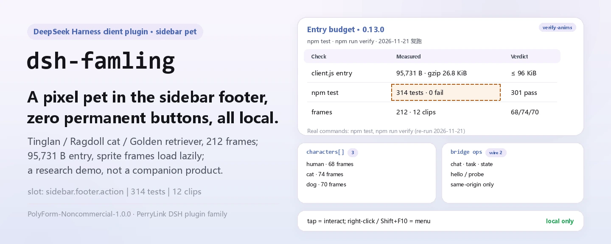
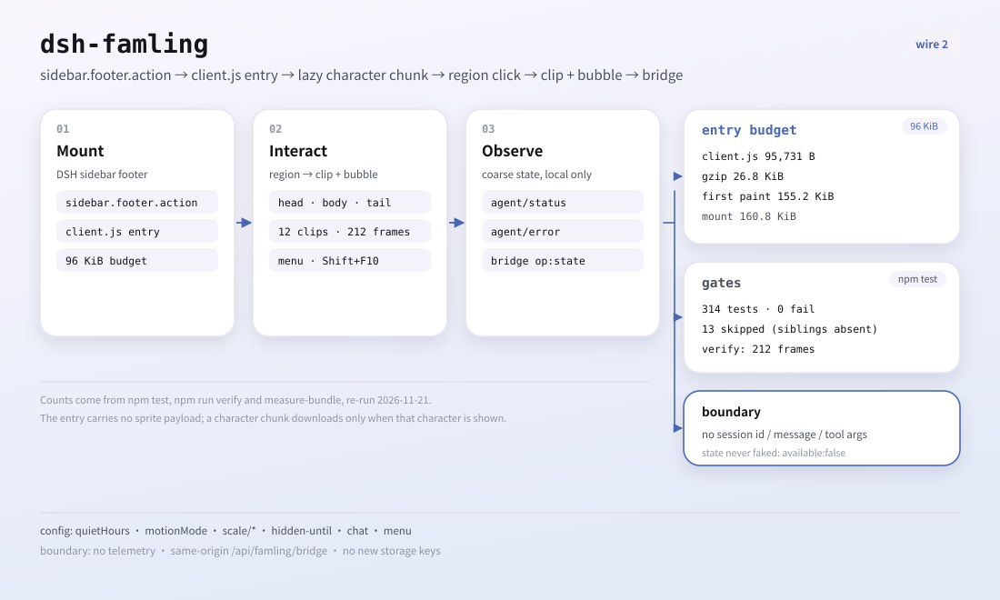
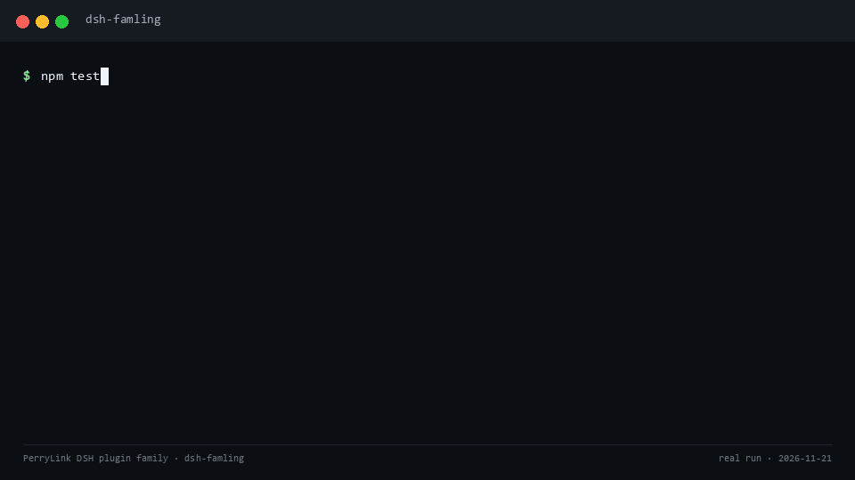

<div align="center">

<picture>
  <source media="(prefers-color-scheme: dark)" srcset="docs/assets/dsh-famling-hero-en-dark.webp">
  
</picture>

# dsh-famling

**Famling / Tinglan, como plugin de barra lateral de DeepSeek Harness.**

*Una pequeña entrada de demostración técnica/investigación en el pie de la barra lateral, bajo el área de cuenta — 212 fotogramas de animación, cero botones permanentes, menú contextual con clic derecho / Shift+F10 y todas las preferencias guardadas localmente. **No** es un producto de acompañamiento emocional.*

[English](README.en.md) · [简体中文](README.md) · [Español](README-es.md) · [Português](README-pt.md) · [हिन्दी](README-hi.md)

</div>

> ⚠️ **Límites de uso (leer primero)**: este proyecto y todo su código, arte, audio, textos, recursos de personaje y derivados son **solo para investigación técnica y validación de prototipos**; **no deben usarse para acompañamiento emocional, parejas virtuales, terapia psicológica, asesoramiento médico/legal/financiero, relaciones íntimas con menores, suplantar a una persona real o a un organismo oficial, ni para ningún fin que viole leyes, reglamentos o normas de plataforma**. El aviso completo está en [docs/LEGAL-NOTICE-2026-11-18.md](docs/LEGAL-NOTICE-2026-11-18.md).

Edición compatible con DSH de Famling / Tinglan: una pequeña entrada de demostración técnica/investigación renderizada **en la esquina inferior izquierda de la barra lateral de DeepSeek Harness, bajo la información de cuenta** (no es un producto de acompañamiento emocional).

---

## Los dos paquetes

Esta línea de trabajo ofrece dos paquetes, separados por propósito:

| Package | Source | Purpose |
|---|---|---|
| **famling** | [PerryLink/famling](https://github.com/PerryLink/famling) | **The standalone desktop pet** (pet-only Tauri app; Tinglan / cat / dog, UI, TTS, age verification and more) |
| **dsh-famling** | this repository | **The DSH client plugin**; it only provides the small Tinglan entry in the sidebar's lower-left corner and small local interactions, and does not replace the standalone app |

> `famling` es la aplicación independiente; `dsh-famling` es la entrada ligera dentro de DSH. Comparten personajes e identidad de marca, no código en ejecución.
>
> **Declaración entre productos (0.10.2 / E3-T3)**: el famling independiente **no ofrece role-play (RP) libre con LLM ni acompañamiento emocional oficial**; este plugin ofrece **respuestas de IA estilo asistente de trabajo** (no RP, no acompañamiento; el texto va al proveedor de modelos configurado en DSH y puede equivocarse). Ninguno de los dos debe promocionarse ni convertirse en un producto de acompañamiento emocional / pareja virtual; los límites completos están en [docs/LEGAL-NOTICE-2026-11-18.md](docs/LEGAL-NOTICE-2026-11-18.md).

<picture>
  <source media="(prefers-color-scheme: dark)" srcset="docs/assets/dsh-famling-flow-v5-dark.svg">
  
</picture>

*Estructura: montar → interactuar → observar. La entrada no lleva carga de sprites — el chunk de un personaje se descarga solo cuando ese personaje se muestra — y el estado del host es un búfer circular local acotado sin ids de sesión, mensajes ni argumentos de herramientas. Las etiquetas del diagrama son nombres reales de slot y bridge, así que la misma imagen sirve para los cinco idiomas.*

## Implementación actual (0.13.0)

Este README también es el registro de ingeniería en formato largo. El estado actual en una pantalla:

- **0.13.0 (2026-11-21, B1/A4)**: nuevo **modo "trabajar juntos (concentración)" de 25/50 minutos** — una ventana silenciosa solo en memoria en la que se pausan las burbujas ambientales automáticas y los micro-movimientos aleatorios, mientras los clics explícitos, las acciones de menú y los chats siguen respondiendo; al terminar el temporizador aparece una burbuja local (sin notificación del sistema, sin historial, sin racha, sin castigo, sin nueva clave de almacenamiento). La UI y los textos de concentración viven por completo en el `client.content.js` perezoso; la entrada creció 198 B (95.533 → **95.731 B**; puerta del 31% 97.576 B → 1.845 B de margen, presupuesto de 96 KiB → 2.573 B de margen). Limpieza de licencias: `LICENSE-ART` cubre ahora las rutas de arte reales (`client.anims.*`, `icon.png`) y las secciones de licencia de NOTICE / README coinciden; la evidencia real de integración con el host DSH 0.2.2-rc.4 (46/46) y las puertas de contrato rc.4/rc.5 (45/45) viajan en el paquete.
- **0.12.0 (2026-11-21)**: hook de estado de trabajo del host (estado de grano grueso, privacidad mínima). La mitad host mantiene un estado acotado desde `ctx.on('agent/status')` / `ctx.on('agent/error')` (anillo de ≤16 `{ state, at }` + contadores de ejecución + un `lastError.kind` clasificado), y añade el bridge `op:"state"` (wire 2) que devuelve `available` / `state` / `active` / `updatedAt` / `lastError` / `transitions` tras validar un esquema cerrado. Nunca lee ni guarda ids de agente, ids de sesión, mensajes, prompts, argumentos de herramientas ni contenido de archivos. Si la API de eventos no existe o la suscripción lanza, `available:false` y el plugin se activa igual — `state` nunca se falsifica.
- **Versiones anteriores (0.8.x–0.11.x)** aportaron las reacciones por región, las interacciones específicas de especie con respuestas aleatorias, el tiempo por fotograma basado en `holdMs`, el menú jerárquico sin botones, el modelo de escalado de cuatro capas, los controles de baja molestia (horas de silencio / reducción de movimiento / ocultar temporalmente), la negociación de capacidades del host hello/probe, el contrato reservado content-extension v3, el consentimiento versionado de TTS/ASR y las puertas de higiene del paquete.
- **Registro completo de versiones**: los presupuestos de bytes y recuentos de pruebas por versión (0.10.3 a 0.13.0) se conservan literalmente en el [`README.md`](README.md) chino; este README de cinco idiomas traduce las secciones normativas y condensa ese apéndice histórico. Pruebas actuales: **314** (`npm test` en un clon superficial: 301 pasan, 0 fallan, 13 omitidas).

## Escalado de cuatro capas (0.10.4, MB-053)

El diálogo de ajustes usa las mismas cuatro capas que `src/pet/scaling.ts` de famling; todas actúan solo sobre los estilos en línea y las variables CSS privadas del widget de este plugin (`--dsh-famling-ui-scale` / `--dsh-famling-bubble-zoom`, `transform` de componentes) y **nunca escriben `document.documentElement` ni cambian el tema global de DSH o el escalado del host**:

| Layer | Where | Control | Semantics |
|---|---|---|---|
| 1 Overall scale | Common · first control | native range 50%–200% (step 5%) | everything scales together: character image, UI/text, bubbles, menu, panels |
| 2 UI + text | Scale (independent axis) | range 40%–150%, 100% = follow overall | text/controls only; "follow overall" resets in one click |
| 2 Image | Scale (independent axis) | range 50%–200%, 100% = follow overall | character/preview image only; fits the window automatically when it does not fit |
| 3 Component scale | Advanced / debug (collapsed by default) | per component: inherit (default) / 75% / 125% / 150% | bubble / context menu / panels / content centre / settings popup; override = inherited UI factor × override factor, and inheritance can be restored at any time |

- Valor efectivo = `global × axis`, luego acotado por legibilidad/seguridad: texto de UI 0,6×–2,5×, imagen 0,5×–2× (72px → 36–144px, todavía dentro de la barra lateral de 240px), componentes 0,5×–2×. El ancho de burbuja tiene un tope duro de 240px y su borde izquierdo se ajusta a la ventana, así que no puede desbordar la barra lateral/ventana; los menús y paneles usan "tamaño de maquetación ÷ zoom + `transform: scale(zoom)`" para seguir dentro de la ventana tras el escalado (anclas izquierda/inferior, `transform-origin` alineado al ancla) sin recortar contenido.
- Persistencia: `dsh-famling/scale/model` (marca de versión) más `dsh-famling/scale/global`, `/ui-text`, `/image`, `/component/<id>`; los valores de seguir/por defecto no escriben claves de eje (restaurar seguir = borrar la clave), y restablecer la escala por defecto solo escribe `global=1` y la marca de versión. En la primera carga, si falta la marca de versión y existen las claves antiguas de factor absoluto `dsh-famling/scale` (número o JSON `{pet,text}`) o `dsh-famling/text-scale`, se migran una vez a `image`/`uiText` (global=100%, mismo valor efectivo); tras migrar, las claves antiguas quedan donde están pero marcadas como inválidas y nunca se aplican dos veces. Limpiar los ajustes locales borra todas las claves de escalado bajo `dsh-famling/*`.
- Teclado / ARIA: todos los deslizadores de escala son `<input type="range">` nativos (las flechas funcionan) con `aria-label` y `aria-valuetext` (por ejemplo "150% · independiente"); los botones del grupo avanzado llevan `aria-expanded`; los selectores de componente llevan `aria-label`; el botón "seguir el global" está `disabled` mientras se sigue; el botón de restablecer tiene nombre legible; el diálogo de ajustes sigue siendo `role="dialog"`.
- Pruebas: `test/client-scale.test.js` cubre el modelo puro (clamp/parseo/persistencia/migración/topes) + comportamiento con React falso (IA de tres capas, ejes global/independiente, anulaciones de componente y herencia, persistencia/restauración, burbuja de 240px y ajuste a ventana, ajuste del menú escalado, teclado/ARIA, sin fetch) + puertas estáticas (estilos privados del widget, sin `document.documentElement`, sin URL externas). `npm test` está totalmente en verde.

## Baja molestia (0.10.6, E7 restante / P-04)

El grupo "baja molestia" del diálogo de ajustes reúne todos los controles de silencio en un solo lugar; su semántica se alinea con `low-disturb.ts` / `reduce-motion.ts` del shell de escritorio de famling (solo el widget de este plugin; el host DSH y el tema global no se tocan):

| Capability | Default | Behaviour | Persistence |
|---|---|---|---|
| Quiet hours | **on, 22:00–08:00** | inside the window **automatic output = 0**: no automatic ambient bubbles and no random micro-motions; region clicks, menu interactions and chat/reminder replies still work. `start === end` or switching it off never silences anything. A cross-midnight window (22:00–08:00) is evaluated as "start ≤ now or now < end". | `dsh-famling/settings.quietHours = { enabled, start, end }` |
| Motion preference | **follow system** | `auto` reads `prefers-reduced-motion: reduce` (read at mount; an explicit choice wins); `on` forces frame animation/blinks/micro-motions on, `off` freezes everything on the first frame. The old boolean `motion` migrates once to `auto`/`off`. | `dsh-famling/settings.motionMode` |
| Automatic micro-motion cadence | 60–90s | raised from 11–20s in 0.10.5 to **≥60s**; a trigger inside quiet hours re-arms the timer instead of playing. | not persisted (runtime cadence) |
| Temporary hide | off | "More → hide for 1 hour / hide until tomorrow" or the same-name button in settings; while hidden, neither the character nor bubbles render and only a ≥24×24px "show" restore control remains; it restores automatically at the deadline. | `dsh-famling/hidden-until` (millisecond timestamp) |
| Mute | off | stops browser TTS only: bubble captions stay, and speech already playing is cancelled immediately; cat/dog still use hollow thought bubbles and never TTS. | `dsh-famling/settings.sound` |

- La entrada de limpieza "borrar ajustes locales y consentimiento" también borra `hidden-until` y los registros de consentimiento v1/v2; la lista de claves de almacenamiento en Ajustes → Avanzado / depuración las muestra.
- Todos los textos y controles viven en el `client.content.js` perezoso (el panel de entrada, el diálogo de consentimiento y el de límites de uso también se movieron a ese chunk en 0.10.6; la migración del consentimiento antiguo de 0.10.10 y "retirar consentimiento de voz" viven ahí también); las decisiones de limitación/espera y los tiempos de fotograma viven en el `client.behavior.js` perezoso, mientras la entrada `client.js` se mantiene dentro del presupuesto de 96 KiB de primera pantalla.
- Pruebas: `test/client-lowdisturb.test.js` (modelo puro: parseo de horas, límites 22:00/08:00, repliegue de ventana inválida, start===end, precedencia auto/on/off, plazo/vencimiento/almacenamiento corrupto de ocultar, cableado estático) y `test/client-behavior.test.js` (reloj falso: estado/persistencia de horas de silencio/hora inválida conservada; las horas de silencio paran micro-movimientos pero los clics siguen respondiendo; reduce-motion del sistema y anulación explícita; ambos modos de ocultar, restauración anticipada, restauración automática al plazo, persistencia tras recarga, ocultar desde ajustes); `npm test` en verde (incluidas las puertas MB-004 LOCK / spec vendorizado / clean-checkout).

## Negociación de capacidades del host hello/probe (0.10.7, MB-034 / E3-T2)

Ambas mitades del plugin comparten el handshake del bridge wire 2; el objetivo es "seguir funcionando mientras las capacidades del host son desconocidas y degradar con honestidad cuando faltan" en lugar de suponer que todo existe por `engines.dsh`.

| Item | Host half `index.js` | Client `client.js` |
|---|---|---|
| Required injection | only `connection` (the authenticated same-origin bridge); `llm` / `schedule` / `agentDefaultModel` are all probed on demand with `ctx.get()`, so a service that arrives late is found by the next call | — |
| Mount handshake | registers `POST /api/famling/bridge` | after mount sends once `{ v: 2, op: "hello", clientVersion, wireVersion: 2, contentExtension: 3, hostVersion?, hostCommit? }` (4s timeout, sent once) |
| Capability matrix | `hello` / `probe` return `capabilities { llm, schedule, agentDefaultModel, brief, bridge }`, per-item `probes[]` (id / available / method) and `degraded[]` | stores the capability document; the input panel and settings use it to show/disable features |
| Version / contract | `plugin.version` (read from this package's package.json), `wire { version: 2, accepts: [1,2] }`, `contract { bridge: 2, contentExtension: 3, contentExtensionSchema: 3 }`, `host { version, commit?, source }` | `hostVersion` comes from `window.__DSH_BOOT__.release` (not sent when absent; the host never guesses from elsewhere); `versionMismatch` is only a hint |
| Degradation | missing `llm` → chat 503 `E_LLM` + `capability:"llm"` + `unavailable:true` (the local crisis short-circuit still works); missing `schedule` → task/task-delete 503 `E_TASK` + `capability:"schedule"` | missing `llm`: send button disabled + panel/settings say "no model connected", the send path intercepts locally and never fakes a reply; missing `schedule`: the reminder entry is not rendered and the reason is shown; an old host that does not answer hello → "compatibility mode" with 0.10.6 behaviour |
| Manual probe | `probe` (wire 2) returns the same capabilities/contract + `generatedAt`, with no side effects, no model call and no reminder creation | Settings → Advanced / debug → "re-detect host capabilities" |

- **Procedencia honesta de la versión**: cuando el proceso host tiene `process.env.DSH_CLIENT_VERSION` se prefiere (`source: "env:DSH_CLIENT_VERSION"`); si no, se usa el `__DSH_BOOT__.release` reportado por el cliente (`source: "client-boot"`); con ninguno queda `source: "unknown"` / `version: null` — sin adivinar.
- **Matriz de protocolo**: `hello` / `probe` / `state` aceptan solo `v: 2` (un cliente antiguo que envíe v1 recibe 426 `E_WIRE`); `echo` / `chat` / `brief` / `task` / `task-delete` funcionan tanto en wire 1 como en wire 2, así que los clientes antiguos no necesitan cambios.
- **Compatibilidad content-extension v3**: esta versión no sube a v4; `content-extension.mjs` exporta `CONTENT_EXTENSION_VERSION = 3`, `CONTENT_EXTENSION_COMPATIBILITY` (versión única, `additive-within-major`) y la función pura `isContentExtensionCompatible(version)`; el `contract.contentExtension` de hello se toma directamente de ese módulo y las pruebas congelan que ambos coincidan, para que wire y esquema no se separen. 0.10.9 añadió campos de cumplimiento opcionales (license / aiProvenance / compatibilidad a nivel de pack / declaración canónica de uso) dentro de la misma revisión v3, así que **ni el wire ni la revisión de hello/probe cambian** y los hosts/packs antiguos siguen funcionando.
- Pruebas: `test/host-bridge.test.js` (inyección mínima, campos hello/probe, procedencia de versión, incompatibilidad de contrato, 503 por capacidad ausente, matriz wire 1/2) y `test/client-behavior.test.js` (payload del handshake de montaje, degradación de ajustes/panel de entrada, modo compatibilidad con host antiguo, aviso de versión distinta, probe manual); `test/client-static.test.js` congela `CONTENT_EXTENSION_VERSION` / la estrategia de compatibilidad.

## Datos de animación multimensaje (0.8.0)

Tres packs de animación pixel de 96×96 (12 clips cada uno; fotogramas por manifiesto: dog 70 / cat 74 / human 68, **212 fotogramas** en total) se dividen por personaje en chunks perezosos (0.8.6): la entrada `client.js` es **95.731 B** (93,5 KiB; gzip 26,8 KiB, dentro del presupuesto de 96 KiB de primera pantalla — subió de 72 a 78 KiB en 0.10.1 por el menú jerárquico y de 78 a 96 KiB en 0.10.4 por el modelo de escalado de cuatro capas, y sigue siendo un 69,6% menor que la línea base de 314,8 KiB anterior a la división), mientras `client.anims.human.js` / `cat` / `dog` los descarga DSH `require.async` solo cuando ese personaje aparece por primera vez; la primera pintura (entrada + human, medida por measure-bundle) es de unos 155,2 KiB (50,49% de la base), la descarga real de montaje más los chunks de comportamiento/estado del host es de unos 164,8 KiB (53,63%, bajo la puerta del 54%), y solo tras cargar todos los personajes llega a unos 334,7 KiB. `client.content.js` (centro de contenido + diálogo de ajustes unificado + tarjeta de seguridad del primer arranque + controles de escala + diálogos de entrada/consentimiento/límites + panel de capacidades del host + metadatos de cumplimiento 0.10.9 + consentimiento versionado 0.10.10 + acciones útiles del primer arranque task-21 de 0.12.0 + el modo de concentración "trabajar juntos") se descarga solo en la primera instalación o al abrir un diálogo por primera vez (83,7 KiB, gzip 24,2 KiB, medido en el árbol de trabajo 0.12.0); `client.behavior.js` (geometría de clic / hit-test por región / espera de clics repetidos / respuestas aleatorias / duraciones `holdMs` por fotograma) se descarga y memoiza justo después del montaje (5,6 KiB, gzip 2,0 KiB, medido en el árbol de trabajo 0.12.0); `client.status.js` (sondeo de estado de host de grano grueso, privacidad mínima, 4,0 KiB / gzip 1,5 KiB) se carga perezosamente y memoiza tras el montaje con el mismo patrón:

- Fuente de datos: el repositorio privado `desktop-games/public/assets/pet/anim/{human,cat,dog}/` (`manifest.json` + PNG por fotograma).
- Generador: `scripts/embed-anims.mjs` lee manifiesto/PNG, valida los contratos de los tres packs de clips, recodifica los fotogramas RGBA **sin pérdida** a PNG indexados de profundidad mínima (alfa duro conservado, aproximadamente la mitad de tamaño) y los inyecta en `client.js` en marcadores. **Nunca editar a mano los bloques generados**: cambia los datos y vuelve a ejecutar el script.
- Tamaños (árbol de trabajo 0.12.0, medido el 2026-11-21): entrada `client.js` 93,5 KiB / 95.731 B (gzip 27.470 B, brotli 22.972 B tal como los congela la verdad de versión de 0.13.0); los tres chunks de personaje suman unos 241,2 KiB (human 61,7 / cat 99,8 / dog 79,7 KiB); el chunk del centro de contenido + ajustes + tarjeta de primer arranque + controles de escala + diálogos de entrada/consentimiento/límites + panel de capacidades del host + metadatos de cumplimiento + consentimiento versionado + acciones de primer arranque task-21 + modo de concentración task-B1 "trabajar juntos" es de 83,7 KiB (gzip 24,2 KiB / brotli 19,7 KiB, árbol 0.12.0; task-21 +4.905 B, task-B1 +6.656 B) y se carga bajo demanda; el chunk de comportamiento `client.behavior.js` 5,6 KiB (gzip 2.043 B / brotli 1.786 B) y el chunk de estado del host `client.status.js` 4,0 KiB (gzip 1.545 B / brotli 1.306 B) se cargan tras el montaje. El presupuesto de primera pantalla subió de 72 KiB a **78 KiB** en 0.10.1 (el menú jerárquico debe estar disponible en la primera pintura) y a **96 KiB** en 0.10.4 por el modelo de escalado y el ajuste de paneles (0.10.6/0.10.7 no lo subieron más); la tarjeta de primer arranque, el contenido de ajustes, la UI de baja molestia y los diálogos de entrada/consentimiento siguen en chunks perezosos y la carga de sprites sigue en los chunks de personaje: la entrada es el **30,41%** de la base de auditoría previa a la división (bajo la puerta del 31%), la primera pintura (entrada + human) es 158.935 B = **50,49%** de la base; la descarga real de montaje (entrada + human + behavior + status) es 168.802 B = **53,63%** (bajo la puerta del 54%).
- Regenerar: `npm run embed:anims`; solo validar sin escribir: `node scripts/embed-anims.mjs --check`; `npm run verify:anims`; cuantificar: `npm run measure:bundle`.
- Validación: `scripts/verify-anims.mjs` comprueba personajes/clips, recuentos de fotogramas por personaje desde cada manifiesto, consistencia de `holdMs` / `durationMs`, dimensiones y píxeles visibles de los PNG, política de burbujas/TTS, mapeo de acciones y claves i18n; también comprueba que `client.content.js` existe, tiene cuatro pestañas de primer nivel y no hace fetch / URL externas, comprueba el registro de chunks / conjunto de exportaciones / sin red, sin eval, sin escrituras de almacenamiento de `client.behavior.js` y el cableado único `require.async` de la entrada, y — cuando hay activos privados — compara los bloques incrustados byte a byte para detectar obsolescencia.
- QA estática: `node scripts/embed-anims.mjs --qa` genera `scripts/qa/anim-data.js`; abrir `scripts/qa/index.html` en un navegador permite cambiar de personaje, reproducir los 12 clips, ver burbujas sólidas/huecas y ejecutar la autocomprobación de datos sin reiniciar DSH.

## Reacciones por región de clic (0.8.2)

- Los datos de región vienen del repositorio privado `desktop-games/public/characters/{pet-tinglan-anim,pet-cat,pet-dog}/regions.json` y comparten el mismo contrato `version/canvas/regions/gestures` que el hero del famling independiente: las regiones son rectángulos `head` / `body` / `tail` (con prioridad) sobre un lienzo lógico de 96×96.
- `scripts/embed-anims.mjs` lee y valida esos documentos y escribe el bloque generado `ANIMS[character].regions`; `--check` lo incluye en la detección de obsolescencia, y el `anim-data.js` que produce `--qa` también lleva los datos de región.
- Al hacer clic, `offsetX/offsetY` se mapean de vuelta a coordenadas lógicas de 96 usando el **tamaño renderizado real** de la imagen, y luego se hace hit-test por prioridad; la misma posición relativa acierta la misma región en cualquier tamaño de visualización (64/72/96/144px …).
- Mapeo de aciertos: `head → pat_head` (caricia en la cabeza), `body → stand_wag` (mover la cola / estirarse), `tail → chase_tail` (perseguir la cola); las frases de burbuja vienen de las filas aleatorias `says` de la propia regla de región (0.8.3) — sin datos de frase no dice nada. Los clics repetidos en la misma región tienen 1,2 s de espera; a partir del 4.º clic en la misma región dentro de 10 s se degrada a la reacción ligera existente `idle_blink` (2,5 s de espera tras saturarse), y las acciones de menú no están sujetas a esto. La geometría de acierto / las decisiones de región / la máquina de estados de espera y el selector de respuestas aleatorias viven en el `client.behavior.js` perezoso; la entrada solo aplica la decisión y actualiza el estado.
- Solo responden los estados `idle` / `idle_blink`; reproducir otro clip no se interrumpe. Un acierto en una región transparente o no declarada es un no-op explícito y **ya no cae a un micro-movimiento aleatorio** (los micro-movimientos aleatorios siguen disparándose por el temporizador de inactividad).
- Respuestas de región (0.8.3): cada regla de región de `regions.json` lleva 3 filas `says`; un acierto elige una al azar (clics consecutivos en la misma región cambian de frase); cat/dog siguen usando burbujas de pensamiento huecas y nunca TTS; Tinglan usa burbuja de habla sólida más el consentimiento de TTS existente.

## Interacciones específicas de especie y respuestas aleatorias (0.8.3)

- El menú de interacción ya no es una tabla fija escrita a mano: `scripts/embed-anims.mjs` incrusta las `actions` (id/label/event/followUpEvent/followUpMs/says) y `gestures[].says` de `regions.json` en `ANIMS[character]`, y las incluye en `source-sha256` y en la detección de obsolescencia de `--check`; tras cambiar los datos, vuelve a ejecutar `npm run embed:anims`.
- El mapeo evento → clip tampoco se escribe a mano: `scripts/gen-content-constants.mjs` genera el bloque `EVENT_CLIPS` de `client.js` desde `public/characters/*/{regions,behavior}.json` + `public/assets/pet/anim/*/manifest.json` de famling (`pat`→`pat_head`, `ball_throw`→`ball_throw`, `ball_chase`→`ball_chase`, `paw_face`→`paw_face`, `run`→`run`; `feed` reutiliza el clip stand/wave; `talk` solo muestra burbuja y se queda en idle); `npm run check:content` detecta la obsolescencia de los bloques generados, y `scripts/verify-anims.mjs` sigue validando que el mapeo es completo, que cat/human no tienen acciones de pelota, el follow-up lanzar→perseguir del golden retriever, y que cada acción/región tiene al menos dos respuestas aleatorias.
- Fuente única y cadena de comprobación (MB-107/MB-108): las constantes de personaje/diálogo/apariencia/uso/cumplimiento de `public/content/library.json` también se generan en el bloque `@generated` de `client.js` mediante `gen-content-constants.mjs` (las diferencias declaradas D1–D4 están en `docs/CONTENT-CONSTANTS-2026-11-20.md`); `npm run check` (ambos bloques generados ANIMS y content), `npm run lint` (cadena mínima JSDoc/lint) y `npm run typecheck` (checkJs, **incluido content-extension.mjs**; omisión honesta cuando falta TypeScript) forman parte de `release:check`. La fuente única i18n/locale la congela `scripts/check-i18n.mjs` (10 comprobaciones: `L` en client.js, `STRINGS` en client.content.js, árbol de claves/referencias/claves muertas en `locale/*.json`; se ejecuta dentro de `npm test` como `test/i18n.test.js`).
- Las respuestas aleatorias usan un selector "evitar la anterior": clics consecutivos en la misma región/acción nunca devuelven la misma frase; el texto de burbuja, TTS y la política de pensamiento no cambian respecto a 0.8.2.

## Tiempos de fotograma y reproducción con holdMs (0.8.4)

- Los recuentos/duraciones de fotogramas ya no están fijados: `scripts/embed-anims.mjs` y `scripts/verify-anims.mjs` leen el `manifest.json` propio de cada personaje para los recuentos y `fps` / `holdMs` / `durationMs` por clip; los recuentos pueden diferir (dog 70 / cat 74 / human 68, **212 en total**; `stand_wag` de cat = 10 fotogramas).
- La reproducción de `client.js` usa `setTimeout` por fotograma: el fotograma n permanece `holdMs[n] ?? round(1000/fps)` milisegundos; un clip no cíclico vuelve a `idle` tras su último fotograma, y si el `durationMs` del manifiesto supera la suma de holds se alarga el último fotograma. El estiramiento de la gata = 300+300+300+350+400+400+400+350+250+150 = **3200ms** (10 fotogramas), ya no se reproduce demasiado rápido por un `setInterval(1000/fps)` fijo; los fotogramas de ataque también siguen el `holdMs` del ataque (83/83/63/42/42/63/63).
- `holdMs` / `durationMs` alimentan `source-sha256` y `--check`: un cambio de manifiesto que solo toca tiempos también deja obsoleto el bloque incrustado; `verify-anims.mjs` valida que `holdMs` cubre cada fotograma y que la suma es igual a `durationMs`.
## UI mínima y menú contextual jerárquico (0.10.1)

- **Cero botones por defecto**: el pie solo contiene la imagen del personaje de 72px; la imagen misma es un botón enfocable con Tab y `aria-haspopup="menu"` / `aria-expanded`, y no se renderiza ningún botón permanente de entrada/interacción/ajustes/contenido.
- **Cómo abrirlo**: clic derecho en el personaje, Shift+F10 o la tecla ContextMenu; el menú es un `role="menu"` + `role="menuitem"` propio con `aria-activedescendant` y tabIndex móvil; un clic fuera / pérdida de foco de la ventana / Escape lo cierra, y al cerrarse el foco vuelve al personaje.
- **Teclado**: ↑/↓ ciclan, Home/End van al primero/último, ←/→ retroceden un nivel o entran en una subpágina, Enter activa, Escape cierra, Tab cierra; el primer elemento de cada subpágina es "« volver".
- **Jerarquía (solo 5 elementos de primer nivel)**: Charlar… (panel de entrada) / Interactuar ▸ (las `ANIMS[character].actions` actuales) / Contenido y personaje… (diálogo del centro de contenido) / Ajustes… (diálogo de ajustes unificado) / Más ▸ (Recordatorios… + límites de uso y versión…). Las funciones complejas no se meten en el primer nivel.
- **Ajuste a la ventana**: el menú es `position: fixed` y ajusta izquierda/arriba a un margen de 8px según el tamaño de la ventana; `clampMenuPosition` es una función pura y las pruebas de comportamiento afirman sus coordenadas directamente.
- **Botón de menú**: "mostrar botón de menú" en el diálogo de ajustes está desactivado por defecto; al activarlo aparece un pequeño disparador "⋯" junto al personaje (`aria-label` "menú"). La preferencia se escribe en `dsh-famling/menu` (`{ button: boolean }`); el estado de apertura del menú y las subpáginas no se persisten, así que cada apertura empieza en el primer nivel.
- **Degradación**: si `client.content.js` no carga, los diálogos de contenido/ajustes muestran un mensaje de fallo local mientras el menú contextual y las interacciones del personaje siguen funcionando; si `client.behavior.js` no está listo o falla al cargar, la reproducción de fotogramas cae a una cadencia uniforme por defecto (sin segmentación por `holdMs`) y los clics por región pasan a ser un no-op local (sin excepción, sin bloquear el render) — las acciones de menú siguen reproduciendo su clip, solo falta la frase aleatoria.

## Centro de contenido: el personaje es el tema (0.10.0)

El centro de contenido ya no trata "tema / fondo / fuente" como visuales de primer nivel paralelos. **El personaje es el bundle de tema**: un rol = seis componentes (character + voicePolicy + dialogue + theme + background + font); un clic en "aplicar todo" aplica el pack entero de forma atómica. Después el usuario puede cambiar cualquier componente en "personalizar" (anulando el preset del rol), o restaurar el rol por defecto en un clic.

### Cuatro pestañas de primer nivel

| Tab | Content | Behaviour / persistence |
|---|---|---|
| **Roles** | Tinglan / Ragdoll cat / Golden retriever (origami bundle data is reserved; assets are not installed, so no card is offered) | each card shows a glyph avatar, the role name, one sentence, a voice / dialogue / appearance summary and an "apply all" button; the current role carries a ✓ mark. Applying writes character, voicePolicy, dialogue, theme/background/font and `dsh-famling/role` together and does not preload other character animation chunks. |
| **Customise** | voice (TTS policy) / dialogue / theme / background / font (0.9.1 capabilities kept) | the header explains "changes only the current role's arrangement, not its preset" and shows "role preset / customised"; changing one component writes only its old key and the role id does not change; "restore role default" resets all components from the current role bundle. |
| **Content packs** | currently only the built-in packs (4 role bundles); no external pack | shows the installed list and the v3 mandatory `usageDeclaration` check result (researchOnly=true + the six prohibited uses), plus an asset-pack import entry (**needs host support**: zip/folder manifest + sha256 parsed by the host; this version does not read files, execute scripts, load assets or go online). |
| **Market** | remote-market placeholder | always shows "remote market interface reserved, server not configured"; shows the reserved fields `catalogUrl` / `configKey` (`dsh-famling/market/catalog`, `dsh-famling.market`); it makes no network request and shows no fabricated products. |

### Bundles de rol

| role | character | Voice policy | Dialogue | Theme / background / font |
|---|---|---|---|---|
| `human` | Tinglan | speech, browser TTS allowed (still behind its own consent gate) | `standard` | `default` / `transparent` / `system` |
| `cat` | Ragdoll cat | thought, no TTS | `standard` | `night` / `dark` / `serif` |
| `dog` | Golden retriever | thought, no TTS | `standard` | `paper` / `paper` / `system` |
| `origami` | reserved | speech (shares the tide voice policy; data reserved, not appliable) | `standard` | `night` (explicit mapping of the shared `high-contrast`) / `transparent` / `mono` (data reserved, not appliable) |

Estos seis componentes se alinean con `rolePresets` de `public/content/library.json` de famling (human: standard/default/transparent/system; cat: standard/night/dark/serif; dog: standard/paper/paper/system); el pack compartido origami usa el tema `high-contrast`, que este plugin no tiene, así que se mapea explícitamente a `night` con `available:false` y nunca se desajusta en silencio. Los modos de diálogo también se alinean con los `dialoguePacks` compartidos: `standard` = 240 caracteres / 70% de burbujas ambientales, `brief` = 80 caracteres / 40%, `quiet` = 50 caracteres / 5%; cambiar estos valores debe sincronizarse en famling y en el plugin.

"Aplicar todo" también pone el interruptor de TTS en la política de voz del bundle; si el usuario aún no ha consentido el TTS, queda apagado (la puerta de consentimiento nunca se salta). Cambiar a cat/dog cancela cualquier voz del navegador que esté sonando.

### Persistencia y relleno

- La nueva clave `dsh-famling/role` registra el tema del rol actual (primary), y `dsh-famling/menu` registra el interruptor "mostrar botón de menú"; las claves antiguas siguen funcionando: `dsh-famling/character`, `dsh-famling/settings` (`sound` / `voiceURI`), `dsh-famling/dialogue`, `dsh-famling/theme`, `dsh-famling/background`, `dsh-famling/font`.
- Aplicar un rol = escribir las claves de los seis componentes + `dsh-famling/role`; personalizar = anular solo la clave del componente pulsado, sin cambiar el id del rol.
- Carga: se lee `dsh-famling/role` primero; sin esa clave, el rol se deriva del `character` guardado; las claves de componente que faltan se rellenan desde el bundle de ese rol, mientras las claves de componente guardadas explícitamente tienen prioridad. Un usuario de 0.9.x recibe el relleno del rol en el primer render tras actualizar.
- El kit de comportamiento `client.behavior.js` se carga tras el montaje a través de un único punto `require.async` memoizado (`requestBehaviorChunk`), con repliegue a la cadencia por defecto si falla; el chunk de UI del centro de contenido `client.content.js` se descarga con `require.async('./client.content.js')` solo la primera vez que se abre el panel; si falla, el panel local muestra un error de carga y las interacciones básicas no se ven afectadas.

## Interfaz de extensión de contenido v3 (reservada, sin conexión)

[`content-extension.mjs`](content-extension.mjs) es el contrato público para futuros packs de contenido locales/remotos (export del paquete: `dsh-famling/content-extension`):

- `CONTENT_EXTENSION_POINTS` — **versión 3** (pack `schemaVersion: 3`), `status: "reserved"`, `transport: { network: false, execute: false, innerHTML: false, worker: false, assets: false }`; desde 0.10.9 el `compliance` de primer nivel publica la forma de los campos de cumplimiento opcionales, las anclas congeladas y la opción de modo estricto.
- `CONTENT_KINDS` — **siete tipos**: `role` / `character` / `voice` / `dialogue` / `theme` / `background` / `font`. `role` es el tipo bundle añadido en v3: apply debe incluir los seis componentes `character / voicePolicy / dialogue / theme / background / font`, y la entrada debe llevar además `compatibility` (`minPluginVersion`, opcional `maxPluginVersion`).
- **Todo pack debe llevar `usageDeclaration`**: `{ researchOnly: true, prohibitedUses: [seis elementos] }`; los seis son fijos: `emotional-companionship` / `virtual-partner` / `professional-advice` / `minor-intimacy` / `impersonation` / `illegal-use`. Una declaración ausente, `researchOnly !== true`, un elemento que falta o sobra, duplicados o campos desconocidos se rechazan todos. Las entradas de rol no están exentas de la declaración a nivel de pack; una entrada de rol puede repetir opcionalmente un `usageDeclaration`, validado con la misma regla cuando aparece. La plantilla se exporta como `USAGE_DECLARATION_TEMPLATE`. Desde 0.10.9 se puede añadir `statement` / `statementRef` / `statementSha256` canónicos, y cuando están presentes los tres deben coincidir literalmente con `CONTENT_USAGE_STATEMENT` / `CONTENT_USAGE_STATEMENT_REF` / `CONTENT_USAGE_STATEMENT_SHA256` (el modo estricto exige `statement` + `statementRef`).
- **Campos de cumplimiento de 0.10.9 (opcionales, compatibles hacia atrás)**: un pack puede llevar `license` (`spdx` + `attribution`, opcional `url` / `file`), `aiProvenance` (`generated` + `disclosure`, opcional `tools`) y `compatibility` (`minPluginVersion` + opcional `maxPluginVersion`); una entrada también puede llevar `license` / `aiProvenance` (el `compatibility` de una entrada de rol sigue siendo obligatorio). Los campos declarados deben ser válidos campo a campo (fail-closed); los no declarados solo producen `warnings`, y los packs v3 anteriores a 0.10.9 siguen funcionando. Las anclas congeladas de primera parte se exportan como `CONTENT_LICENSE_TEMPLATE` / `CONTENT_AI_PROVENANCE_TEMPLATE`.
- **Modo estricto y puerta de versión**: `validateContentPack(pack, { requireCompliance: true })` permite al host fallar cerrado al cargar un pack no confiable — una `license` / `aiProvenance` / `compatibility` ausente o `usageDeclaration.statement` / `statementRef` canónicos ausentes van directamente a `errors`; `{ pluginVersion: "x.y.z" }` valida además si los rangos de compatibilidad del pack y de la entrada de rol incluyen la versión actual del plugin (función pura `isPackCompatibleWithPlugin`).
- **`assets` reservado**: un pack puede llevar `{ format: "zip" | "folder", files: [{ path, sha256, bytes? }], totalBytes? }`; `path` debe ser una ruta relativa segura (≤6 segmentos, sin `..`, sin esquema, ≤160 caracteres, con extensión) y `sha256` 64 caracteres hex en minúsculas; **solo validación de datos/manifiesto — no se lee, abre, ejecuta ni carga ningún activo**.
- **`remoteCatalog` reservado**: opcional `{ status: "reserved", url?: "https://..." }`; solo validación de metadatos — **sin fetch, sin precalentamiento, sin carga de catálogo remoto**. Una fuente remota (`source: "remote"`) se rechaza por defecto; un host futuro debe pasar explícitamente `{ allowRemote: true }` para que pase la validación de esquema.
- `validateContentPack(pack, { allowRemote?, requireCompliance?, pluginVersion? }) → { ok, errors, warnings }` — validación **de datos puros**: `warnings` informa de campos de cumplimiento opcionales ausentes (no cambia `ok`), modo estricto/puerta de versión como arriba; nunca lanza, nunca ejecuta, nunca se conecta y nunca lee archivos.
- `CONTENT_PACK_EXAMPLE` — un pack de ejemplo v3 legal (usageDeclaration completa + campos canónicos de declaración, license / aiProvenance / compatibility, un bundle de rol, una entrada de tema; legal tanto por defecto como con `requireCompliance: true`); nunca se carga automáticamente.

Declaración mínima y fragmento de rol:

```json
{
  "schemaVersion": 3,
  "id": "com.example.warm-pack",
  "name": "Warm Example",
  "version": "1.0.0",
  "source": "local",
  "usageDeclaration": {
    "researchOnly": true,
    "prohibitedUses": [
      "emotional-companionship", "virtual-partner", "professional-advice",
      "minor-intimacy", "impersonation", "illegal-use"
    ],
    "statement": "本项目及其全部代码、美术、音频、文案、角色素材和衍生物仅用于技术研究与原型验证，不得用于情感陪伴、虚拟伴侣、心理治疗/医疗/法律/金融建议、未成年人亲密关系、冒充真人/官方，或任何违反法律法规/平台规则的用途。",
    "statementRef": "docs/legal/USE-RESTRICTIONS-2026-11-19.md",
    "statementSha256": "0353536cefd702014b12a8365c4a486f19848d049652e9692027216adb80c743"
  },
  "license": { "spdx": "CC-BY-4.0", "attribution": "Example pack authors" },
  "aiProvenance": { "generated": false, "disclosure": "Example content is written by hand; no generative AI was used.", "tools": ["deterministic-python-renderer"] },
  "compatibility": { "minPluginVersion": "0.10.0" },
  "entries": [
    {
      "kind": "role",
      "id": "warm-human",
      "name": "Warm Human",
      "version": "1.0.0",
      "source": "local",
      "preview": { "kind": "glyph", "value": "🧑" },
      "permissions": ["apply:role", "store:selection"],
      "compatibility": { "minPluginVersion": "0.10.0" },
      "apply": {
        "character": "human",
        "voicePolicy": { "canTts": true, "mode": "speech", "sound": true },
        "dialogue": { "mode": "standard" },
        "theme": { "variables": { "--dsh-famling-bubble-bg": "#fff3cd", "--dsh-famling-bubble-text": "#3b2f24" } },
        "background": { "kind": "transparent" },
        "font": { "family": "system-ui, sans-serif", "size": 12, "lineHeight": 1.5 }
      }
    }
  ]
}
```

Otras validaciones (sin cambios respecto a v2 y vigentes): datos puros (rechazar funciones / símbolos / bigints / números no finitos / objetos no planos), campos/enums desconocidos, cadenas/arrays demasiado largos, JSON ≤ 64 KiB, entradas ≤ 32 (≤16 por tipo), límites de id/name/description, claves de cadena de prototipo (`__proto__` / `constructor` / `prototype`), traversal de rutas/absolutas/URL en previsualizaciones de imagen, `<` y caracteres de control, CSS peligroso como `url()` / `expression()` / `@import`; las variables de tema deben ser `--dsh-famling-*` con valores de color seguros; el fondo solo permite transparente/color sólido seguro; la fuente solo permite 1..8 nombres locales sin comillas (se rechazan comillas, `url()`, `var()`, punto y coma, llaves y reglas `@`). Se rechazan ids de entrada duplicados / rutas de activo duplicadas / rangos de compatibilidad de rol invertidos. Desde 0.10.9 los campos de cumplimiento también se validan como datos puros: `spdx` 2..64 caracteres, `attribution` ≤ 200, `url` solo https (sin fetch), `file` solo ruta relativa segura (nunca se abre), `aiProvenance.disclosure` ≤ 280 y `generated=true` exige una declaración real, `tools` 1..8 ids de herramienta en minúsculas (nunca se ejecutan), y las versiones de compatibilidad deben ser `x.y.z`.

Esta versión **no carga ningún pack**: sin peticiones de red, sin ejecución de scripts de pack, sin `innerHTML`, sin descomprimir activos; el centro de contenido solo muestra el catálogo integrado, la comprobación de declaración y las notas reservadas. Un cargador futuro también debe ser "datos puros + parseo/validación en el host + UI que solo renderiza datos". El esquema completo, límites y ejemplos están en [docs/DETAIL.md](docs/DETAIL.md).

> La relación con el modelo de contenido compartido `famling.content/0.2` del famling independiente (characters / voices / dialoguePacks / themes / backgrounds / fonts / **rolePresets**) es una **relación de superconjunto objetivo**: los seis tipos siguen mapeándose uno a uno con los tipos del plugin (`builtin` ≡ `bundled`), y el `role` de v3 es esos seis tipos combinados en un bundle de tema de personaje. Desde 0.10.1 los `ROLE_BUNDLES` del plugin y los `rolePresets` compartidos se alinean componente a componente (human/cat/dog), y `DIALOGUE_MODES` se alinea con maxChars/bubbleChance de los `dialoguePacks` compartidos; el tema `high-contrast` de origami no existe en este plugin, así que se mapea explícitamente a `night` con `available:false`. El contrato del plugin modela "seleccionar/aplicar" como `apply` + permisos, mientras el modelo compartido es entradas de catálogo + funciones de resolución; el prefijo CSS del tema, la fuente de voz (speechSynthesis del navegador vs DeepSeek stella/tide) y la forma de retorno de validación siguen siendo distintos. Los dos contratos conviven, cada uno fail-closed; 0.10.9 proyecta la **forma y semántica** de license / aiProvenance / compatibility de v2 en v3 como campos opcionales aditivos (y congela anclas en ambos lados), pero sigue sin fusionar los dos esquemas ni cambiar la estructura de pack v2, y la convergencia futura seguirá pasando por una capa adaptadora — ver [docs/DETAIL.md](docs/DETAIL.md).

## Host bridge (P0/P1/P2/P4 implementados; hello/probe en 0.10.7; state en 0.12.0)

- `POST /api/famling/bridge` (mismo origen, solo owner, JSON ≤16KB); se aceptan wire 1 y wire 2, mientras `hello` / `probe` / `state` aceptan solo wire 2
- `op:"hello"` (wire 2) → handshake: versión del plugin / wire del bridge / contrato **content-extension v3** / versión y origen del host / matriz de capacidades / probes por elemento / `compatible` / `versionMismatch`; sin llamadas al modelo, sin lectura de archivos, sin efectos secundarios
- `op:"probe"` (wire 2) → vuelve a sondear los servicios opcionales del host (`llm` / `schedule` / `agentDefaultModel`) y devuelve las mismas capacidades/contrato + `generatedAt`; "volver a detectar capacidades del host" en ajustes lo usa
- `op:"state"` (wire 2) → estado de grano grueso de solo lectura: `{ available, source, state: "idle"|"running"|"unknown", active, updatedAt, lastError: null | { kind, at }, transitions: [{ state, at }] }`. `source:"events"` viene del anillo en memoria acotado de `ctx.on("agent/status")` + `ctx.on("agent/error")` (≤16 entradas, solo estado + marca de tiempo + tipo de error clasificado: `aborted`/`auth`/`network`/`rate-limit`/`server`/`timeout`/`tool`/`unknown`); **nunca lee ni guarda** ids de agente / ids de sesión / mensajes / prompts / argumentos de herramientas / contenido de archivos, no escribe en disco, no sube nada y no registra logs. Cuando el host no tiene API de eventos o la suscripción lanza, `available:false` + `source:"unsupported"` y el plugin se activa igual; la respuesta se valida en el host contra un esquema cerrado y una instantánea inválida cae entera a unavailable (fail-closed)
- `inject` requiere solo `connection`; sin `llm`/`schedule` el plugin se activa igual, las entradas correspondientes son `false` en las `capabilities` de la respuesta, y chat/task devuelven 503 `E_LLM`/`E_TASK` + `{ capability, unavailable: true }`
- `op:"echo"` → eco local
- `op:"chat"` → host `ctx.llm.stream`; provider/model vienen de la selección de modelo por defecto de DSH o del Config de este plugin y **nunca se fijan en duro** (la clave solo está en el host); el system prompt elige la persona según el `character` solicitado (inválido/ausente cae a `human`)
- `op:"brief"` → `~/.advisers/pet-brief.json` de solo lectura (≤128 KiB); el documento entero se valida primero estrictamente contra el contrato cerrado v0.2 (`schemaVersion 1|2`, esquema cerrado con campos desconocidos/prohibidos, `displayPolicy`, horas ISO con **cota superior de TTL de 5 minutos**, counts = longitud del array, límites de elementos/enums), y cualquier desviación es 404 `E_MEMORY` fail-closed; solo si tiene éxito proyecta counts + como máximo 3 today/commitments, sin reenviar los TOS de Advisers y sin proyectar risks/facts/suggestedLines. La compatibilidad con Advisers 0.3.0 (contrato Pet Brief v0.2), la matriz de validación y los puntos no cubiertos están en [docs/PET-BRIEF-0.3.0-COMPAT-2026-11-20.md](docs/PET-BRIEF-0.3.0-COMPAT-2026-11-20.md).
- `op:"task"` → `ctx.schedule.create` recordatorio de una sola vez (hora absoluta; sin temporizadores propios)
- TTS/ASR tienen consentimientos separados; ambos están apagados por defecto; la voz del navegador indica explícitamente a dónde va el audio; los registros de consentimiento llevan la versión de la declaración + SHA-256 + acceptedAt + withdrawn (0.10.10) y pueden retirarse individualmente
- **El chat LLM está cableado al host bridge** (`op:"chat"` pasa por DSH `ctx.llm.stream`, así que el contenido se envía al proveedor de modelos configurado); TTS/ASR son capacidades locales del navegador con consentimientos separados; **la escritura de memoria sigue sin implementarse**. Los próximos pasos están en `docs/DSH-FAMLING-BRIDGE-2026-11-17.md`.
- Divulgación del flujo de datos: el texto del chat pasa por el host DSH al proveedor de modelos configurado en DSH; el plugin en sí no recibe ni almacena claves API y no guarda registros de chat; `brief` solo lee `~/.advisers` local y no sube nada. **Ante una coincidencia de palabra clave de crisis el texto nunca sale de la máquina** (cortocircuito local, sin llamada al modelo); con el interruptor "chat con IA" apagado en ajustes no se envía texto de chat; "borrar ajustes locales y consentimiento" solo borra las claves del navegador de este plugin, sin tocar los datos del host DSH/sesión/proveedor.

## Compatibilidad con Pet Brief (Advisers 0.3.0, 2026-11-20)

Advisers 0.3.0 (registry npm en bruto `latest`; la caché local de npmmirror todavía muestra 0.2.3, lo que no refleja el estado publicado) **no cambia el contrato Pet Brief**: sigue siendo v0.2 (`schemaVersion: 2`), con v0.1 (`1`) legible como legacy; el cambio de `pet-brief` en 0.3.0 es un refactor de rendimiento más filtrado de secrecía en el productor, y la evidencia de que la salida es equivalente es el test `assert.deepEqual(projectedBrief, fullBrief)` en `test/read-model-projections.test.js` del repositorio de Advisers. **Esta ronda (task-152) sube el bridge de un límite de proyección laxo a un consumidor estricto**: tras leer, el documento entero se valida contra el contrato cerrado v0.2 y solo entonces se proyecta por una allowlist fija; el comportamiento laxo antiguo (política desconocida normalizada a private / counts no comparados / campos desconocidos aceptados) se elimina (fail-closed, 404 `E_MEMORY`).

| Check | Plugin behaviour (measured) |
|---|---|
| Valid v0.2 private/public | 200, projecting counts + at most 3 each of today/commitments |
| `displayPolicy: none` | 404 `E_MEMORY` (no derived content rendered) |
| Unknown displayPolicy / v0.2 missing displayPolicy | **404 fail-closed** (closed enum / required) |
| v0.1 legacy (no displayPolicy) | accepted, treated as `private` |
| schemaVersion ≥3 / invalid / missing | 404 fail-closed |
| expired / no `expiresAt` / invalid time / **TTL >5 min** / times out of order / generatedAt more than 60s ahead | 404 |
| missing/invalid counts, **counts ≠ array length**, corrupt JSON, >128 KiB | 404 |
| unknown/forbidden fields (reasoning/api_key/…), >10 items, duplicate ids, invalid enum/confidence/over-long strings | **404 fail-closed** (closed schema; error messages carry only stable codes) |

Pruebas: `test/pet-brief-compat.test.js` (14: 11 casos estrictos/negativos siempre activos + 3 capas opcionales — el productor real 0.3.0, los 26 vectores canónicos v0.2, fixtures privados de famling; "ida y vuelta del libro sintético del productor real 0.3.0", "26 vectores canónicos v0.2" e "ida y vuelta de fixtures privados de famling" se omiten con honestidad cuando faltan los checkouts hermanos y no se registran en el subproceso clean-checkout de MB-004); `test/host-bridge.test.js` 26. Medido localmente: `node --test test/pet-brief-compat.test.js test/host-bridge.test.js` = **40/40 pass**, y `npm run lint` / `npm run typecheck` / `npm run check:package` están todos ok. La verdad de versión completa, la matriz de validación, los huecos restantes (G3–G6) y la evidencia están en [docs/PET-BRIEF-0.3.0-COMPAT-2026-11-20.md](docs/PET-BRIEF-0.3.0-COMPAT-2026-11-20.md).

### Selección de modelo (ya no fija desde 2026-11-18)

El provider/model de `op:"chat"` se resuelve en este orden (`resolveSelection` en `index.js`):

1. **Anulación explícita del Config del plugin** (opcional): `provider`/`model` deben aparecer en pareja, o la carga falla; `reasoningEffort` es opcional.
2. **Selección de modelo por defecto de DSH**: se lee del servicio del host `agentDefaultModel.currentSelection()` (es decir, el modelo por defecto de los ajustes/selector de modelo de DSH), así que el chat de la mascota sigue automáticamente al cambiar de modelo.
3. Si ninguno resuelve, `chat` devuelve 503 `E_LLM` y **nunca cae en silencio a un modelo fijado en duro**.

Un modelo fijo (solo cuando sabes que lo quieres) lo aporta la capa patch del usuario, por ejemplo:

```yaml
- id: dsh-famling
  name: dsh-famling
  config:
    provider: deepseek-official
    model: deepseek-flash
    reasoningEffort: max   # optional
```

No edites el bundle de perfil propio de DSH; prefiere el selector de modelos de DSH.

## La persona sigue al personaje (0.8.1)

Cambiar de personaje cambia la imagen y la persona del chat a la vez: la petición `op:"chat"` de `client.js` lleva el `character` actual (`human`/`cat`/`dog`; inválido o ausente se normaliza en el cliente a `human`), e `index.js` lo usa para elegir el system prompt, con el lado host cayendo también a `human` para valores inválidos.

| character | Image | Persona notes | Bubble/voice |
|---|---|---|---|
| `human` | Tinglan | quiet, concise work buddy; conclusion first | solid speech, browser TTS allowed |
| `cat` | Ragdoll cat (white base, blue-point long hair) | lazy, aloof, short sentences; mildly tsundere but never offensive | hollow thought, never TTS |
| `dog` | Golden retriever | friendly, enthusiastic, simple and direct | hollow thought, never TTS |

Las tres personas comparten un conjunto de límites de seguridad: nunca suplantar a una persona real, a un organismo oficial o a un asesor profesional; nunca inducir dependencia, romance, pago o relaciones emocionales con menores; nunca emitir contenido ilegal, privado o suplantado. Una persona es solo una diferencia de tono a nivel de system prompt, no role-play independiente ni acompañamiento emocional; el modelo lo sigue decidiendo la selección de modelo por defecto de DSH.

## Instalación

### A. Desde npm (recomendado, 0.11.1+)

```sh
dsh plugin --profile web add dsh-famling
```

El paquete declara el manifiesto `dsh.bundle` (`cordis.patch.yml`) y el frontend `dsh.client`; el nombre del paquete npm es `dsh-famling`.

### B. Directorio local

1. Coloca este directorio en el directorio de plugins de DSH;
2. En DSH **Plugins → Add plugin**, selecciona este directorio (o usa `plugin_manager install_bundle` con la ruta absoluta de este directorio como target);
3. Activa `dsh-famling` y refresca la UI web;
4. Comprueba que `汀岚` (Tinglan) aparece en la barra lateral inferior izquierda, bajo el área de cuenta;
5. `npm view dsh-famling` muestra la versión publicada (actualmente 0.11.1); la instalación por el directorio de plugins de DSH sigue los pasos 1–4.

## Publicación e higiene del paquete (0.11.1, residuo MB-094, 2026-11-21)

Este plugin se distribuye como tarball npm, así que los metadatos de `package.json` y la allowlist `files` *son* la superficie de publicación; estas reglas las imponen puertas de script, no convenciones:

- **Metadatos**: `repository` = `git+https://github.com/PerryLink/dsh-famling.git`, `homepage` = el README de este repositorio, `bugs` = los issues de este repositorio; los tres deben apuntar al mismo repositorio (`dsh-famling` es el repositorio del plugin DSH; el repositorio de la app independiente `PerryLink/famling` aparece solo como enlace a producto relacionado en "Los dos paquetes").
- **Allowlist `files`**: sin duplicados (se eliminó la entrada duplicada heredada `docs`), cada entrada debe existir, se cubren todos los archivos necesarios en ejecución y `exports`, y `test/` / `scripts/` / `*.tgz` nunca se empaquetan; `npm run verify:package` usa `npm pack --dry-run --json` para comprobar la igualdad de conjuntos entre "lista empaquetada real = expansión de la allowlist + archivos que npm siempre incluye".
- **`prepack`**: cada `npm pack` / `npm publish` ejecuta automáticamente la comprobación estática de higiene de publicación; el mensaje de éxito va a stderr (para no contaminar el stdout de `npm pack --json`) y un fallo aborta el empaquetado.
- **Comandos**: `npm run check:package` (estático) / `npm run verify:package` (incluye `npm pack --dry-run`) / `npm run release:check` (test + check + verify + verify:package, la puerta previa a publicar).
- **Publicado**: `npm publish` 0.11.0 (2026-11-21, publicado con un token npm local; **provenance / trusted publishing no habilitados**); `npm view dsh-famling version` = 0.11.0. La primera ejecución real de CI tras empujar el repositorio público es lo que reporte esa ejecución real (esta máquina no fabrica resultados de CI). Detalles, evidencia y registros de medición locales están en [docs/RELEASE-HYGIENE.md](docs/RELEASE-HYGIENE.md).

## Reconstrucción de checkout independiente y LOCK (MB-004, 2026-11-20)

Este plugin puede reconstruirse, probarse y verificarse en un checkout independiente **sin el repositorio privado de famling**:

- **LOCK de instalación**: el repositorio confirma `package-lock.json` (lockfileVersion 3; el plugin tiene cero dependencias en ejecución → lock solo raíz); `npm ci` / `npm ci --offline` instalan de forma reproducible. `scripts/check-package.mjs` incluye el LOCK en la puerta de publicación (name/version/license coinciden con `package.json`, toda dependencia declarada está en el lock y se prohíben resoluciones privadas como `file:`/`link:`/rutas absolutas).
- **Spec/LOCK vendorizado de animación**: `scripts/spec/anim-spec.json` guarda el contrato semántico de los tres packs (recuentos de fotogramas/fps/holdMs por clip, regiones/acciones), el SHA-256 de `client.js` / chunks perezosos / cada fotograma y el SHA-256 por archivo de los fotogramas fuente privados (**sin bytes PNG/base64**). `node scripts/embed-anims.mjs --check` entra en `standalone spec mode` cuando faltan los activos privados (un spec ausente o manipulado siempre falla, ya no se omite); `node scripts/verify-anims.mjs` valida siempre el spec vendorizado e imprime `private assets: absent` en lugar de omitir la comparación byte a byte cuando faltan los activos privados.
- **Puerta de clean checkout**: `node scripts/clean-checkout.mjs` copia el paquete a un directorio temporal, apunta `FAMLING_ANIM_DIR` / `FAMLING_CHARACTERS_DIR` / `FAMLING_REPO_DIR` a rutas inexistentes y ejecuta de verdad `npm ci --offline` + el `node --test` completo + `check` / `verify` / `check-package --pack` / `lint` / `typecheck`; `--json` imprime evidencia revisable y `--keep` conserva la copia. `test/clean-checkout.test.js` integra la puerta en `npm test`.
- **Preparación de sincronización al repositorio público**: `node scripts/clean-checkout.mjs --export DIR` produce un árbol de repositorio público que se puede empujar tal cual (excluyendo `node_modules` / `.git` / cachés / tarballs) y ejecuta higiene estática de paquete + validación de spec sobre el árbol exportado; el primer push, la primera ejecución de CI, la protección de ramas y `npm publish` son pasos externos (este espacio de trabajo no los ejecuta ni los da por hechos).
- **Límites restantes**: un checkout independiente sigue teniendo **10 omisiones de paridad entre repositorios** (frente a los valores congelados library/behavior/terms/compliance del repositorio hermano famling; los valores congelados del lado del plugin y `test/fixtures/content-compliance/` siguen ejecutándose), que no son dependencias de build — la puerta de clean-checkout afirma "solo quedan estas omisiones conocidas entre repositorios y ninguna por activos privados". En un checkout sin TypeScript, `typecheck` imprime una omisión honesta por diseño.
- Detalles y evidencia medida: [docs/INDEPENDENT-REBUILD-2026-11-20.md](docs/INDEPENDENT-REBUILD-2026-11-20.md); manifiesto de staging del repositorio público: [docs/PUBLIC-REPO-SYNC-2026-11-20.md](docs/PUBLIC-REPO-SYNC-2026-11-20.md).

## Verificación



*Animación: el stdout real de `npm test` y `npm run verify` del repositorio, capturado el 2026-11-21 en un clon superficial. Las 13 pruebas omitidas necesitan checkouts hermanos (productor de Advisers, fixtures privados de famling) que este clon no contiene, así que se muestran como omitidas en lugar de esconderse.*

- `node --check client.js`
- `node --check client.content.js` (chunk perezoso de UI del centro de contenido, render puramente local)
- `node --check client.behavior.js` (chunk perezoso del kit de comportamiento, lógica pura de interacción/tiempos, sin escrituras DOM)
- `node --check content-extension.mjs` (contrato de extensión de contenido, datos puros / sin efectos secundarios)
- `node --check index.js`
- `node --test test/pet-brief-compat.test.js` (compatibilidad Pet Brief v0.2 × Advisers 0.3.0: esquema cerrado estricto, cota TTL, consistencia de counts, displayPolicy, puertas de esquema, allowlist de proyección y casos negativos; las capas opcionales "productor real 0.3.0 con libro sintético" y "fixtures privados de famling" se omiten con honestidad cuando faltan los repositorios hermanos)
- `npm test` (`node --test test/`: pruebas de fake-context del host bridge + **negociación de capacidades hello/probe/degradación (0.10.7)** + pruebas de bloques generados del cliente / comportamiento multimensaje + pruebas de UI mínima / menú jerárquico / diálogo de ajustes / teclado + pruebas del centro de contenido (cuatro categorías / bundles de rol / alineación con rolePresets compartidos / contrato content-extension v3 y campos de cumplimiento 0.10.9 (license / aiProvenance / compatibility, compatibilidad hacia atrás, modo estricto)) + pruebas del suelo de seguridad del plugin (cortocircuito de crisis / destino de envío / tarjeta de primer arranque / borrar y retirar / interruptor de chat / verdad de versión) + pruebas de consentimiento versionado (0.10.10 / MB-014: aceptar/migrar/versión o hash obsoletos/retirar/borrar, hash canónico y anclas congeladas en ambos lados) + pruebas de higiene de publicación (metadatos / allowlist de files / cableado de prepack / lista empaquetada) + pruebas de **reconstrucción independiente MB-004 (LOCK package-lock / spec de animación vendorizado / clean checkout / staging de exportación al repositorio público)** (el número de casos cambia con el trabajo concurrente; el `npm test` medido es la autoridad) — sin llamadas a modelos reales)
- `npm run check:package` (higiene estática de publicación: repository/homepage/bugs coinciden, `files` sin duplicados y todo existe, entradas prohibidas, cobertura completa de `exports`)
- `npm run verify:package` (estático + `npm pack --dry-run --json`: la lista real del tarball debe igualar exactamente la expansión de la allowlist)
- `npm run release:check` (puerta previa a publicar = test + check + verify + verify:package)
- `node scripts/clean-checkout.mjs` (MB-004: reconstrucción de checkout temporal sin el repositorio privado; evidencia `--json` / staging del repositorio público con `--export DIR`; también se ejecuta dentro de `npm test`)
- `npm run check` (= `check:anims`: los bloques incrustados coinciden con el pack de animación privado; sin activos privados usa el `anim-spec` vendorizado en `standalone spec mode`)
- `npm run verify` (= `verify:anims`: validación del anim-spec vendorizado + 3 personajes × 12 clips, recuentos por manifiesto 68/74/70 = **212** y duraciones `holdMs`, contrato de clic por región, política de burbujas/TTS, mapeo de acciones, cuatro pestañas del centro de contenido / comprobación de declaración / puerta sin fetch, registro y conjunto de exportaciones del chunk de comportamiento / sin red, sin eval, presupuesto de 96 KiB de primera pantalla; además imprime la primera pintura de entrada+human y la descarga de montaje incluido el kit de comportamiento)
- `npm run measure:bundle` (entrada medida 93,5 KiB, el chunk de contenido + ajustes + tarjeta de primer arranque + diálogos de entrada/consentimiento + panel de capacidades del host + metadatos de cumplimiento + consentimiento versionado 83,7 KiB y otras cifras; el kit de comportamiento de 5,6 KiB se mide aparte y el script aún no lo cuenta)
- Verdad de versión: `package.json` es la fuente única; `node test/version-truth.test.js --write` regenera las constantes `PLUGIN_VERSION` de `client.js`/`client.content.js` (las etiquetas zh/en derivan de ellas), la línea "implementación actual" del README, la "versión aplicable del plugin" de LEGAL-NOTICE y el `meta.version` de `locale/*.json` desde package.json, y `npm test` verifica que todo coincide (incluida la verdad del documento del suelo de seguridad)
- `npm run qa:anims` y luego abrir `scripts/qa/index.html` en un navegador (QA estática, sin reiniciar DSH)
- Detalle/icono del plugin: `locale/zh.json`, `locale/en.json`, `icon.png`
- Esta versión está escrita para el slot `sidebar.footer.action` de la línea DSH 0.2.2-rc (el checkout local de DSH es `dsh-v0.2.2-rc.4`); el `engines.dsh` de `package.json` cubre tanto `>=0.2.1-rc.5 <0.3.0` como la línea de prepublicación 0.2.2 (`>=0.2.2-0 <0.3.0`); el render real del slot todavía debe verificarse en la UI web de DSH.

## Licencia

- © 2026 PerryLink. Este es un proyecto no oficial y no está afiliado a DeepSeek.
- Código: **PolyForm Noncommercial 1.0.0** (`LICENSE`; SPDX `PolyForm-Noncommercial-1.0.0`). Source-available, **no es open source OSI**; el uso comercial requiere permiso escrito aparte.
- Arte: **CC BY-NC-SA 4.0** (`LICENSE-ART`; SPDX `CC-BY-NC-SA-4.0`), que cubre los fotogramas de animación de personaje incrustados en los archivos `client.anims.*.js` realmente distribuidos en este paquete y `icon.png` (pixel art de Tinglan / gata ragdoll / golden retriever, originado en `PerryLink/famling`).
- La redistribución debe llevar `LICENSE`, `LICENSE-ART` y `NOTICE`; los requisitos de atribución, aviso de cambios y declaración de no oficialidad están en `LICENSE-ART` §3.
- Activos de terceros: este paquete no empaqueta arte, fuentes ni audio de terceros; el TTS/ASR del navegador, los servicios de modelos y el host DSH siguen sus propios términos (límites en `docs/LEGAL-NOTICE-2026-11-18.md`).
- La dirección de licencia la decidió el dueño del proyecto el 2026-11-16; el texto de licencia es una declaración del proyecto (BORRADOR, no revisado por un abogado), no asesoría legal.

## Límites

- Solo un widget local pequeño, no el famling completo; la aplicación completa es `PerryLink/famling`.
- El centro de contenido es **temas de personaje + anulaciones de componentes**, no un motor de temas programable; no carga packs, no carga activos y nunca se conecta.
- El mercado remoto es solo UI de marcador de posición más campos reservados: sin servidor, sin productos, sin peticiones de red. No lo trates como un mercado en vivo.
- El bundle de rol `origami` es solo datos reservados (sin chunk de animación/activos), y la UI no ofrece "aplicar todo" para él.
- La persona del chat del host sigue al personaje (0.8.1): la diferencia está solo en el system prompt, los límites de seguridad y la declaración de IA no cambian; cambiar de personaje solo afecta a solicitudes de chat posteriores y nunca reescribe una respuesta en curso o ya generada. La selección de modelo la siguen decidiendo la selección por defecto de DSH / el Config del plugin.
- Los packs de animación están etiquetados como placeholder (no es arte final, no tiene licencia comercial), coherente con la licencia PolyForm Noncommercial global del plugin.
- No es un proyecto oficial de DeepSeek; no usa el logotipo ni el wordmark oficiales de DeepSeek.
- El plugin no guarda datos personales; los recuentos de clics no se persisten.
