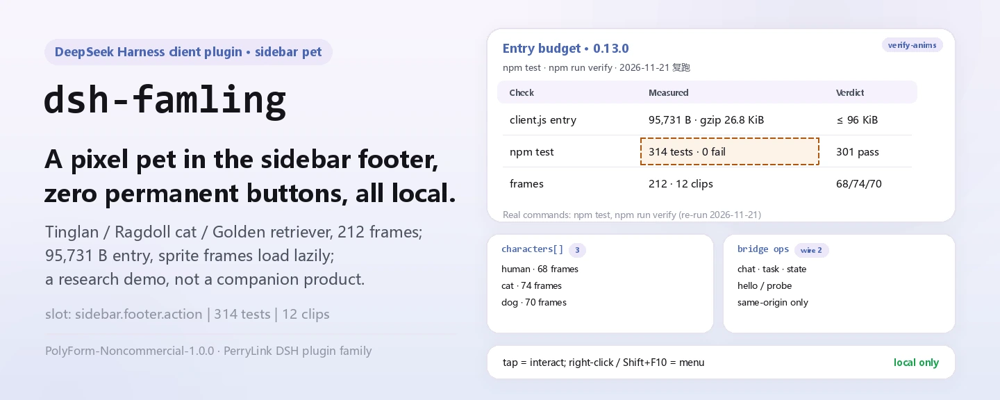
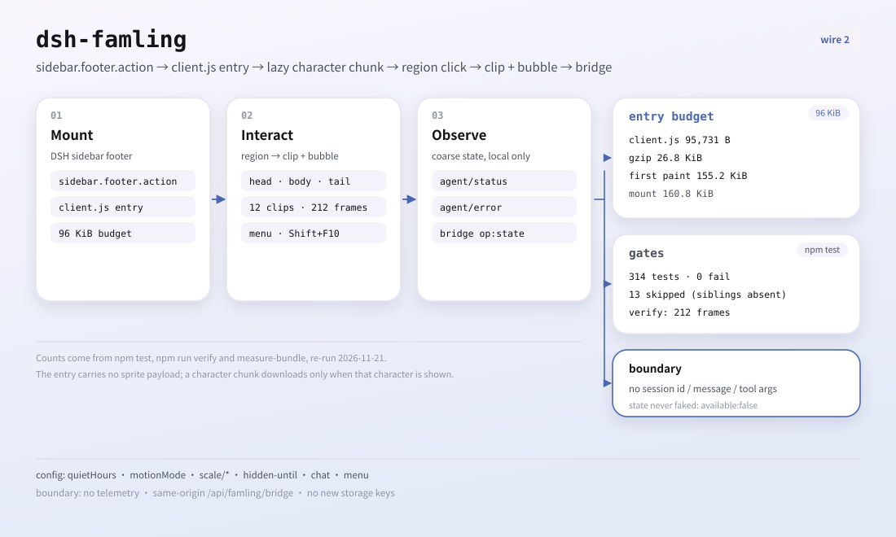
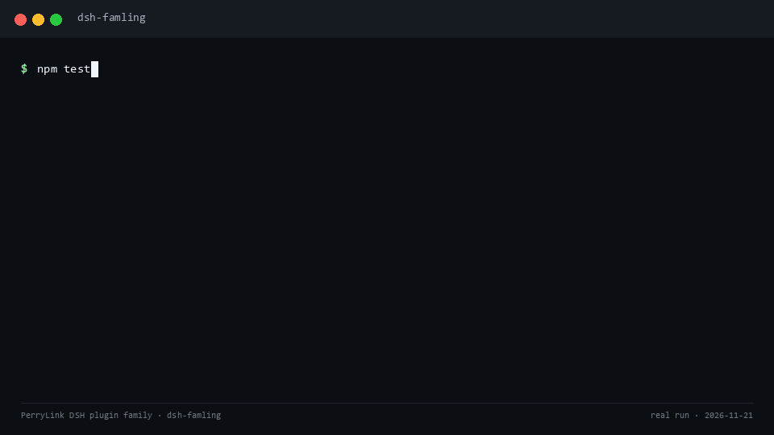

<div align="center">

<picture>
  <source media="(prefers-color-scheme: dark)" srcset="docs/assets/dsh-famling-hero-en-dark.webp">
  
</picture>

# dsh-famling

**Famling / तिंगलान, DeepSeek Harness के साइडबार प्लगइन के रूप में।**

*साइडबार फ़ुटर में, खाता-क्षेत्र के नीचे एक छोटी शोध/तकनीकी-डेमो entry — 212 एनिमेशन फ़्रेम, शून्य स्थायी बटन, राइट-क्लिक / Shift+F10 मेन्यू, और सारी प्राथमिकताएँ स्थानीय रूप से संग्रहीत। यह **नहीं** है कोई भावनात्मक-साथ उत्पाद।*

अंतिम सत्यापन: DeepSeek Harness `dsh-v0.2.3-alpha.1` (2026-11-22).

[English](README.en.md) · [简体中文](README.md) · [Español](README-es.md) · [Português](README-pt.md) · [हिन्दी](README-hi.md)

</div>

> ⚠️ **उपयोग की सीमाएँ (पहले पढ़ें)**: यह प्रोजेक्ट और इसका सारा कोड, कला, ऑडियो, पाठ, पात्र-सामग्री और व्युत्पन्न सामग्री **केवल तकनीकी शोध और प्रोटोटाइप सत्यापन के लिए** हैं; **इनका उपयोग भावनात्मक साथ, आभासी साथी, मनोचिकित्सा, चिकित्सीय/कानूनी/वित्तीय सलाह, नाबालिगों के साथ घनिष्ठ संबंध, किसी वास्तविक व्यक्ति या आधिकारिक निकाय का रूप धारण करने, या कानून/नियम/प्लेटफ़ॉर्म नियमों के उल्लंघन वाले किसी भी उद्देश्य के लिए नहीं किया जाना चाहिए**। पूरा नोटिस [docs/LEGAL-NOTICE-2026-11-18.md](docs/LEGAL-NOTICE-2026-11-18.md) में है।

Famling / तिंगलान का DSH-संगत संस्करण: एक छोटी शोध/तकनीकी-डेमो entry जो **DeepSeek Harness साइडबार के निचले-बाएँ कोने में, खाता जानकारी के नीचे** दिखती है (भावनात्मक-साथ उत्पाद नहीं)।

---

## दो पैकेज

यह कार्य-रेखा दो पैकेज देती है, उपयोग के आधार पर अलग:

| Package | Source | Purpose |
|---|---|---|
| **famling** | [PerryLink/famling](https://github.com/PerryLink/famling) | **The standalone desktop pet** (pet-only Tauri app; Tinglan / cat / dog, UI, TTS, age verification and more) |
| **dsh-famling** | this repository | **The DSH client plugin**; it only provides the small Tinglan entry in the sidebar's lower-left corner and small local interactions, and does not replace the standalone app |

> `famling` स्वतंत्र एप्लिकेशन है; `dsh-famling` DSH के अंदर हल्की साथी-entry है। दोनों पात्र और ब्रांड साझा करते हैं, रनटाइम कोड नहीं।
>
> **क्रॉस-प्रोडक्ट कथन (0.10.2 / E3-T3)**: स्वतंत्र famling **आधिकारिक मुक्त LLM रोल-प्ले (RP) या भावनात्मक साथ नहीं देता**; यह प्लगइन **कार्य-सहायक शैली के AI उत्तर** देता है (RP नहीं, साथ नहीं; पाठ DSH में कॉन्फ़िगर किए गए मॉडल प्रदाता को जाता है और ग़लत हो सकता है)। दोनों को भावनात्मक-साथ / आभासी-साथी उत्पाद के रूप में बढ़ावा या बदला नहीं जाना चाहिए; पूरी उपयोग-सीमाएँ [docs/LEGAL-NOTICE-2026-11-18.md](docs/LEGAL-NOTICE-2026-11-18.md) में हैं।

<picture>
  <source media="(prefers-color-scheme: dark)" srcset="docs/assets/dsh-famling-flow-v5-dark.svg">
  
</picture>

*संरचना: माउंट → इंटरैक्ट → ऑब्ज़र्व। entry में sprites नहीं होते — किसी पात्र का chunk तभी डाउनलोड होता है जब वह पात्र दिखता है — और host state सीमित स्थानीय रिंग बफ़र है जिसमें session id, संदेश या tool arguments नहीं होते। आरेख के लेबल असली slot और bridge नाम हैं, इसलिए वही चित्र पाँचों भाषाओं के लिए काम करता है।*

## वर्तमान कार्यान्वयन (0.13.0)

यह README लंबे रूप का इंजीनियरिंग लॉग भी है। एक स्क्रीन में वर्तमान रिलीज़ स्थिति:

- **0.13.0 (2026-11-21, B1/A4)**: नया **"साथ में काम (फ़ोकस)" 25/50 मिनट मोड** — केवल मेमोरी में रहने वाली शांत खिड़की, जिसमें स्वचालित परिवेशी बुलबुले और यादृच्छिक सूक्ष्म-हलचलें रुक जाती हैं, जबकि स्पष्ट क्लिक, मेन्यू क्रियाएँ और चैट उत्तर देते रहते हैं; समय पूरा होने पर एक स्थानीय बुलबुला दिखता है (कोई सिस्टम सूचना नहीं, इतिहास नहीं, streak नहीं, दंड नहीं, नई storage key नहीं)। फ़ोकस UI और पाठ पूरी तरह आलसी `client.content.js` में हैं; entry 198 B बढ़ी (95,533 → **95,731 B**; 31% गेट 97,576 B → 1,845 B शेष, 96 KiB बजट → 2,573 B शेष)। लाइसेंस सफ़ाई: `LICENSE-ART` अब वास्तविक कला पथों (`client.anims.*`, `icon.png`) को कवर करता है और NOTICE / README लाइसेंस खंड मेल खाते हैं; वास्तविक DSH 0.2.2-rc.4 host एकीकरण साक्ष्य (46/46) और rc.4/rc.5 अनुबंध गेट (45/45) पैकेज में भेजे गए हैं।
- **0.12.0 (2026-11-21)**: host कार्य-स्थिति hook (मोटी स्थिति, न्यूनतम गोपनीयता)। host आधा `ctx.on('agent/status')` / `ctx.on('agent/error')` से सीमित मोटी स्थिति रखता है (≤16 `{ state, at }` रिंग + रन काउंटर + वर्गीकृत `lastError.kind`), और bridge `op:"state"` (wire 2) जोड़ता है जो closed-schema सत्यापन के बाद `available` / `state` / `active` / `updatedAt` / `lastError` / `transitions` लौटाता है। यह कभी agent id, session id, संदेश, prompt, tool arguments या फ़ाइल सामग्री न पढ़ता है न संग्रहीत करता है। events API न हो या सदस्यता विफल हो तो `available:false` और प्लगइन सामान्य रूप से सक्रिय रहता है — `state` कभी नकली नहीं बनती।
- **पहले के रिलीज़ (0.8.x–0.11.x)** ने क्षेत्र-क्लिक प्रतिक्रियाएँ, जाति-विशिष्ट इंटरैक्शन और यादृच्छिक उत्तर, `holdMs`-आधारित फ़्रेम समय, शून्य-बटन पदानुक्रमित राइट-क्लिक मेन्यू, चार-परत स्केलिंग मॉडल, कम-व्यवधान नियंत्रण (शांत घंटे / motion कम करें / अस्थायी रूप से छिपाएँ), hello/probe host क्षमता बातचीत, आरक्षित content-extension v3 अनुबंध, संस्करणित TTS/ASR सहमति और पैकेज-स्वच्छता गेट जोड़े।
- **पूरा रिलीज़ लॉग**: प्रति-रिलीज़ बाइट बजट और परीक्षण गणना (0.10.3 से 0.13.0) चीनी [`README.md`](README.md) में शब्दशः रखे गए हैं; यह पाँच-भाषा README मानक खंडों का अनुवाद करता है और उस ऐतिहासिक परिशिष्ट को संक्षेपित करता है। वर्तमान परीक्षण: **314** (उथले clone में `npm test`: 301 पास, 0 विफल, 13 छोड़े गए)।

## चार-परत स्केलिंग (0.10.4, MB-053)

सेटिंग्स पॉपअप famling के `src/pet/scaling.ts` जैसी चार परतें उपयोग करता है; ये सब केवल इस प्लगइन के widget इनलाइन स्टाइल और widget-निजी CSS वेरिएबल (`--dsh-famling-ui-scale` / `--dsh-famling-bubble-zoom`, component `transform`) पर लागू होती हैं और **कभी `document.documentElement` नहीं लिखतीं, न DSH वैश्विक थीम या host स्केलिंग बदलती हैं**:

| Layer | Where | Control | Semantics |
|---|---|---|---|
| 1 Overall scale | Common · first control | native range 50%–200% (step 5%) | everything scales together: character image, UI/text, bubbles, menu, panels |
| 2 UI + text | Scale (independent axis) | range 40%–150%, 100% = follow overall | text/controls only; "follow overall" resets in one click |
| 2 Image | Scale (independent axis) | range 50%–200%, 100% = follow overall | character/preview image only; fits the window automatically when it does not fit |
| 3 Component scale | Advanced / debug (collapsed by default) | per component: inherit (default) / 75% / 125% / 150% | bubble / context menu / panels / content centre / settings popup; override = inherited UI factor × override factor, and inheritance can be restored at any time |

- प्रभावी मान = `global × axis`, फिर पठनीयता/सुरक्षा के लिए सीमित: UI पाठ 0.6×–2.5×, छवि 0.5×–2× (72px → 36–144px, अब भी 240px साइडबार के अंदर), components 0.5×–2×। बुलबुले की चौड़ाई की कठोर सीमा 240px है और उसका बायाँ किनारा व्यूपोर्ट से क्लैंप होता है, इसलिए वह साइडबार/विंडो से बाहर नहीं जा सकता; मेन्यू और पैनल "लेआउट आकार ÷ zoom + `transform: scale(zoom)`" उपयोग करते हैं ताकि स्केलिंग के बाद भी व्यूपोर्ट के अंदर रहें (बाएँ/नीचे एंकर, `transform-origin` एंकर से संरेखित) और सामग्री कटे नहीं।
- स्थायित्व: `dsh-famling/scale/model` (संस्करण चिह्न) के साथ `dsh-famling/scale/global`, `/ui-text`, `/image`, `/component/<id>`; follow/default मान axis कुंजियाँ नहीं लिखते (follow बहाल करना = कुंजी हटाना), और डिफ़ॉल्ट स्केल रीसेट केवल `global=1` और संस्करण चिह्न लिखता है। पहली लोड पर यदि संस्करण चिह्न नहीं है और पुरानी निरपेक्ष-गुणक कुंजियाँ `dsh-famling/scale` (संख्या या `{pet,text}` JSON) या `dsh-famling/text-scale` मौजूद हैं, तो वे एक बार `image`/`uiText` में माइग्रेट होती हैं (global=100%, वही प्रभावी मान); माइग्रेशन के बाद पुरानी कुंजियाँ अपनी जगह रहती हैं पर अमान्य चिह्नित होती हैं और दोबारा लागू नहीं होतीं। स्थानीय सेटिंग्स साफ़ करने पर `dsh-famling/*` के अंतर्गत सभी स्केलिंग कुंजियाँ हट जाती हैं।
- कीबोर्ड / ARIA: सभी स्केलिंग स्लाइडर मूल `<input type="range">` हैं (तीर कुंजियाँ काम करती हैं), `aria-label` और `aria-valuetext` के साथ (जैसे "150% · स्वतंत्र"); advanced समूह के बटनों पर `aria-expanded`; component चयनकर्ताओं पर `aria-label`; follow के दौरान "follow overall" बटन `disabled`; रीसेट बटन का पठनीय नाम; सेटिंग्स पॉपअप अब भी `role="dialog"` है।
- परीक्षण: `test/client-scale.test.js` शुद्ध मॉडल (clamp/parse/persist/migrate/caps) + नकली React व्यवहार (तीन-परत IA, global/स्वतंत्र axis, component ओवरराइड और विरासत, स्थायित्व/पुनर्स्थापन, 240px बुलबुला और व्यूपोर्ट क्लैंप, मेन्यू स्केलिंग क्लैंप, कीबोर्ड/ARIA, कोई fetch नहीं) + स्थिर गेट (widget-निजी शैलियाँ, `document.documentElement` नहीं, बाहरी URL नहीं) को कवर करता है। `npm test` पूरी तरह हरा है।

## कम व्यवधान (0.10.6, E7 शेष / P-04)

सेटिंग्स पॉपअप का "कम व्यवधान" समूह सभी शांत नियंत्रण एक जगह रखता है; इसकी अर्थ-व्यवस्था famling के डेस्कटॉप शेल `low-disturb.ts` / `reduce-motion.ts` से मेल खाती है (केवल इस प्लगइन का widget; DSH host और वैश्विक थीम छुए नहीं जाते):

| Capability | Default | Behaviour | Persistence |
|---|---|---|---|
| Quiet hours | **on, 22:00–08:00** | inside the window **automatic output = 0**: no automatic ambient bubbles and no random micro-motions; region clicks, menu interactions and chat/reminder replies still work. `start === end` or switching it off never silences anything. A cross-midnight window (22:00–08:00) is evaluated as "start ≤ now or now < end". | `dsh-famling/settings.quietHours = { enabled, start, end }` |
| Motion preference | **follow system** | `auto` reads `prefers-reduced-motion: reduce` (read at mount; an explicit choice wins); `on` forces frame animation/blinks/micro-motions on, `off` freezes everything on the first frame. The old boolean `motion` migrates once to `auto`/`off`. | `dsh-famling/settings.motionMode` |
| Automatic micro-motion cadence | 60–90s | raised from 11–20s in 0.10.5 to **≥60s**; a trigger inside quiet hours re-arms the timer instead of playing. | not persisted (runtime cadence) |
| Temporary hide | off | "More → hide for 1 hour / hide until tomorrow" or the same-name button in settings; while hidden, neither the character nor bubbles render and only a ≥24×24px "show" restore control remains; it restores automatically at the deadline. | `dsh-famling/hidden-until` (millisecond timestamp) |
| Mute | off | stops browser TTS only: bubble captions stay, and speech already playing is cancelled immediately; cat/dog still use hollow thought bubbles and never TTS. | `dsh-famling/settings.sound` |

- क्लीनअप प्रविष्टि "स्थानीय सेटिंग्स और सहमति साफ़ करें" `hidden-until` और v1/v2 सहमति रिकॉर्ड भी हटाती है; सेटिंग्स → उन्नत / डीबग में storage-key सूची उन्हें दिखाती है।
- सारा पाठ और नियंत्रण आलसी `client.content.js` में हैं (इनपुट पैनल, सहमति संवाद और उपयोग-सीमा संवाद भी 0.10.6 से उस chunk में चले गए; 0.10.10 का पुराना-सहमति माइग्रेशन और "आवाज़ सहमति वापस लें" भी वहीं हैं); throttling/cooldown निर्णय और फ़्रेम समय आलसी `client.behavior.js` में हैं, जबकि entry `client.js` 96 KiB प्रथम-स्क्रीन बजट के अंदर रहती है।
- परीक्षण: `test/client-lowdisturb.test.js` (शुद्ध मॉडल: समय पार्सिंग, 22:00/08:00 सीमाएँ, अमान्य-खिड़की fallback, start===end, auto/on/off प्राथमिकता, hide समय-सीमा/समाप्ति/ख़राब storage, स्थिर वायरिंग) और `test/client-behavior.test.js` (नकली घड़ी: शांत घंटे स्थिति/स्थायित्व/अमान्य समय संरक्षित; शांत घंटे सूक्ष्म-हलचलें रोकते हैं पर क्लिक उत्तर देते हैं; सिस्टम reduce-motion और स्पष्ट ओवरराइड; दोनों hide मोड, जल्दी बहाली, समय-सीमा पर स्वतः बहाली, reload पर स्थायित्व, सेटिंग्स से छिपाना); `npm test` हरा (MB-004 LOCK / vendored spec / clean-checkout गेट सहित)।

## Host क्षमता बातचीत hello/probe (0.10.7, MB-034 / E3-T2)

प्लगइन के दोनों आधे bridge wire 2 का handshake साझा करते हैं; लक्ष्य है "जब तक host क्षमताएँ अज्ञात हैं तब भी काम करना, और कमी होने पर ईमानदारी से कमज़ोर पड़ना", न कि `engines.dsh` से सब मौजूद मान लेना।

| Item | Host half `index.js` | Client `client.js` |
|---|---|---|
| Required injection | only `connection` (the authenticated same-origin bridge); `llm` / `schedule` / `agentDefaultModel` are all probed on demand with `ctx.get()`, so a service that arrives late is found by the next call | — |
| Mount handshake | registers `POST /api/famling/bridge` | after mount sends once `{ v: 2, op: "hello", clientVersion, wireVersion: 2, contentExtension: 3, hostVersion?, hostCommit? }` (4s timeout, sent once) |
| Capability matrix | `hello` / `probe` return `capabilities { llm, schedule, agentDefaultModel, brief, bridge }`, per-item `probes[]` (id / available / method) and `degraded[]` | stores the capability document; the input panel and settings use it to show/disable features |
| Version / contract | `plugin.version` (read from this package's package.json), `wire { version: 2, accepts: [1,2] }`, `contract { bridge: 2, contentExtension: 3, contentExtensionSchema: 3 }`, `host { version, commit?, source }` | `hostVersion` comes from `window.__DSH_BOOT__.release` (not sent when absent; the host never guesses from elsewhere); `versionMismatch` is only a hint |
| Degradation | missing `llm` → chat 503 `E_LLM` + `capability:"llm"` + `unavailable:true` (the local crisis short-circuit still works); missing `schedule` → task/task-delete 503 `E_TASK` + `capability:"schedule"` | missing `llm`: send button disabled + panel/settings say "no model connected", the send path intercepts locally and never fakes a reply; missing `schedule`: the reminder entry is not rendered and the reason is shown; an old host that does not answer hello → "compatibility mode" with 0.10.6 behaviour |
| Manual probe | `probe` (wire 2) returns the same capabilities/contract + `generatedAt`, with no side effects, no model call and no reminder creation | Settings → Advanced / debug → "re-detect host capabilities" |

- **ईमानदार संस्करण स्रोत**: जब host प्रक्रिया में `process.env.DSH_CLIENT_VERSION` हो तो उसे प्राथमिकता (`source: "env:DSH_CLIENT_VERSION"`); अन्यथा client द्वारा रिपोर्ट किया `__DSH_BOOT__.release` (`source: "client-boot"`); दोनों न हों तो `source: "unknown"` / `version: null` — कोई अनुमान नहीं।
- **प्रोटोकॉल मैट्रिक्स**: `hello` / `probe` / `state` केवल `v: 2` स्वीकारते हैं (v1 भेजने वाले पुराने client को 426 `E_WIRE` मिलता है); `echo` / `chat` / `brief` / `task` / `task-delete` wire 1 और wire 2 दोनों पर काम करते हैं, इसलिए पुराने clients को बदलाव की ज़रूरत नहीं।
- **content-extension v3 संगतता**: यह रिलीज़ v4 नहीं देती; `content-extension.mjs` `CONTENT_EXTENSION_VERSION = 3`, `CONTENT_EXTENSION_COMPATIBILITY` (एकल संस्करण, `additive-within-major`) और शुद्ध फ़ंक्शन `isContentExtensionCompatible(version)` निर्यात करता है; hello का `contract.contentExtension` सीधे उसी मॉड्यूल से लिया जाता है और परीक्षण दोनों के मेल को फ़्रीज़ करते हैं, ताकि wire और schema अलग न हों। 0.10.9 ने उसी v3 revision में वैकल्पिक compliance फ़ील्ड (license / aiProvenance / pack-स्तरीय compatibility / canonical usage statement) जोड़े, इसलिए hello/probe के **wire और revision दोनों अपरिवर्तित** रहते हैं और पुराने hosts/packs चलते रहते हैं।
- परीक्षण: `test/host-bridge.test.js` (न्यूनतम injection, hello/probe फ़ील्ड, संस्करण स्रोत, अनुबंध असंगति, क्षमता-अनुपस्थिति 503, wire 1/2 मैट्रिक्स) और `test/client-behavior.test.js` (माउंट handshake payload, सेटिंग्स/इनपुट-पैनल गिरावट, पुराने host का compatibility मोड, संस्करण-असमानता संकेत, मैनुअल probe); `test/client-static.test.js` `CONTENT_EXTENSION_VERSION` / संगतता रणनीति फ़्रीज़ करता है।

## बहु-पात्र एनिमेशन डेटा (0.8.0)

तीन 96×96 पिक्सेल एनिमेशन pack (प्रत्येक 12 clips; manifest के अनुसार फ़्रेम: dog 70 / cat 74 / human 68, कुल **212 फ़्रेम**) पात्र के अनुसार आलसी chunks (0.8.6) में बंटे हैं: entry `client.js` **95,731 B** है (93.5 KiB; gzip 26.8 KiB, 96 KiB प्रथम-स्क्रीन बजट के अंदर — 0.10.1 में पदानुक्रमित मेन्यू के लिए 72→78 KiB और 0.10.4 में चार-परत स्केलिंग मॉडल के लिए 78→96 KiB हुई, और विभाजन-पूर्व 314.8 KiB आधार से अब भी 69.6% छोटी है), जबकि `client.anims.human.js` / `cat` / `dog` को DSH `require.async` तभी खींचता है जब वह पात्र पहली बार दिखता है; प्रथम पेंट (entry + human, measure-bundle के अनुसार) लगभग 155.2 KiB (आधार का 50.49%), वास्तविक माउंट डाउनलोड और behavior / host-state chunks लगभग 164.8 KiB (53.63%, 54% गेट के नीचे), और सभी पात्र लोड होने पर लगभग 334.7 KiB। `client.content.js` (कंटेंट सेंटर + एकीकृत सेटिंग्स पॉपअप + प्रथम-रन सुरक्षा कार्ड + स्केलिंग नियंत्रण + इनपुट/सहमति/उपयोग-सीमा संवाद + host क्षमता पैनल + 0.10.9 compliance मेटाडेटा + 0.10.10 संस्करणित सहमति/वापसी + 0.12.0 task-21 प्रथम-रन उपयोगी क्रियाएँ + "साथ में काम" फ़ोकस मोड) केवल पहली install या पहली बार संवाद खोलने पर डाउनलोड होता है (83.7 KiB, gzip 24.2 KiB, 0.12.0 कार्य-वृक्ष में मापा गया); `client.behavior.js` (क्लिक ज्यामिति / क्षेत्र hit-testing / दोहराए क्लिक cooldown / यादृच्छिक उत्तर / प्रति-फ़्रेम `holdMs` अवधि) माउंट के तुरंत बाद डाउनलोड और memoize होता है (5.6 KiB, gzip 2.0 KiB, 0.12.0 कार्य-वृक्ष में मापा गया); `client.status.js` (मोटी host-स्थिति polling, न्यूनतम गोपनीयता, 4.0 KiB / gzip 1.5 KiB) उसी पैटर्न में माउंट के बाद आलसी लोड और memoize होता है:

- डेटा स्रोत: निजी रिपॉज़िटरी `desktop-games/public/assets/pet/anim/{human,cat,dog}/` (`manifest.json` + फ़्रेम PNGs)।
- जनरेटर: `scripts/embed-anims.mjs` manifest/PNGs पढ़ता है, तीनों clip अनुबंध सत्यापित करता है, RGBA फ़्रेम को **हानि-रहित** न्यूनतम bit-depth indexed PNG में पुनः-एनकोड करता है (hard alpha संरक्षित, लगभग आधा आकार) और markers पर `client.js` में inject करता है। **जनरेट किए ब्लॉक कभी हाथ से न बदलें** — डेटा बदलें और स्क्रिप्ट दोबारा चलाएँ।
- आकार (0.12.0 कार्य-वृक्ष, 2026-11-21 को मापा): entry `client.js` 93.5 KiB / 95,731 B (gzip 27,470 B, brotli 22,972 B, जैसा 0.13.0 की संस्करण-सत्यता में फ़्रीज़ है); तीन पात्र chunks कुल लगभग 241.2 KiB (human 61.7 / cat 99.8 / dog 79.7 KiB); कंटेंट सेंटर + सेटिंग्स + प्रथम-रन कार्ड + स्केलिंग नियंत्रण + इनपुट/सहमति/उपयोग-सीमा संवाद + host क्षमता पैनल + compliance मेटाडेटा + संस्करणित सहमति + task-21 प्रथम-रन क्रियाएँ + task-B1 "साथ में काम" फ़ोकस-मोड chunk 83.7 KiB (gzip 24.2 KiB / brotli 19.7 KiB, 0.12.0 कार्य-वृक्ष; task-21 +4,905 B, task-B1 +6,656 B) माँग पर लोड होता है; behavior chunk `client.behavior.js` 5.6 KiB (gzip 2,043 B / brotli 1,786 B) और host-state chunk `client.status.js` 4.0 KiB (gzip 1,545 B / brotli 1,306 B) माउंट के बाद लोड होते हैं। प्रथम-स्क्रीन बजट 0.10.1 में 72 KiB से **78 KiB** (पदानुक्रमित मेन्यू प्रथम पेंट पर उपलब्ध होना चाहिए) और 0.10.4 में चार-परत स्केलिंग मॉडल व पैनल फ़िटिंग के लिए **96 KiB** हुआ (0.10.6/0.10.7 ने और नहीं बढ़ाया); प्रथम-रन कार्ड, सेटिंग्स सामग्री, कम-व्यवधान UI और इनपुट/सहमति संवाद आलसी chunks में ही रहते हैं और sprite payload पात्र chunks में ही रहता है: entry विभाजन-पूर्व audit आधार का **30.41%** है (31% गेट के नीचे), प्रथम पेंट (entry + human) 158,935 B = आधार का **50.49%**; वास्तविक माउंट डाउनलोड (entry + human + behavior + status) 168,802 B = **53.63%** (54% गेट के नीचे)।
- पुनः-जनरेट: `npm run embed:anims`; केवल सत्यापन, कोई लेखन नहीं: `node scripts/embed-anims.mjs --check`; `npm run verify:anims`; मात्रा: `npm run measure:bundle`।
- सत्यापन: `scripts/verify-anims.mjs` पात्र/clips, प्रत्येक manifest से प्रति-पात्र फ़्रेम गणना, `holdMs` / `durationMs` समय-संगति, PNG आयाम और दृश्य पिक्सेल, बुलबुले/TTS नीति, action mapping और i18n कुंजियाँ जाँचता है; यह भी जाँचता है कि `client.content.js` मौजूद है, उसके चार शीर्ष-स्तरीय tabs हैं और कोई fetch / बाहरी URL नहीं, `client.behavior.js` का chunk पंजीकरण / export सेट / कोई नेटवर्क नहीं, कोई eval नहीं, कोई storage लेखन नहीं और entry की एकल `require.async` वायरिंग जाँचता है, और — जब निजी assets उपलब्ध हों — अंतर्निहित ब्लॉकों की byte-दर-byte तुलना करता है।
- स्थिर QA: `node scripts/embed-anims.mjs --qa` `scripts/qa/anim-data.js` बनाता है; ब्राउज़र में `scripts/qa/index.html` खोलकर पात्र बदले जा सकते हैं, सभी 12 clips चलाए जा सकते हैं, solid/hollow बुलबुले देखे जा सकते हैं और DSH रीस्टार्ट किए बिना डेटा स्व-जाँच चलाई जा सकती है।

## क्षेत्र-क्लिक प्रतिक्रियाएँ (0.8.2)

- क्षेत्र डेटा निजी रिपॉज़िटरी `desktop-games/public/characters/{pet-tinglan-anim,pet-cat,pet-dog}/regions.json` से आता है और स्वतंत्र famling hero के समान `version/canvas/regions/gestures` अनुबंध साझा करता है: क्षेत्र 96×96 तार्किक कैनवास पर `head` / `body` / `tail` आयत हैं (priority के साथ)।
- `scripts/embed-anims.mjs` इन दस्तावेज़ों को पढ़कर सत्यापित करता है और जनरेट किया ब्लॉक `ANIMS[character].regions` लिखता है; `--check` इसे अप्रचलन-पहचान में शामिल करता है, और `--qa` से बना `anim-data.js` भी क्षेत्र डेटा रखता है।
- क्लिक पर `offsetX/offsetY` को छवि के **वास्तविक रेंडर आकार** से 96 तार्किक निर्देशांकों में मैप किया जाता है, फिर priority से hit-test होता है; वही सापेक्ष स्थिति किसी भी प्रदर्शन आकार (64/72/96/144px …) पर वही क्षेत्र पकड़ती है।
- Hit mapping: `head → pat_head` (सिर पर सहलाना), `body → stand_wag` (पूँछ हिलाना / तानना), `tail → chase_tail` (पूँछ पकड़ना); बुलबुले की पंक्तियाँ क्षेत्र-नियम की अपनी यादृच्छिक `says` पंक्तियों से आती हैं (0.8.3) — पंक्ति डेटा न हो तो कुछ नहीं कहता। एक ही क्षेत्र पर दोहराए क्लिक में 1.2s cooldown है; 10s में उसी क्षेत्र पर चौथे क्लिक से मौजूदा `idle_blink` हल्की प्रतिक्रिया में बदल जाता है (संतृप्ति के बाद 2.5s cooldown), और मेन्यू क्रियाएँ इससे बाधित नहीं होतीं। Hit ज्यामिति / क्षेत्र निर्णय / cooldown स्टेट मशीन और यादृच्छिक-उत्तर चयनकर्ता आलसी `client.behavior.js` में हैं; entry केवल निर्णय लागू करती और स्थिति अद्यतन करती है।
- केवल `idle` / `idle_blink` स्थितियाँ उत्तर देती हैं; कोई अन्य clip चल रहा हो तो बाधित नहीं होता। पारदर्शी या अन-घोषित क्षेत्र पर hit स्पष्ट no-op है और **अब यादृच्छिक सूक्ष्म-हलचल में नहीं बदलता** (यादृच्छिक सूक्ष्म-हलचलें अब भी idle टाइमर से चलती हैं)।
- क्षेत्र उत्तर (0.8.3): `regions.json` में प्रत्येक क्षेत्र-नियम के पास 3 `says` पंक्तियाँ होती हैं; hit पर एक यादृच्छिक चुनी जाती है (लगातार उसी क्षेत्र पर क्लिक करने से पंक्ति बदलती है); cat/dog अब भी hollow thought बुलबुले और कभी TTS नहीं; तिंगलान solid speech बुलबुला और मौजूदा TTS सहमति उपयोग करती है।

## जाति-विशिष्ट इंटरैक्शन और यादृच्छिक उत्तर (0.8.3)

- इंटरैक्शन मेन्यू अब हाथ से लिखी स्थिर तालिका नहीं है: `scripts/embed-anims.mjs` `regions.json` की `actions` (id/label/event/followUpEvent/followUpMs/says) और `gestures[].says` को `ANIMS[character]` में एम्बेड करता है, और उन्हें `source-sha256` व `--check` अप्रचलन-पहचान में शामिल करता है; डेटा बदलने के बाद `npm run embed:anims` दोबारा चलाएँ।
- event → clip मैपिंग भी हाथ से नहीं लिखी जाती: `scripts/gen-content-constants.mjs` famling के `public/characters/*/{regions,behavior}.json` + `public/assets/pet/anim/*/manifest.json` से `client.js` का `EVENT_CLIPS` ब्लॉक बनाता है (`pat`→`pat_head`, `ball_throw`→`ball_throw`, `ball_chase`→`ball_chase`, `paw_face`→`paw_face`, `run`→`run`; `feed` stand/wave clip का पुनःउपयोग; `talk` केवल बुलबुला दिखाता और idle रहता है); `npm run check:content` जनरेट किए ब्लॉकों का अप्रचलन पकड़ता है, और `scripts/verify-anims.mjs` मैपिंग की पूर्णता, cat/human के पास ball क्रियाएँ न होना, गोल्डन रिट्रीवर का throw→chase follow-up, और प्रत्येक action/region के लिए कम-से-कम दो यादृच्छिक उत्तर सत्यापित करता रहता है।
- एकल स्रोत और जाँच-श्रृंखला (MB-107/MB-108): `public/content/library.json` के पात्र/संवाद/रूप/उपयोग/compliance स्थिरांक भी `gen-content-constants.mjs` द्वारा `client.js` के `@generated` ब्लॉक में जनरेट होते हैं (घोषित अंतर D1–D4 `docs/CONTENT-CONSTANTS-2026-11-20.md` में हैं); `npm run check` (ANIMS और content दोनों जनरेट ब्लॉक), `npm run lint` (न्यूनतम JSDoc/lint श्रृंखला) और `npm run typecheck` (checkJs, **content-extension.mjs सहित**; TypeScript न हो तो ईमानदार skip) `release:check` का हिस्सा हैं। i18n/locale एकल स्रोत `scripts/check-i18n.mjs` फ़्रीज़ करता है (10 जाँचें: client.js का `L`, client.content.js का `STRINGS`, `locale/*.json` का key tree/references/dead keys; `npm test` के भीतर `test/i18n.test.js` के रूप में चलती हैं)।
- यादृच्छिक उत्तर "पिछले से बचने" वाला चयनकर्ता उपयोग करते हैं: एक ही क्षेत्र/क्रिया पर लगातार क्लिक कभी वही पंक्ति नहीं लौटाते; बुलबुला पाठ, TTS और thought नीति 0.8.2 जैसी ही हैं।

## फ़्रेम अवधि और holdMs प्लेबैक (0.8.4)

- फ़्रेम गणना/अवधि अब कठोर-कोडित नहीं: `scripts/embed-anims.mjs` और `scripts/verify-anims.mjs` प्रत्येक पात्र के अपने `manifest.json` से फ़्रेम गणना और प्रति-clip `fps` / `holdMs` / `durationMs` पढ़ते हैं; गणनाएँ भिन्न हो सकती हैं (dog 70 / cat 74 / human 68, कुल **212**; cat `stand_wag` = 10 फ़्रेम)।
- `client.js` प्लेबैक प्रति-फ़्रेम `setTimeout` उपयोग करता है: फ़्रेम n `holdMs[n] ?? round(1000/fps)` मिलीसेकंड रुकता है; गैर-चक्रीय clip अंतिम फ़्रेम के बाद `idle` लौटता है, और यदि manifest का `durationMs` holds के योग से बड़ा हो तो अंतिम फ़्रेम बढ़ाया जाता है। बिल्ली का तानना = 300+300+300+350+400+400+400+350+250+150 = **3200ms** (10 फ़्रेम), अब स्थिर `setInterval(1000/fps)` से तेज़ नहीं चलता; attack फ़्रेम भी attack के `holdMs` (83/83/63/42/42/63/63) से चलते हैं।
- `holdMs` / `durationMs` `source-sha256` और `--check` में जाते हैं: केवल timing बदलने वाला manifest परिवर्तन भी एम्बेडेड ब्लॉक को अप्रचलित करता है; `verify-anims.mjs` सत्यापित करता है कि `holdMs` हर फ़्रेम को कवर करता है और योग `durationMs` के बराबर है।
## न्यूनतम UI और पदानुक्रमित संदर्भ मेन्यू (0.10.1)

- **डिफ़ॉल्ट रूप से शून्य बटन**: फ़ुटर में केवल 72px पात्र छवि है; छवि स्वयं Tab-फ़ोकस-योग्य बटन है जिस पर `aria-haspopup="menu"` / `aria-expanded` है, और कोई स्थायी input/interaction/settings/content बटन रेंडर नहीं होता।
- **कैसे खोलें**: पात्र पर राइट-क्लिक, Shift+F10, या ContextMenu कुंजी; मेन्यू स्व-चित्रित `role="menu"` + `role="menuitem"` है जिसमें `aria-activedescendant` और roving tabIndex है; बाहर क्लिक / विंडो ब्लर / Escape बंद करता है, और बंद होने पर फ़ोकस पात्र पर लौटता है।
- **कीबोर्ड**: ↑/↓ चक्र, Home/End पहले/अंतिम पर, ←/→ एक स्तर पीछे या उपपृष्ठ में, Enter सक्रिय, Escape बंद, Tab बंद; प्रत्येक उपपृष्ठ का पहला आइटम "« वापस" है।
- **पदानुक्रम (केवल 5 शीर्ष-स्तरीय आइटम)**: बात करें… (इनपुट पैनल) / इंटरैक्ट करें ▸ (वर्तमान `ANIMS[character].actions`) / सामग्री और पात्र… (कंटेंट सेंटर संवाद) / सेटिंग्स… (एकीकृत सेटिंग्स संवाद) / अधिक ▸ (रिमाइंडर… + उपयोग-सीमाएँ और संस्करण…)। जटिल सुविधाएँ शीर्ष स्तर में नहीं ठूँसी जातीं।
- **व्यूपोर्ट क्लैंप**: मेन्यू `position: fixed` है और व्यूपोर्ट आकार से left/top को 8px मार्जिन में क्लैंप करता है; `clampMenuPosition` शुद्ध फ़ंक्शन है और व्यवहार-परीक्षण उसके निर्देशांक सीधे जाँचते हैं।
- **मेन्यू बटन**: सेटिंग्स संवाद में "मेन्यू बटन दिखाएँ" डिफ़ॉल्ट रूप से बंद है; चालू करने पर पात्र के पास छोटा "⋯" ट्रिगर आता है (`aria-label` "मेन्यू")। प्राथमिकता `dsh-famling/menu` (`{ button: boolean }`) में लिखी जाती है; मेन्यू खुलने की स्थिति और उपपृष्ठ संग्रहीत नहीं होते, इसलिए हर बार खोलने पर शीर्ष स्तर से शुरू होता है।
- **गिरावट**: यदि `client.content.js` लोड न हो, तो content/settings संवाद स्थानीय विफलता संदेश दिखाते हैं जबकि संदर्भ मेन्यू और पात्र इंटरैक्शन चलते रहते हैं; यदि `client.behavior.js` तैयार न हो या लोड विफल हो, तो फ़्रेम प्लेबैक एक समान डिफ़ॉल्ट गति पर लौटता है (कोई `holdMs` विभाजन नहीं) और क्षेत्र-क्लिक स्थानीय no-op बन जाते हैं (कोई throw नहीं, render अवरुद्ध नहीं) — मेन्यू क्रियाएँ अपना clip फिर भी चलाती हैं, केवल यादृच्छिक पंक्ति छूटती है।

## कंटेंट सेंटर: पात्र ही थीम है (0.10.0)

कंटेंट सेंटर अब "theme / background / font" को समानांतर शीर्ष-स्तरीय दृश्य नहीं मानता। **पात्र ही थीम bundle है**: एक role = छह components (character + voicePolicy + dialogue + theme + background + font); "सब लागू करें" पर एक क्लिक पूरा pack परमाणु रूप से लागू करता है। बाद में उपयोगकर्ता "अनुकूलित करें" में कोई भी component बदल सकता है (role preset को ओवरराइड करके), या एक क्लिक में role डिफ़ॉल्ट बहाल कर सकता है।

### चार शीर्ष-स्तरीय tabs

| Tab | Content | Behaviour / persistence |
|---|---|---|
| **Roles** | Tinglan / Ragdoll cat / Golden retriever (origami bundle data is reserved; assets are not installed, so no card is offered) | each card shows a glyph avatar, the role name, one sentence, a voice / dialogue / appearance summary and an "apply all" button; the current role carries a ✓ mark. Applying writes character, voicePolicy, dialogue, theme/background/font and `dsh-famling/role` together and does not preload other character animation chunks. |
| **Customise** | voice (TTS policy) / dialogue / theme / background / font (0.9.1 capabilities kept) | the header explains "changes only the current role's arrangement, not its preset" and shows "role preset / customised"; changing one component writes only its old key and the role id does not change; "restore role default" resets all components from the current role bundle. |
| **Content packs** | currently only the built-in packs (4 role bundles); no external pack | shows the installed list and the v3 mandatory `usageDeclaration` check result (researchOnly=true + the six prohibited uses), plus an asset-pack import entry (**needs host support**: zip/folder manifest + sha256 parsed by the host; this version does not read files, execute scripts, load assets or go online). |
| **Market** | remote-market placeholder | always shows "remote market interface reserved, server not configured"; shows the reserved fields `catalogUrl` / `configKey` (`dsh-famling/market/catalog`, `dsh-famling.market`); it makes no network request and shows no fabricated products. |

### Role bundles

| role | character | Voice policy | Dialogue | Theme / background / font |
|---|---|---|---|---|
| `human` | Tinglan | speech, browser TTS allowed (still behind its own consent gate) | `standard` | `default` / `transparent` / `system` |
| `cat` | Ragdoll cat | thought, no TTS | `standard` | `night` / `dark` / `serif` |
| `dog` | Golden retriever | thought, no TTS | `standard` | `paper` / `paper` / `system` |
| `origami` | reserved | speech (shares the tide voice policy; data reserved, not appliable) | `standard` | `night` (explicit mapping of the shared `high-contrast`) / `transparent` / `mono` (data reserved, not appliable) |

ये छह components famling के `public/content/library.json` के `rolePresets` से मेल खाते हैं (human: standard/default/transparent/system; cat: standard/night/dark/serif; dog: standard/paper/paper/system); origami साझा pack `high-contrast` थीम उपयोग करता है, जो इस प्लगइन में नहीं है, इसलिए उसे स्पष्ट रूप से `night` पर मैप किया गया है, `available:false` के साथ, और कभी चुपचाप बेमेल नहीं होता। Dialogue मोड भी साझा `dialoguePacks` से मेल खाते हैं: `standard` = 240 अक्षर / 70% परिवेशी बुलबुले, `brief` = 80 अक्षर / 40%, `quiet` = 50 अक्षर / 5%; ये मान बदलने पर famling और प्लगइन दोनों में सिंक करना होगा।

"सब लागू करें" TTS स्विच को भी bundle की voice नीति पर सेट करता है; यदि उपयोगकर्ता ने TTS की सहमति नहीं दी है तो वह बंद रहता है (सहमति गेट कभी नहीं लाँघा जाता)। cat/dog पर जाने से चल रही ब्राउज़र वाणी रद्द हो जाती है।

### स्थायित्व और backfill

- नई कुंजी `dsh-famling/role` वर्तमान role थीम (primary) रिकॉर्ड करती है, और `dsh-famling/menu` "मेन्यू बटन दिखाएँ" स्विच रिकॉर्ड करती है; पुरानी कुंजियाँ चलती रहती हैं: `dsh-famling/character`, `dsh-famling/settings` (`sound` / `voiceURI`), `dsh-famling/dialogue`, `dsh-famling/theme`, `dsh-famling/background`, `dsh-famling/font`।
- role लागू करना = छहों components की कुंजियाँ + `dsh-famling/role` लिखना; अनुकूलित करना = केवल क्लिक किए component की कुंजी ओवरराइड करना, role id अपरिवर्तित।
- लोड: पहले `dsh-famling/role` पढ़ें; वह कुंजी न हो तो संग्रहीत `character` से role निकालें; छूटी component कुंजियाँ उस role के bundle से भर दी जाती हैं, जबकि स्पष्ट रूप से सहेजी गई component कुंजियाँ प्राथमिकता लेती हैं। 0.9.x उपयोगकर्ता को अपग्रेड के बाद पहले render पर role backfill मिलता है।
- व्यवहार kit `client.behavior.js` माउंट के बाद एक memoized `require.async` प्रवेश-बिंदु (`requestBehaviorChunk`) से खींचा जाता है, विफलता पर डिफ़ॉल्ट फ़्रेम गति पर fallback; कंटेंट-सेंटर UI chunk `client.content.js` केवल पैनल पहली बार खुलने पर `require.async('./client.content.js')` से डाउनलोड होता है; विफलता पर स्थानीय पैनल लोड-विफलता दिखाता है और मुख्य इंटरैक्शन अप्रभावित रहते हैं।

## कंटेंट एक्सटेंशन इंटरफ़ेस v3 (आरक्षित, ऑफ़लाइन)

[`content-extension.mjs`](content-extension.mjs) भविष्य के स्थानीय/रिमोट कंटेंट packs के लिए सार्वजनिक अनुबंध है (package export: `dsh-famling/content-extension`):

- `CONTENT_EXTENSION_POINTS` — **संस्करण 3** (pack `schemaVersion: 3`), `status: "reserved"`, `transport: { network: false, execute: false, innerHTML: false, worker: false, assets: false }`; 0.10.9 से शीर्ष-स्तरीय `compliance` वैकल्पिक compliance फ़ील्डों का आकार, फ़्रीज़ किए anchors और strict-mode विकल्प प्रकाशित करता है।
- `CONTENT_KINDS` — **सात प्रकार**: `role` / `character` / `voice` / `dialogue` / `theme` / `background` / `font`। `role` v3 में जोड़ा गया bundle प्रकार है: apply में छह components `character / voicePolicy / dialogue / theme / background / font` अनिवार्य हैं, और entry में `compatibility` (`minPluginVersion`, वैकल्पिक `maxPluginVersion`) भी होना चाहिए।
- **हर pack में `usageDeclaration` अनिवार्य है**: `{ researchOnly: true, prohibitedUses: [छह आइटम] }`; छह निश्चित हैं: `emotional-companionship` / `virtual-partner` / `professional-advice` / `minor-intimacy` / `impersonation` / `illegal-use`। अनुपस्थित declaration, `researchOnly !== true`, आइटम छूटना या अतिरिक्त होना, दोहराव या अज्ञात फ़ील्ड — सब अस्वीकृत। Role entries pack-स्तरीय declaration से मुक्त नहीं हैं; role entry वैकल्पिक रूप से एक `usageDeclaration` दोहरा सकती है, जो मौजूद होने पर उसी नियम से सत्यापित होती है। टेम्पलेट `USAGE_DECLARATION_TEMPLATE` के रूप में निर्यात है। 0.10.9 से canonical `statement` / `statementRef` / `statementSha256` जोड़े जा सकते हैं, और मौजूद होने पर तीनों `CONTENT_USAGE_STATEMENT` / `CONTENT_USAGE_STATEMENT_REF` / `CONTENT_USAGE_STATEMENT_SHA256` से शब्दशः मेल खाने चाहिए (strict mode में `statement` + `statementRef` अनिवार्य)।
- **0.10.9 compliance फ़ील्ड (वैकल्पिक, पीछे-संगत)**: pack `license` (`spdx` + `attribution`, वैकल्पिक `url` / `file`), `aiProvenance` (`generated` + `disclosure`, वैकल्पिक `tools`) और `compatibility` (`minPluginVersion` + वैकल्पिक `maxPluginVersion`) ले सकता है; entry भी `license` / `aiProvenance` ले सकती है (role entry का `compatibility` अनिवार्य रहता है)। घोषित फ़ील्ड फ़ील्ड-दर-फ़ील्ड वैध होने चाहिए (fail-closed); अन-घोषित केवल `warnings` बनाते हैं, और 0.10.9 से पहले के v3 packs चलते रहते हैं। फ़्रीज़ किए first-party anchors `CONTENT_LICENSE_TEMPLATE` / `CONTENT_AI_PROVENANCE_TEMPLATE` के रूप में निर्यात हैं।
- **Strict mode और संस्करण गेट**: `validateContentPack(pack, { requireCompliance: true })` host को अविश्वसनीय pack लोड करते समय fail-closed होने देता है — अनुपस्थित `license` / `aiProvenance` / `compatibility` या canonical `usageDeclaration.statement` / `statementRef` सीधे `errors` में जाते हैं; `{ pluginVersion: "x.y.z" }` अतिरिक्त रूप से जाँचता है कि pack-स्तरीय और role-entry compatibility रेंज में वर्तमान plugin संस्करण है या नहीं (शुद्ध फ़ंक्शन `isPackCompatibleWithPlugin`)।
- **`assets` आरक्षित**: pack `{ format: "zip" | "folder", files: [{ path, sha256, bytes? }], totalBytes? }` ले सकता है; `path` सुरक्षित सापेक्ष पथ होना चाहिए (≤6 खंड, `..` नहीं, scheme नहीं, ≤160 अक्षर, extension सहित) और `sha256` 64 लोअरकेस hex अक्षर; **केवल डेटा सत्यापन/manifest — कोई asset पढ़ा, खोला, चलाया या लोड नहीं किया जाता**।
- **`remoteCatalog` आरक्षित**: वैकल्पिक `{ status: "reserved", url?: "https://..." }`; केवल metadata सत्यापन — **कोई fetch, कोई prewarm, कोई रिमोट catalogue लोड नहीं**। Remote source (`source: "remote"`) डिफ़ॉल्ट रूप से अस्वीकृत; भविष्य के host को schema सत्यापन पास करने के लिए स्पष्ट रूप से `{ allowRemote: true }` देना होगा।
- `validateContentPack(pack, { allowRemote?, requireCompliance?, pluginVersion? }) → { ok, errors, warnings }` — **शुद्ध डेटा** सत्यापन: `warnings` अनुपस्थित वैकल्पिक compliance फ़ील्ड बताता है (`ok` नहीं बदलता), strict mode/संस्करण गेट ऊपर जैसा; कभी throw नहीं, कभी execute नहीं, कभी नेटवर्क नहीं और कभी फ़ाइल नहीं पढ़ता।
- `CONTENT_PACK_EXAMPLE` — एक वैध v3 उदाहरण pack (पूर्ण usageDeclaration + canonical statement फ़ील्ड, license / aiProvenance / compatibility, एक role bundle, एक theme entry; डिफ़ॉल्ट और `requireCompliance: true` दोनों में वैध); इसे कभी स्वतः लोड नहीं किया जाता।

न्यूनतम declaration और role अंश:

```json
{
  "schemaVersion": 3,
  "id": "com.example.warm-pack",
  "name": "Warm Example",
  "version": "1.0.0",
  "source": "local",
  "usageDeclaration": {
    "researchOnly": true,
    "prohibitedUses": [
      "emotional-companionship", "virtual-partner", "professional-advice",
      "minor-intimacy", "impersonation", "illegal-use"
    ],
    "statement": "本项目及其全部代码、美术、音频、文案、角色素材和衍生物仅用于技术研究与原型验证，不得用于情感陪伴、虚拟伴侣、心理治疗/医疗/法律/金融建议、未成年人亲密关系、冒充真人/官方，或任何违反法律法规/平台规则的用途。",
    "statementRef": "docs/legal/USE-RESTRICTIONS-2026-11-19.md",
    "statementSha256": "0353536cefd702014b12a8365c4a486f19848d049652e9692027216adb80c743"
  },
  "license": { "spdx": "CC-BY-4.0", "attribution": "Example pack authors" },
  "aiProvenance": { "generated": false, "disclosure": "Example content is written by hand; no generative AI was used.", "tools": ["deterministic-python-renderer"] },
  "compatibility": { "minPluginVersion": "0.10.0" },
  "entries": [
    {
      "kind": "role",
      "id": "warm-human",
      "name": "Warm Human",
      "version": "1.0.0",
      "source": "local",
      "preview": { "kind": "glyph", "value": "🧑" },
      "permissions": ["apply:role", "store:selection"],
      "compatibility": { "minPluginVersion": "0.10.0" },
      "apply": {
        "character": "human",
        "voicePolicy": { "canTts": true, "mode": "speech", "sound": true },
        "dialogue": { "mode": "standard" },
        "theme": { "variables": { "--dsh-famling-bubble-bg": "#fff3cd", "--dsh-famling-bubble-text": "#3b2f24" } },
        "background": { "kind": "transparent" },
        "font": { "family": "system-ui, sans-serif", "size": 12, "lineHeight": 1.5 }
      }
    }
  ]
}
```

अन्य सत्यापन (v2 से अपरिवर्तित और जारी): शुद्ध डेटा (फ़ंक्शन / symbol / bigint / non-finite संख्या / non-plain object अस्वीकार), अज्ञात फ़ील्ड/enums, अति-लंबी strings/arrays, JSON ≤ 64 KiB, entries ≤ 32 (प्रति प्रकार ≤16), id/name/description सीमाएँ, prototype-chain कुंजियाँ (`__proto__` / `constructor` / `prototype`), image-preview path traversal/निरपेक्ष पथ/URLs, `<` और control वर्ण, खतरनाक CSS जैसे `url()` / `expression()` / `@import`; theme वेरिएबल `--dsh-famling-*` और सुरक्षित रंग मान होने चाहिए; background केवल transparent/सुरक्षित ठोस रंग; font केवल 1..8 बिना उद्धरण के स्थानीय फ़ॉन्ट नाम (उद्धरण, `url()`, `var()`, अर्धविराम, ब्रेसिज़ और `@` नियम अस्वीकृत)। दोहरे entry id / दोहरे asset path / उलटी role compatibility रेंज अस्वीकृत। 0.10.9 से compliance फ़ील्ड भी शुद्ध-डेटा सत्यापित: `spdx` 2..64 अक्षर, `attribution` ≤ 200, `url` केवल https (कोई fetch नहीं), `file` केवल सुरक्षित सापेक्ष पथ (कभी नहीं खोला जाता), `aiProvenance.disclosure` ≤ 280 और `generated=true` के लिए वास्तविक disclosure अनिवार्य, `tools` 1..8 लोअरकेस tool ids (कभी नहीं चलाए जाते), और compatibility संस्करण `x.y.z` होने चाहिए।

यह संस्करण **कोई pack लोड नहीं करता**: कोई नेटवर्क अनुरोध नहीं, कोई pack स्क्रिप्ट निष्पादन नहीं, कोई `innerHTML` नहीं, कोई asset अनपैकिंग नहीं; कंटेंट सेंटर केवल अंतर्निहित catalogue, declaration जाँच और आरक्षित टिप्पणियाँ दिखाता है। भविष्य के loader को भी "शुद्ध डेटा + host की ओर parse/validate + UI केवल डेटा रेंडर करे" होना चाहिए। पूरा schema, सीमाएँ और उदाहरण [docs/DETAIL.md](docs/DETAIL.md) में हैं।

> स्वतंत्र famling के साझा कंटेंट मॉडल `famling.content/0.2` (characters / voices / dialoguePacks / themes / backgrounds / fonts / **rolePresets**) के साथ संबंध **लक्ष्य-सुपरसेट संबंध** है: छह प्रकार अब भी plugin kinds से एक-एक मैप होते हैं (`builtin` ≡ `bundled`), और v3 का `role` उन छह प्रकारों को मिलाकर बना पात्र-थीम bundle है। 0.10.1 से plugin के `ROLE_BUNDLES` और साझा `rolePresets` component-दर-component मेल खाते हैं (human/cat/dog), और `DIALOGUE_MODES` साझा `dialoguePacks` के maxChars/bubbleChance से मेल खाते हैं; origami की `high-contrast` थीम इस plugin में नहीं है, इसलिए स्पष्ट रूप से `night` पर मैप, `available:false` के साथ। Plugin अनुबंध "चुनें/लागू करें" को `apply` + permissions के रूप में मॉडल करता है, जबकि साझा मॉडल catalogue entries + resolver फ़ंक्शन हैं; theme CSS प्रीफ़िक्स, voice स्रोत (ब्राउज़र speechSynthesis बनाम DeepSeek stella/tide) और validation return shape अब भी भिन्न हैं। दोनों अनुबंध साथ रहते हैं, प्रत्येक fail-closed; 0.10.9 v2 के license / aiProvenance / compatibility के **आकार और अर्थ** को v3 में additive वैकल्पिक फ़ील्ड के रूप में प्रक्षेपित करता है (और दोनों ओर anchors फ़्रीज़ करता है), पर अब भी दोनों schemas को नहीं मिलाता न v2 pack संरचना बदलता है, और भविष्य का अभिसरण adapter परत से होगा — देखें [docs/DETAIL.md](docs/DETAIL.md)।

## Host bridge (P0/P1/P2/P4 लागू; hello/probe 0.10.7 में; state 0.12.0 में)

- `POST /api/famling/bridge` (समान-मूल, केवल owner, JSON ≤16KB); wire 1 और wire 2 दोनों स्वीकृत, जबकि `hello` / `probe` / `state` केवल wire 2 स्वीकारते हैं
- `op:"hello"` (wire 2) → handshake: plugin संस्करण / bridge wire / **content-extension v3** अनुबंध / host संस्करण और स्रोत / capability matrix / प्रति-आइटम probes / `compatible` / `versionMismatch`; कोई मॉडल कॉल नहीं, फ़ाइल पठन नहीं, कोई side effect नहीं
- `op:"probe"` (wire 2) → वैकल्पिक host सेवाओं (`llm` / `schedule` / `agentDefaultModel`) को दोबारा जाँचता और वही capabilities/contract + `generatedAt` लौटाता है; सेटिंग्स का "host क्षमताएँ दोबारा पहचानें" इसका उपयोग करता है
- `op:"state"` (wire 2) → केवल-पढ़ने योग्य मोटी स्थिति: `{ available, source, state: "idle"|"running"|"unknown", active, updatedAt, lastError: null | { kind, at }, transitions: [{ state, at }] }`। `source:"events"` `ctx.on("agent/status")` + `ctx.on("agent/error")` के सीमित इन-मेमोरी रिंग से आता है (≤16 प्रविष्टियाँ, केवल स्थिति + timestamp + वर्गीकृत error kind: `aborted`/`auth`/`network`/`rate-limit`/`server`/`timeout`/`tool`/`unknown`); यह **कभी न पढ़ता न संग्रहीत करता है** agent id / session id / संदेश / prompt / tool arguments / फ़ाइल सामग्री, डिस्क पर नहीं लिखता, अपलोड नहीं करता और लॉग नहीं करता। जब host में events API न हो या सदस्यता throw करे, `available:false` + `source:"unsupported"` और plugin सामान्य रूप से सक्रिय रहता है; प्रतिक्रिया host पर closed schema से सत्यापित होती है और अमान्य snapshot पूरी तरह unavailable में बदल जाता है (fail-closed)
- `inject` केवल `connection` चाहता है; `llm`/`schedule` न हों तो plugin सामान्य रूप से सक्रिय रहता है, संबंधित प्रविष्टियाँ प्रतिक्रिया की `capabilities` में `false` होती हैं, और chat/task 503 `E_LLM`/`E_TASK` + `{ capability, unavailable: true }` लौटाते हैं
- `op:"echo"` → स्थानीय echo
- `op:"chat"` → host `ctx.llm.stream`; provider/model DSH की डिफ़ॉल्ट मॉडल चयन या इस plugin के Config से आते हैं और **कभी कठोर-कोडित नहीं** (key केवल host में); system prompt अनुरोधित `character` से persona चुनता है (अमान्य/अनुपस्थित `human` पर), और host पक्ष भी अमान्य मानों पर `human` पर लौटता है
- `op:"brief"` → `~/.advisers/pet-brief.json` केवल-पढ़ने योग्य (≤128 KiB); पूरा दस्तावेज़ पहले closed contract v0.2 के विरुद्ध कठोरता से सत्यापित होता है (`schemaVersion 1|2`, closed-schema अज्ञात/निषिद्ध फ़ील्ड, `displayPolicy`, ISO समय और **5-मिनट TTL ऊपरी सीमा**, counts = array लंबाई, item/enum/caps), और कोई भी विचलन 404 `E_MEMORY` fail-closed है; केवल सफलता पर counts + अधिकतम 3 today/commitments प्रक्षेपित होते हैं, Advisers TOS आगे नहीं भेजे जाते और risks/facts/suggestedLines प्रक्षेपित नहीं होते। Advisers 0.3.0 (Pet Brief contract v0.2) के साथ संगतता, validation matrix और अ-कवर आइटम [docs/PET-BRIEF-0.3.0-COMPAT-2026-11-20.md](docs/PET-BRIEF-0.3.0-COMPAT-2026-11-20.md) में हैं।
- `op:"task"` → `ctx.schedule.create` एक-बार रिमाइंडर (निरपेक्ष समय; स्वयं का टाइमर नहीं)
- TTS/ASR की अलग-अलग सहमतियाँ; दोनों डिफ़ॉल्ट बंद; ब्राउज़र वाणी स्पष्ट बताती है कि ऑडियो कहाँ जाता है; सहमति रिकॉर्ड में declaration संस्करण + SHA-256 + acceptedAt + withdrawn (0.10.10) होते हैं और अलग-अलग वापस लिए जा सकते हैं
- **LLM चैट host bridge से जुड़ा है** (`op:"chat"` DSH `ctx.llm.stream` से जाता है, इसलिए सामग्री कॉन्फ़िगर किए गए मॉडल प्रदाता को भेजी जाती है); TTS/ASR स्थानीय ब्राउज़र क्षमताएँ हैं जिनकी अलग सहमतियाँ हैं; **memory लेखन अब भी लागू नहीं**। अगले कदम `docs/DSH-FAMLING-BRIDGE-2026-11-17.md` में हैं।
- डेटा-प्रवाह प्रकटीकरण: चैट पाठ DSH host से होकर DSH में कॉन्फ़िगर किए गए मॉडल प्रदाता तक जाता है; plugin स्वयं API keys प्राप्त या संग्रहीत नहीं करता और चैट लॉग नहीं रखता; `brief` केवल स्थानीय `~/.advisers` पढ़ता है और कुछ अपलोड नहीं करता। **संकट-कीवर्ड मिलने पर पाठ कभी मशीन से बाहर नहीं जाता** (स्थानीय short-circuit, कोई मॉडल कॉल नहीं); सेटिंग्स में "AI चैट" स्विच बंद होने पर कोई चैट पाठ नहीं भेजा जाता; "स्थानीय सेटिंग्स और सहमति साफ़ करें" केवल इस plugin की browser कुंजियाँ हटाता है, DSH host/session/provider डेटा अछूता रहता है।

## Pet Brief संगतता (Advisers 0.3.0, 2026-11-20)

Advisers 0.3.0 (npm raw registry `latest`; स्थानीय npmmirror cache अब भी 0.2.3 दिखाता है, जो प्रकाशित स्थिति नहीं दर्शाता) **Pet Brief अनुबंध नहीं बदलता**: अब भी v0.2 (`schemaVersion: 2`), और v0.1 (`1`) legacy के रूप में पठनीय; 0.3.0 का `pet-brief` परिवर्तन प्रदर्शन refactor और producer-पक्ष secrecy फ़िल्टर है, और आउटपुट समान होने का प्रमाण Advisers रिपॉज़िटरी के `test/read-model-projections.test.js` में `assert.deepEqual(projectedBrief, fullBrief)` परीक्षण है। **इस राउंड (task-152) ने bridge को ढीली projection सीमा से कठोर consumer में उन्नत किया**: पढ़ने के बाद पूरा दस्तावेज़ closed contract v0.2 के विरुद्ध सत्यापित होता है और फिर निश्चित allowlist से प्रक्षेपित होता है; पुराना ढीला व्यवहार (अज्ञात policy का private में सामान्यीकरण / counts की तुलना नहीं / अज्ञात फ़ील्ड स्वीकार) हटा दिया गया (fail-closed, 404 `E_MEMORY`)।

| Check | Plugin behaviour (measured) |
|---|---|
| Valid v0.2 private/public | 200, projecting counts + at most 3 each of today/commitments |
| `displayPolicy: none` | 404 `E_MEMORY` (no derived content rendered) |
| Unknown displayPolicy / v0.2 missing displayPolicy | **404 fail-closed** (closed enum / required) |
| v0.1 legacy (no displayPolicy) | accepted, treated as `private` |
| schemaVersion ≥3 / invalid / missing | 404 fail-closed |
| expired / no `expiresAt` / invalid time / **TTL >5 min** / times out of order / generatedAt more than 60s ahead | 404 |
| missing/invalid counts, **counts ≠ array length**, corrupt JSON, >128 KiB | 404 |
| unknown/forbidden fields (reasoning/api_key/…), >10 items, duplicate ids, invalid enum/confidence/over-long strings | **404 fail-closed** (closed schema; error messages carry only stable codes) |

परीक्षण: `test/pet-brief-compat.test.js` (14: 11 सदा-सक्रिय कठोर/नकारात्मक मामले + 3 वैकल्पिक परतें — वास्तविक 0.3.0 producer, canonical v0.2 26 vectors, निजी famling fixtures; "वास्तविक 0.3.0 producer synthetic ledger round-trip", "canonical v0.2 26 vectors" और "निजी famling fixtures round-trip" सहोदर checkouts न होने पर ईमानदारी से skip होते हैं और MB-004 clean-checkout उपप्रक्रिया में पंजीकृत नहीं होते); `test/host-bridge.test.js` 26। स्थानीय रूप से मापा: `node --test test/pet-brief-compat.test.js test/host-bridge.test.js` = **40/40 pass**, और `npm run lint` / `npm run typecheck` / `npm run check:package` सभी ok। पूरी संस्करण-सत्यता, validation matrix, शेष अंतराल (G3–G6) और साक्ष्य [docs/PET-BRIEF-0.3.0-COMPAT-2026-11-20.md](docs/PET-BRIEF-0.3.0-COMPAT-2026-11-20.md) में हैं।

### मॉडल चयन (2026-11-18 से कठोर-कोडित नहीं)

`op:"chat"` का provider/model इस क्रम में हल होता है (`index.js` में `resolveSelection`):

1. **Plugin Config का स्पष्ट ओवरराइड** (वैकल्पिक): `provider`/`model` जोड़ी में होने चाहिए, नहीं तो लोडिंग विफल; `reasoningEffort` वैकल्पिक।
2. **DSH डिफ़ॉल्ट मॉडल चयन**: host सेवा `agentDefaultModel.currentSelection()` से पढ़ा जाता है (यानी DSH सेटिंग्स/मॉडल चयनकर्ता का डिफ़ॉल्ट मॉडल), इसलिए मॉडल बदलने पर पालतू का चैट स्वतः साथ चलता है।
3. दोनों न मिलें तो `chat` 503 `E_LLM` लौटाता है और **कभी चुपचाप कठोर-कोडित मॉडल पर नहीं लौटता**।

निश्चित मॉडल (केवल जब आप जानते हैं कि यही चाहिए) उपयोगकर्ता की patch परत देती है, उदाहरण:

```yaml
- id: dsh-famling
  name: dsh-famling
  config:
    provider: deepseek-official
    model: deepseek-flash
    reasoningEffort: max   # optional
```

DSH का अपना profile bundle न बदलें; DSH के मॉडल चयनकर्ता को प्राथमिकता दें।

## Persona पात्र के साथ बदलती है (0.8.1)

पात्र बदलने पर छवि और चैट persona साथ बदलते हैं: `client.js` का `op:"chat"` अनुरोध वर्तमान `character` (`human`/`cat`/`dog`; अमान्य या अनुपस्थित client-side में `human` पर सामान्यीकृत) भेजता है, और `index.js` उससे system prompt चुनता है, host पक्ष भी अमान्य मानों पर `human` पर लौटता है।

| character | Image | Persona notes | Bubble/voice |
|---|---|---|---|
| `human` | Tinglan | quiet, concise work buddy; conclusion first | solid speech, browser TTS allowed |
| `cat` | Ragdoll cat (white base, blue-point long hair) | lazy, aloof, short sentences; mildly tsundere but never offensive | hollow thought, never TTS |
| `dog` | Golden retriever | friendly, enthusiastic, simple and direct | hollow thought, never TTS |

तीनों personas सुरक्षा सीमाओं का एक ही सेट साझा करती हैं: कभी वास्तविक व्यक्ति, आधिकारिक निकाय या पेशेवर सलाहकार का रूप नहीं; कभी निर्भरता, रोमांस, भुगतान या नाबालिगों के साथ भावनात्मक संबंध नहीं उकसाना; कभी अवैध, निजी या प्रतिरूपित सामग्री नहीं। Persona केवल system prompt स्तर का स्वर-अंतर है, स्वतंत्र role-play या भावनात्मक साथ नहीं; मॉडल अब भी DSH डिफ़ॉल्ट मॉडल चयन तय करता है।

## इंस्टॉल

### A. npm से (अनुशंसित, 0.11.1+)

```sh
dsh plugin --profile web add dsh-famling
```

पैकेज `dsh.bundle` manifest (`cordis.patch.yml`) और `dsh.client` frontend घोषित करता है; npm पैकेज नाम `dsh-famling` है।

### B. स्थानीय डायरेक्टरी

1. इस डायरेक्टरी को DSH plugin डायरेक्टरी में रखें;
2. DSH **Plugins → Add plugin** में यह डायरेक्टरी चुनें (या `plugin_manager install_bundle` में इस डायरेक्टरी का निरपेक्ष पथ target के रूप में दें);
3. `dsh-famling` सक्रिय करें और Web UI रीफ़्रेश करें;
4. जाँचें कि बाईं साइडबार के निचले हिस्से में, खाता-क्षेत्र के नीचे `汀岚` (तिंगलान) दिखता है;
5. `npm view dsh-famling` प्रकाशित संस्करण दिखाता है (वर्तमान में 0.11.1); DSH plugin डायरेक्टरी से इंस्टॉल अब भी चरण 1–4 का पालन करता है।

## रिलीज़ और पैकेज स्वच्छता (0.11.1, MB-094 शेष, 2026-11-21)

यह plugin npm tarball के रूप में वितरित होता है, इसलिए `package.json` मेटाडेटा और `files` allowlist ही *release surface* हैं; ये नियम script गेटों से लागू होते हैं, परंपराओं से नहीं:

- **मेटाडेटा**: `repository` = `git+https://github.com/PerryLink/dsh-famling.git`, `homepage` = इस रिपॉज़िटरी का README, `bugs` = इस रिपॉज़िटरी के issues; तीनों एक ही रिपॉज़िटरी की ओर इशारा करने चाहिए (`dsh-famling` DSH plugin रिपॉज़िटरी है; स्वतंत्र ऐप रिपॉज़िटरी `PerryLink/famling` ऊपर "दो पैकेज" में केवल संबंधित-उत्पाद लिंक के रूप में आती है)।
- **`files` allowlist**: कोई दोहराव नहीं (पुरानी दोहरी `docs` प्रविष्टि हटा दी गई), हर प्रविष्टि मौजूद होनी चाहिए, सभी runtime-आवश्यक फ़ाइलें और `exports` कवर हों, और `test/` / `scripts/` / `*.tgz` कभी पैक नहीं होते; `npm run verify:package` `npm pack --dry-run --json` से "वास्तविक पैक सूची = allowlist विस्तार + npm द्वारा सदा शामिल फ़ाइलें" की समुच्चय-समानता जाँचता है।
- **`prepack`**: प्रत्येक `npm pack` / `npm publish` स्वतः स्थिर release-hygiene जाँच चलाता है; सफलता संदेश stderr पर जाता है (ताकि `npm pack --json` का stdout दूषित न हो) और विफलता पैकिंग रोक देती है।
- **कमांड**: `npm run check:package` (स्थिर) / `npm run verify:package` (`npm pack --dry-run` सहित) / `npm run release:check` (test + check + verify + verify:package, प्रकाशन-पूर्व गेट)।
- **प्रकाशित**: `npm publish` 0.11.0 (2026-11-21, स्थानीय npm token से प्रकाशित; **provenance / trusted publishing सक्षम नहीं**); `npm view dsh-famling version` = 0.11.0. सार्वजनिक रिपॉज़िटरी push के बाद पहला वास्तविक CI रन वही है जो वह रन रिपोर्ट करे (यह मशीन CI परिणाम नहीं गढ़ती)। विवरण, साक्ष्य और स्थानीय मापन रिकॉर्ड [docs/RELEASE-HYGIENE.md](docs/RELEASE-HYGIENE.md) में हैं।

## स्वतंत्र checkout पुनर्निर्माण और LOCK (MB-004, 2026-11-20)

यह plugin **निजी famling रिपॉज़िटरी के बिना** एक अलग checkout में पुनर्निर्मित, परीक्षित और सत्यापित हो सकता है:

- **इंस्टॉल LOCK**: रिपॉज़िटरी `package-lock.json` कमिट करता है (lockfileVersion 3; plugin की रनटाइम निर्भरताएँ शून्य → root-only lock); `npm ci` / `npm ci --offline` पुनरुत्पाद्य इंस्टॉल करते हैं। `scripts/check-package.mjs` LOCK को release गेट में शामिल करता है (name/version/license `package.json` से मेल, घोषित सभी निर्भरताएँ lock में, और `file:`/`link:`/निरपेक्ष पथ जैसे निजी resolutions निषिद्ध)।
- **एनिमेशन vendored spec/LOCK**: `scripts/spec/anim-spec.json` तीनों pack के semantic अनुबंध (प्रति-clip फ़्रेम/fps/holdMs, regions/actions), `client.js` / आलसी chunks / प्रत्येक फ़्रेम का SHA-256, और निजी स्रोत फ़्रेमों का प्रति-फ़ाइल SHA-256 रखता है (**PNG/base64 बाइट के बिना**)। निजी assets न होने पर `node scripts/embed-anims.mjs --check` `standalone spec mode` में जाता है (अनुपस्थित या छेड़ा गया spec सदा विफल, अब skip नहीं); `node scripts/verify-anims.mjs` सदा vendored spec सत्यापित करता है और निजी assets न होने पर byte-स्तरीय तुलना skip करने के बजाय `private assets: absent` प्रिंट करता है।
- **clean checkout गेट**: `node scripts/clean-checkout.mjs` पैकेज को अस्थायी डायरेक्टरी में कॉपी करता है, `FAMLING_ANIM_DIR` / `FAMLING_CHARACTERS_DIR` / `FAMLING_REPO_DIR` को अनुपस्थित पथों पर सेट करता है, और वास्तव में `npm ci --offline` + पूरा `node --test` + `check` / `verify` / `check-package --pack` / `lint` / `typecheck` चलाता है; `--json` समीक्षायोग्य साक्ष्य देता है और `--keep` प्रतिलिपि रखता है। `test/clean-checkout.test.js` गेट को `npm test` में एकीकृत करता है।
- **सार्वजनिक रिपॉज़िटरी सिंक तैयारी**: `node scripts/clean-checkout.mjs --export DIR` सीधे push करने योग्य सार्वजनिक-रिपॉज़िटरी वृक्ष बनाता है (`node_modules` / `.git` / caches / tarballs को छोड़कर) और export किए वृक्ष पर स्थिर पैकेज hygiene + spec सत्यापन चलाता है; पहला push, पहला CI रन, branch protection और `npm publish` बाहरी कदम हैं (यह workspace उन्हें नहीं करता और पूरा नहीं बताता)।
- **शेष सीमाएँ**: अलग checkout में अब भी **10 अंतर-रिपॉज़िटरी parity skips** हैं (सहोदर famling रिपॉज़िटरी के frozen library/behavior/terms/compliance मानों के विरुद्ध; plugin-पक्ष frozen मान और `test/fixtures/content-compliance/` अब भी चलते हैं), जो build निर्भरताएँ नहीं हैं — clean-checkout गेट प्रमाणित करता है "केवल ये ज्ञात अंतर-रिपॉज़िटरी skips बचे हैं और कोई निजी-asset skip नहीं"। TypeScript रहित bare checkout में `typecheck` डिज़ाइन से ईमानदार skip प्रिंट करता है।
- विवरण और मापा साक्ष्य: [docs/INDEPENDENT-REBUILD-2026-11-20.md](docs/INDEPENDENT-REBUILD-2026-11-20.md); सार्वजनिक-रिपॉज़िटरी staging manifest: [docs/PUBLIC-REPO-SYNC-2026-11-20.md](docs/PUBLIC-REPO-SYNC-2026-11-20.md)।

## सत्यापन



*एनिमेशन: रिपॉज़िटरी के `npm test` और `npm run verify` का वास्तविक stdout, 2026-11-21 को उथले clone में कैप्चर किया गया। 13 छोड़े गए परीक्षणों को सहोदर checkouts (Advisers producer, निजी famling fixtures) चाहिए जो इस clone में नहीं हैं, इसलिए वे छिपाए नहीं बल्कि छोड़े गए के रूप में दिखाए गए हैं।*

- `node --check client.js`
- `node --check client.content.js` (कंटेंट-सेंटर आलसी UI chunk, पूर्णतः स्थानीय rendering)
- `node --check client.behavior.js` (behaviour-kit आलसी chunk, शुद्ध interaction/timing तर्क, कोई DOM लेखन नहीं)
- `node --check content-extension.mjs` (content-extension अनुबंध, शुद्ध डेटा / कोई side effect नहीं)
- `node --check index.js`
- `node --test test/pet-brief-compat.test.js` (Pet Brief v0.2 × Advisers 0.3.0 संगतता: कठोर closed schema, TTL ऊपरी सीमा, counts संगति, displayPolicy, schema गेट, projection allowlist और नकारात्मक मामले; वैकल्पिक "वास्तविक 0.3.0 producer synthetic ledger" और "निजी famling fixtures" परतें सहोदर रिपॉज़िटरी न होने पर ईमानदारी से skip होती हैं)
- `npm test` (`node --test test/`: host-bridge fake-context परीक्षण + **host क्षमता बातचीत hello/probe/degradation (0.10.7)** + client जनरेट-ब्लॉक / बहु-पात्र व्यवहार परीक्षण + न्यूनतम-UI / पदानुक्रमित मेन्यू / सेटिंग्स संवाद / कीबोर्ड परीक्षण + कंटेंट सेंटर चार-श्रेणी / role-bundle / साझा rolePresets संरेखण / content-extension v3 अनुबंध और 0.10.9 compliance फ़ील्ड (license / aiProvenance / compatibility, पीछे-संगतता, strict mode) परीक्षण + plugin सुरक्षा-तल (संकट short-circuit / भेजने की जगह / प्रथम-रन कार्ड / साफ़-और-वापसी / चैट स्विच / संस्करण सत्यता) परीक्षण + संस्करणित सहमति (0.10.10 / MB-014: स्वीकार/migrate/पुराना संस्करण या hash/वापसी/सफ़ाई, canonical hash और दोनों ओर फ़्रीज़ anchors) परीक्षण + release hygiene (metadata / files allowlist / prepack वायरिंग / पैक सूची) परीक्षण + **MB-004 स्वतंत्र पुनर्निर्माण (package-lock LOCK / vendored anim spec / clean checkout / सार्वजनिक-रिपॉज़िटरी export staging)** परीक्षण (मामलों की संख्या समवर्ती कार्य से बदलती है; मापा गया `npm test` प्रामाणिक है) — कोई वास्तविक मॉडल कॉल नहीं)
- `npm run check:package` (स्थिर release hygiene: repository/homepage/bugs मेल, `files` बिना दोहराव और सब मौजूद, निषिद्ध प्रविष्टियाँ, पूर्ण `exports` कवरेज)
- `npm run verify:package` (स्थिर + `npm pack --dry-run --json`: वास्तविक tarball सूची allowlist विस्तार के बराबर होनी चाहिए)
- `npm run release:check` (प्रकाशन-पूर्व गेट = test + check + verify + verify:package)
- `node scripts/clean-checkout.mjs` (MB-004: निजी रिपॉज़िटरी के बिना अस्थायी checkout पुनर्निर्माण; `--json` साक्ष्य / `--export DIR` सार्वजनिक-रिपॉज़िटरी staging; `npm test` के भीतर भी चलता है)
- `npm run check` (= `check:anims`: एम्बेडेड ब्लॉक निजी एनिमेशन pack से मेल; निजी assets न हों तो vendored `anim-spec` का `standalone spec mode`)
- `npm run verify` (= `verify:anims`: vendored anim-spec सत्यापन + 3 पात्र × 12 clips, manifest अनुसार फ़्रेम गणना 68/74/70 = **212** और `holdMs` अवधि, क्षेत्र-क्लिक अनुबंध, बुलबुले/TTS नीति, action mapping, कंटेंट-सेंटर चार tabs / declaration जाँच / no-fetch गेट, behaviour-chunk पंजीकरण और export सेट / कोई नेटवर्क नहीं, कोई eval नहीं, 96 KiB प्रथम-स्क्रीन बजट; entry+human प्रथम पेंट और behaviour kit सहित माउंट डाउनलोड भी प्रिंट करता है)
- `npm run measure:bundle` (मापा गया entry 93.5 KiB, कंटेंट + सेटिंग्स + प्रथम-रन कार्ड + इनपुट/सहमति संवाद + host क्षमता पैनल + compliance मेटाडेटा + संस्करणित सहमति chunk 83.7 KiB और अन्य आँकड़े; 5.6 KiB behaviour kit अलग मापा जाता है और script अब भी उसे नहीं गिनती)
- संस्करण सत्यता: `package.json` एकमात्र स्रोत है; `node test/version-truth.test.js --write` package.json से `client.js`/`client.content.js` के `PLUGIN_VERSION` स्थिरांक (zh/en लेबल उनसे व्युत्पन्न), README की "वर्तमान कार्यान्वयन" पंक्ति, LEGAL-NOTICE की "लागू plugin संस्करण" और `locale/*.json` का `meta.version` पुनः-जनरेट करता है, और `npm test` सत्यापित करता है कि सब मेल खाते हैं (सुरक्षा-तल दस्तावेज़ सत्यता सहित)
- `npm run qa:anims` और फिर ब्राउज़र में `scripts/qa/index.html` खोलें (स्थिर QA, DSH रीस्टार्ट नहीं)
- Plugin विवरण/आइकन: `locale/zh.json`, `locale/en.json`, `icon.png`
- यह संस्करण DSH 0.2.2-rc लाइन के `sidebar.footer.action` slot के लिए लिखा गया है (स्थानीय DSH checkout `dsh-v0.2.2-rc.4`); `package.json` का `engines.dsh` `>=0.2.1-rc.5 <0.3.0` और 0.2.2 प्री-रिलीज़ लाइन (`>=0.2.2-0 <0.3.0`) दोनों कवर करता है; slot का वास्तविक render अब भी DSH Web UI में सत्यापित करना होगा।

## लाइसेंस

- © 2026 PerryLink। यह एक अनौपचारिक प्रोजेक्ट है और DeepSeek से संबद्ध नहीं है।
- कोड: **PolyForm Noncommercial 1.0.0** (`LICENSE`; SPDX `PolyForm-Noncommercial-1.0.0`)। Source-available, **OSI open source नहीं**; व्यावसायिक उपयोग के लिए अलग लिखित अनुमति चाहिए।
- कला: **CC BY-NC-SA 4.0** (`LICENSE-ART`; SPDX `CC-BY-NC-SA-4.0`), जो इस पैकेज में वास्तव में वितरित `client.anims.*.js` फ़ाइलों में एम्बेडेड पात्र एनिमेशन फ़्रेम और `icon.png` को कवर करता है (तिंगलान / रैगडॉल बिल्ली / गोल्डन रिट्रीवर pixel art, `PerryLink/famling` से उत्पन्न)।
- पुनर्वितरण में `LICENSE`, `LICENSE-ART` और `NOTICE` अनिवार्य; attribution, परिवर्तन-सूचना और अनौपचारिकता कथन की आवश्यकताएँ `LICENSE-ART` §3 में हैं।
- तृतीय-पक्ष सामग्री: यह पैकेज कोई तृतीय-पक्ष कला, फ़ॉन्ट या ऑडियो पैक नहीं करता; ब्राउज़र TTS/ASR, मॉडल सेवाएँ और DSH host अपनी-अपनी शर्तों का पालन करते हैं (सीमाएँ `docs/LEGAL-NOTICE-2026-11-18.md` में)।
- लाइसेंस दिशा परियोजना के owner ने 2026-11-16 को निर्णय लिया; लाइसेंस पाठ परियोजना की घोषणा है (DRAFT, वकील से समीक्षित नहीं), कानूनी सलाह नहीं।

## सीमाएँ

- केवल एक छोटा स्थानीय widget, पूरा famling नहीं; पूरा एप्लिकेशन `PerryLink/famling` है।
- कंटेंट सेंटर **पात्र थीम + component ओवरराइड** है, प्रोग्रामेबल थीम इंजन नहीं; कोई pack लोड नहीं, कोई asset लोड नहीं और कभी नेटवर्क नहीं।
- Remote बाज़ार केवल placeholder UI और आरक्षित फ़ील्ड हैं: कोई सर्वर, कोई उत्पाद, कोई नेटवर्क अनुरोध नहीं। इसे लाइव बाज़ार न मानें।
- `origami` role bundle केवल आरक्षित डेटा है (कोई एनिमेशन/asset chunk नहीं), और UI उसके लिए "सब लागू करें" नहीं देता।
- Host चैट persona पात्र के साथ बदलती है (0.8.1): अंतर केवल system prompt में है, सुरक्षा सीमाएँ और AI कथन अपरिवर्तित; पात्र बदलना केवल आगे के चैट अनुरोधों को प्रभावित करता है और चल रहे या बन चुके उत्तर को कभी नहीं बदलता। मॉडल चयन अब भी DSH डिफ़ॉल्ट मॉडल चयन / plugin Config तय करता है।
- एनिमेशन packs placeholder के रूप में लेबल हैं (अंतिम कला नहीं, व्यावसायिक रूप से लाइसेंस-प्राप्त नहीं), plugin के समग्र PolyForm Noncommercial लाइसेंस के अनुरूप।
- यह आधिकारिक DeepSeek प्रोजेक्ट नहीं; DeepSeek का आधिकारिक logo/wordmark उपयोग नहीं करता।
- Plugin कोई व्यक्तिगत डेटा संग्रहीत नहीं करता; क्लिक गणनाएँ स्थायी नहीं होतीं।
