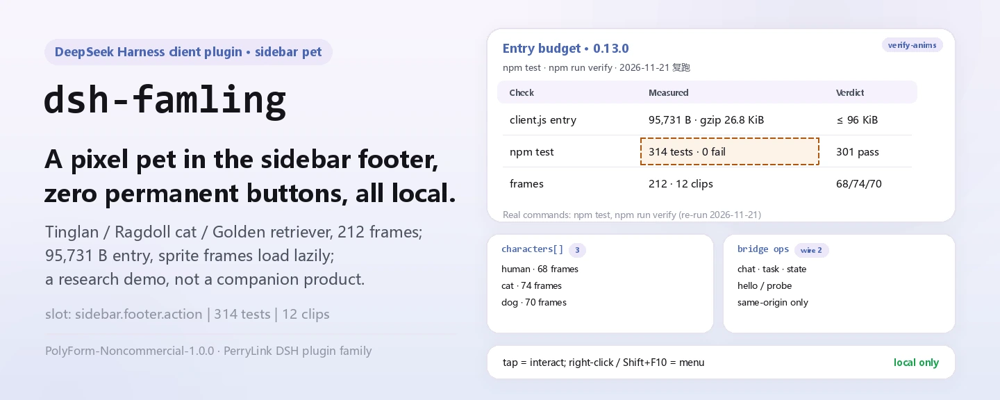
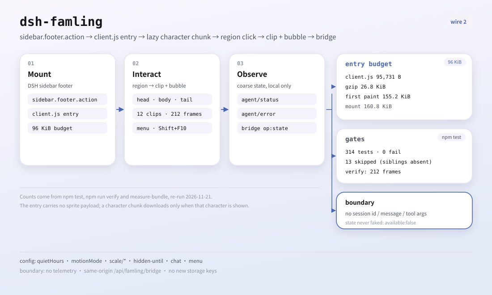
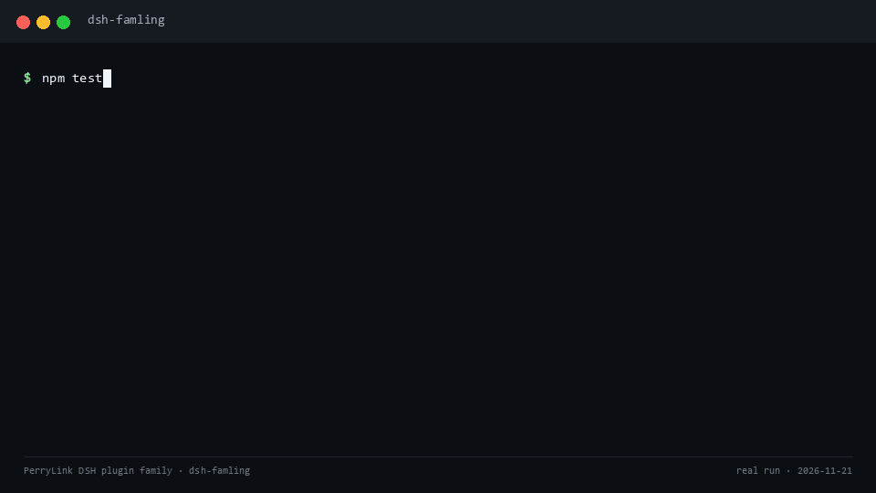

<div align="center">

<picture>
  <source media="(prefers-color-scheme: dark)" srcset="docs/assets/dsh-famling-hero-en-dark.webp">
  
</picture>

# dsh-famling

**Famling / Tinglan, como plugin da barra lateral do DeepSeek Harness.**

*Uma pequena entrada de demonstração técnica/pesquisa no rodapé da barra lateral, abaixo da área da conta — 212 quadros de animação, zero botões permanentes, menu de contexto com clique direito / Shift+F10 e todas as preferências guardadas localmente. **Não** é um produto de companhia emocional.*

Última verificação: DeepSeek Harness `dsh-v0.2.3-alpha.1` (2026-11-22).

[English](README.en.md) · [简体中文](README.md) · [Español](README-es.md) · [Português](README-pt.md) · [हिन्दी](README-hi.md)

</div>

> ⚠️ **Limites de uso (leia primeiro)**: este projeto e todo o seu código, arte, áudio, textos, recursos de personagem e derivados são **apenas para pesquisa técnica e validação de protótipos**; **não devem ser usados para companhia emocional, parceiros virtuais, terapia psicológica, aconselhamento médico/jurídico/financeiro, relações íntimas com menores, personificar uma pessoa real ou um órgão oficial, nem para qualquer finalidade que viole leis, regulamentos ou regras de plataforma**. O aviso completo está em [docs/LEGAL-NOTICE-2026-11-18.md](docs/LEGAL-NOTICE-2026-11-18.md).

Edição compatível com DSH do Famling / Tinglan: uma pequena entrada de demonstração técnica/pesquisa renderizada **no canto inferior esquerdo da barra lateral do DeepSeek Harness, abaixo das informações da conta** (não é um produto de companhia emocional).

---

## Os dois pacotes

Esta linha de trabalho oferece dois pacotes, separados por finalidade:

| Package | Source | Purpose |
|---|---|---|
| **famling** | [PerryLink/famling](https://github.com/PerryLink/famling) | **The standalone desktop pet** (pet-only Tauri app; Tinglan / cat / dog, UI, TTS, age verification and more) |
| **dsh-famling** | this repository | **The DSH client plugin**; it only provides the small Tinglan entry in the sidebar's lower-left corner and small local interactions, and does not replace the standalone app |

> `famling` é o aplicativo independente; `dsh-famling` é a entrada leve dentro do DSH. Eles compartilham personagens e identidade de marca, não código em execução.
>
> **Declaração entre produtos (0.10.2 / E3-T3)**: o famling independente **não oferece role-play (RP) livre com LLM nem companhia emocional oficial**; este plugin oferece **respostas de IA no estilo assistente de trabalho** (não RP, não companhia; o texto vai para o provedor de modelos configurado no DSH e pode errar). Nenhum dos dois deve ser promovido ou transformado em produto de companhia emocional / parceiro virtual; os limites completos estão em [docs/LEGAL-NOTICE-2026-11-18.md](docs/LEGAL-NOTICE-2026-11-18.md).

<picture>
  <source media="(prefers-color-scheme: dark)" srcset="docs/assets/dsh-famling-flow-v5-dark.svg">
  
</picture>

*Estrutura: montar → interagir → observar. A entrada não carrega os sprites — o chunk de um personagem só é baixado quando aquele personagem aparece — e o estado do host é um buffer circular local limitado, sem ids de sessão, mensagens ou argumentos de ferramentas. Os rótulos do diagrama são nomes reais de slot e bridge, então a mesma imagem serve aos cinco idiomas.*

## Implementação atual (0.13.0)

Este README também é o registro de engenharia em formato longo. O estado atual em uma tela:

- **0.13.0 (2026-11-21, B1/A4)**: novo **modo "trabalhar juntos (foco)" de 25/50 minutos** — uma janela silenciosa apenas em memória em que os balões ambientais automáticos e os micro-movimentos aleatórios pausam, enquanto cliques explícitos, ações de menu e conversas continuam respondendo; ao fim do temporizador aparece um balão local (sem notificação do sistema, sem histórico, sem sequência, sem punição, sem nova chave de armazenamento). A UI e os textos de foco vivem inteiramente no `client.content.js` preguiçoso; a entrada cresceu 198 B (95.533 → **95.731 B**; portão de 31% 97.576 B → 1.845 B de folga, orçamento de 96 KiB → 2.573 B de folga). Limpeza de licenças: `LICENSE-ART` agora cobre os caminhos reais de arte (`client.anims.*`, `icon.png`) e as seções de licença do NOTICE / README coincidem; a evidência real de integração com o host DSH 0.2.2-rc.4 (46/46) e os portões de contrato rc.4/rc.5 (45/45) viajam no pacote.
- **0.12.0 (2026-11-21)**: hook de estado de trabalho do host (estado de granularidade grossa, privacidade mínima). A metade host mantém um estado limitado a partir de `ctx.on('agent/status')` / `ctx.on('agent/error')` (anel de ≤16 `{ state, at }` + contadores de execução + `lastError.kind` classificado) e adiciona o bridge `op:"state"` (wire 2) que devolve `available` / `state` / `active` / `updatedAt` / `lastError` / `transitions` após validar um esquema fechado. Nunca lê nem guarda ids de agente, ids de sessão, mensagens, prompts, argumentos de ferramentas ou conteúdo de arquivos. Se a API de eventos não existe ou a assinatura lança, `available:false` e o plugin se ativa normalmente — `state` nunca é falsificado.
- **Versões anteriores (0.8.x–0.11.x)** trouxeram as reações por região, as interações específicas de espécie com respostas aleatórias, o tempo por quadro baseado em `holdMs`, o menu hierárquico sem botões, o modelo de escala em quatro camadas, os controles de baixa perturbação (horas de silêncio / redução de movimento / ocultar temporariamente), a negociação de capacidades do host hello/probe, o contrato reservado content-extension v3, o consentimento versionado de TTS/ASR e os portões de higiene do pacote.
- **Registro completo de versões**: os orçamentos de bytes e contagens de testes por versão (0.10.3 a 0.13.0) estão preservados literalmente no [`README.md`](README.md) chinês; este README de cinco idiomas traduz as seções normativas e condensa esse apêndice histórico. Testes atuais: **314** (`npm test` em um clone raso: 301 passam, 0 falham, 13 ignorados).

## Escala em quatro camadas (0.10.4, MB-053)

O diálogo de configurações usa as mesmas quatro camadas de `src/pet/scaling.ts` do famling; todas atuam apenas nos estilos inline e nas variáveis CSS privadas do widget deste plugin (`--dsh-famling-ui-scale` / `--dsh-famling-bubble-zoom`, `transform` de componentes) e **nunca escrevem `document.documentElement` nem mudam o tema global do DSH ou a escala do host**:

| Layer | Where | Control | Semantics |
|---|---|---|---|
| 1 Overall scale | Common · first control | native range 50%–200% (step 5%) | everything scales together: character image, UI/text, bubbles, menu, panels |
| 2 UI + text | Scale (independent axis) | range 40%–150%, 100% = follow overall | text/controls only; "follow overall" resets in one click |
| 2 Image | Scale (independent axis) | range 50%–200%, 100% = follow overall | character/preview image only; fits the window automatically when it does not fit |
| 3 Component scale | Advanced / debug (collapsed by default) | per component: inherit (default) / 75% / 125% / 150% | bubble / context menu / panels / content centre / settings popup; override = inherited UI factor × override factor, and inheritance can be restored at any time |

- Valor efetivo = `global × axis`, depois limitado por legibilidade/segurança: texto de UI 0,6×–2,5×, imagem 0,5×–2× (72px → 36–144px, ainda dentro da barra lateral de 240px), componentes 0,5×–2×. A largura do balão tem teto rígido de 240px e sua borda esquerda é ajustada à janela, então não pode transbordar a barra lateral/janela; menus e painéis usam "tamanho de layout ÷ zoom + `transform: scale(zoom)`" para continuarem dentro da janela após a escala (âncoras esquerda/inferior, `transform-origin` alinhado à âncora) sem cortar conteúdo.
- Persistência: `dsh-famling/scale/model` (marca de versão) mais `dsh-famling/scale/global`, `/ui-text`, `/image`, `/component/<id>`; valores de seguir/padrão não escrevem chaves de eixo (restaurar seguir = apagar a chave), e redefinir a escala padrão escreve apenas `global=1` e a marca de versão. No primeiro carregamento, se a marca de versão estiver ausente e existirem as chaves antigas de fator absoluto `dsh-famling/scale` (número ou JSON `{pet,text}`) ou `dsh-famling/text-scale`, elas são migradas uma vez para `image`/`uiText` (global=100%, mesmo valor efetivo); após a migração as chaves antigas permanecem onde estão, mas marcadas como inválidas e nunca são aplicadas duas vezes. Limpar as configurações locais apaga todas as chaves de escala sob `dsh-famling/*`.
- Teclado / ARIA: todos os sliders de escala são `<input type="range">` nativos (as setas funcionam) com `aria-label` e `aria-valuetext` (por exemplo "150% · independente"); os botões do grupo avançado trazem `aria-expanded`; os seletores de componente trazem `aria-label`; o botão "seguir o global" fica `disabled` enquanto segue; o botão de redefinir tem nome legível; o diálogo de configurações continua `role="dialog"`.
- Testes: `test/client-scale.test.js` cobre o modelo puro (clamp/parse/persistência/migração/tetos) + comportamento com React falso (IA de três camadas, eixos global/independente, substituições de componente e herança, persistência/restauração, balão de 240px e ajuste à janela, ajuste do menu escalado, teclado/ARIA, sem fetch) + portões estáticos (estilos privados do widget, sem `document.documentElement`, sem URL externas). `npm test` está totalmente verde.

## Baixa perturbação (0.10.6, E7 restante / P-04)

O grupo "baixa perturbação" do diálogo de configurações reúne todos os controles de silêncio em um só lugar; sua semântica se alinha com `low-disturb.ts` / `reduce-motion.ts` do shell de desktop do famling (apenas o widget deste plugin; o host DSH e o tema global não são tocados):

| Capability | Default | Behaviour | Persistence |
|---|---|---|---|
| Quiet hours | **on, 22:00–08:00** | inside the window **automatic output = 0**: no automatic ambient bubbles and no random micro-motions; region clicks, menu interactions and chat/reminder replies still work. `start === end` or switching it off never silences anything. A cross-midnight window (22:00–08:00) is evaluated as "start ≤ now or now < end". | `dsh-famling/settings.quietHours = { enabled, start, end }` |
| Motion preference | **follow system** | `auto` reads `prefers-reduced-motion: reduce` (read at mount; an explicit choice wins); `on` forces frame animation/blinks/micro-motions on, `off` freezes everything on the first frame. The old boolean `motion` migrates once to `auto`/`off`. | `dsh-famling/settings.motionMode` |
| Automatic micro-motion cadence | 60–90s | raised from 11–20s in 0.10.5 to **≥60s**; a trigger inside quiet hours re-arms the timer instead of playing. | not persisted (runtime cadence) |
| Temporary hide | off | "More → hide for 1 hour / hide until tomorrow" or the same-name button in settings; while hidden, neither the character nor bubbles render and only a ≥24×24px "show" restore control remains; it restores automatically at the deadline. | `dsh-famling/hidden-until` (millisecond timestamp) |
| Mute | off | stops browser TTS only: bubble captions stay, and speech already playing is cancelled immediately; cat/dog still use hollow thought bubbles and never TTS. | `dsh-famling/settings.sound` |

- A entrada de limpeza "apagar configurações locais e consentimento" também apaga `hidden-until` e os registros de consentimento v1/v2; a lista de chaves de armazenamento em Configurações → Avançado / depuração as mostra.
- Todos os textos e controles vivem no `client.content.js` preguiçoso (o painel de entrada, o diálogo de consentimento e o de limites de uso também foram movidos para esse chunk em 0.10.6; a migração do consentimento antigo de 0.10.10 e "retirar consentimento de voz" vivem lá também); as decisões de limitação/espera e os tempos de quadro vivem no `client.behavior.js` preguiçoso, enquanto a entrada `client.js` se mantém dentro do orçamento de 96 KiB da primeira tela.
- Testes: `test/client-lowdisturb.test.js` (modelo puro: parse de horas, limites 22:00/08:00, fallback de janela inválida, start===end, precedência auto/on/off, prazo/expiração/armazenamento corrompido de ocultar, ligação estática) e `test/client-behavior.test.js` (relógio falso: estado/persistência das horas de silêncio/hora inválida preservada; horas de silêncio param micro-movimentos mas cliques continuam respondendo; reduce-motion do sistema e substituição explícita; ambos os modos de ocultar, restauração antecipada, restauração automática no prazo, persistência após recarregar, ocultar pelas configurações); `npm test` verde (incluindo os portões MB-004 LOCK / spec vendorizado / clean-checkout).

## Negociação de capacidades do host hello/probe (0.10.7, MB-034 / E3-T2)

As duas metades do plugin compartilham o handshake do bridge wire 2; o objetivo é "continuar funcionando enquanto as capacidades do host são desconhecidas e degradar com honestidade quando faltam", em vez de supor que tudo existe por `engines.dsh`.

| Item | Host half `index.js` | Client `client.js` |
|---|---|---|
| Required injection | only `connection` (the authenticated same-origin bridge); `llm` / `schedule` / `agentDefaultModel` are all probed on demand with `ctx.get()`, so a service that arrives late is found by the next call | — |
| Mount handshake | registers `POST /api/famling/bridge` | after mount sends once `{ v: 2, op: "hello", clientVersion, wireVersion: 2, contentExtension: 3, hostVersion?, hostCommit? }` (4s timeout, sent once) |
| Capability matrix | `hello` / `probe` return `capabilities { llm, schedule, agentDefaultModel, brief, bridge }`, per-item `probes[]` (id / available / method) and `degraded[]` | stores the capability document; the input panel and settings use it to show/disable features |
| Version / contract | `plugin.version` (read from this package's package.json), `wire { version: 2, accepts: [1,2] }`, `contract { bridge: 2, contentExtension: 3, contentExtensionSchema: 3 }`, `host { version, commit?, source }` | `hostVersion` comes from `window.__DSH_BOOT__.release` (not sent when absent; the host never guesses from elsewhere); `versionMismatch` is only a hint |
| Degradation | missing `llm` → chat 503 `E_LLM` + `capability:"llm"` + `unavailable:true` (the local crisis short-circuit still works); missing `schedule` → task/task-delete 503 `E_TASK` + `capability:"schedule"` | missing `llm`: send button disabled + panel/settings say "no model connected", the send path intercepts locally and never fakes a reply; missing `schedule`: the reminder entry is not rendered and the reason is shown; an old host that does not answer hello → "compatibility mode" with 0.10.6 behaviour |
| Manual probe | `probe` (wire 2) returns the same capabilities/contract + `generatedAt`, with no side effects, no model call and no reminder creation | Settings → Advanced / debug → "re-detect host capabilities" |

- **Procedência honesta da versão**: quando o processo host tem `process.env.DSH_CLIENT_VERSION` ele é preferido (`source: "env:DSH_CLIENT_VERSION"`); caso contrário usa-se o `__DSH_BOOT__.release` reportado pelo cliente (`source: "client-boot"`); sem nenhum fica `source: "unknown"` / `version: null` — sem adivinhar.
- **Matriz de protocolo**: `hello` / `probe` / `state` aceitam apenas `v: 2` (um cliente antigo enviando v1 recebe 426 `E_WIRE`); `echo` / `chat` / `brief` / `task` / `task-delete` funcionam tanto em wire 1 como em wire 2, então clientes antigos não precisam de mudança.
- **Compatibilidade content-extension v3**: esta versão não sobe para v4; `content-extension.mjs` exporta `CONTENT_EXTENSION_VERSION = 3`, `CONTENT_EXTENSION_COMPATIBILITY` (versão única, `additive-within-major`) e a função pura `isContentExtensionCompatible(version)`; o `contract.contentExtension` do hello é lido diretamente desse módulo e os testes congelam a concordância dos dois, para que wire e esquema não se separem. 0.10.9 adicionou campos de conformidade opcionais (license / aiProvenance / compatibilidade em nível de pack / declaração canônica de uso) dentro da mesma revisão v3, então **nem o wire nem a revisão do hello/probe mudam** e hosts/packs antigos continuam funcionando.
- Testes: `test/host-bridge.test.js` (injeção mínima, campos hello/probe, procedência de versão, incompatibilidade de contrato, 503 por capacidade ausente, matriz wire 1/2) e `test/client-behavior.test.js` (payload do handshake de montagem, degradação de configurações/painel de entrada, modo compatibilidade com host antigo, aviso de versão diferente, probe manual); `test/client-static.test.js` congela `CONTENT_EXTENSION_VERSION` / a estratégia de compatibilidade.

## Dados de animação multi-personagem (0.8.0)

Três packs de animação em pixel de 96×96 (12 clips cada; quadros por manifesto: dog 70 / cat 74 / human 68, **212 quadros** no total) são divididos por personagem em chunks preguiçosos (0.8.6): a entrada `client.js` é **95.731 B** (93,5 KiB; gzip 26,8 KiB, dentro do orçamento de 96 KiB da primeira tela — subiu de 72 para 78 KiB em 0.10.1 pelo menu hierárquico e de 78 para 96 KiB em 0.10.4 pelo modelo de escala em quatro camadas, e ainda é 69,6% menor que a linha de base de 314,8 KiB antes da divisão), enquanto `client.anims.human.js` / `cat` / `dog` são baixados pelo DSH `require.async` só quando aquele personagem aparece pela primeira vez; a primeira pintura (entrada + human, medida pelo measure-bundle) é cerca de 155,2 KiB (50,49% da base), o download real de montagem mais os chunks de comportamento/estado do host é cerca de 164,8 KiB (53,63%, abaixo do portão de 54%), e só após carregar todos os personagens chega a cerca de 334,7 KiB. `client.content.js` (centro de conteúdo + diálogo de configurações unificado + cartão de segurança da primeira execução + controles de escala + diálogos de entrada/consentimento/limites + painel de capacidades do host + metadados de conformidade 0.10.9 + consentimento versionado 0.10.10 + ações úteis da primeira execução task-21 de 0.12.0 + o modo de foco "trabalhar juntos") é baixado apenas na primeira instalação ou ao abrir um diálogo pela primeira vez (83,7 KiB, gzip 24,2 KiB, medido na árvore de trabalho 0.12.0); `client.behavior.js` (geometria de clique / hit-test por região / espera de cliques repetidos / respostas aleatórias / durações `holdMs` por quadro) é baixado e memoizado logo após a montagem (5,6 KiB, gzip 2,0 KiB, medido na árvore 0.12.0); `client.status.js` (sondagem de estado do host de granularidade grossa, privacidade mínima, 4,0 KiB / gzip 1,5 KiB) é carregado preguiçosamente e memoizado após a montagem no mesmo padrão:

- Fonte de dados: o repositório privado `desktop-games/public/assets/pet/anim/{human,cat,dog}/` (`manifest.json` + PNGs por quadro).
- Gerador: `scripts/embed-anims.mjs` lê manifesto/PNGs, valida os contratos dos três packs de clips, recodifica os quadros RGBA **sem perdas** em PNGs indexados de profundidade mínima (alfa rígido preservado, cerca de metade do tamanho) e os injeta em `client.js` em marcadores. **Nunca editar à mão os blocos gerados**: mude os dados e execute o script de novo.
- Tamanhos (árvore de trabalho 0.12.0, medido em 2026-11-21): entrada `client.js` 93,5 KiB / 95.731 B (gzip 27.470 B, brotli 22.972 B como congelados pela verdade de versão da 0.13.0); os três chunks de personagem somam cerca de 241,2 KiB (human 61,7 / cat 99,8 / dog 79,7 KiB); o chunk do centro de conteúdo + configurações + cartão da primeira execução + controles de escala + diálogos de entrada/consentimento/limites + painel de capacidades do host + metadados de conformidade + consentimento versionado + ações da primeira execução task-21 + modo de foco task-B1 "trabalhar juntos" é de 83,7 KiB (gzip 24,2 KiB / brotli 19,7 KiB, árvore 0.12.0; task-21 +4.905 B, task-B1 +6.656 B) e é carregado sob demanda; o chunk de comportamento `client.behavior.js` 5,6 KiB (gzip 2.043 B / brotli 1.786 B) e o chunk de estado do host `client.status.js` 4,0 KiB (gzip 1.545 B / brotli 1.306 B) carregam após a montagem. O orçamento da primeira tela subiu de 72 KiB para **78 KiB** em 0.10.1 (o menu hierárquico precisa estar disponível na primeira pintura) e para **96 KiB** em 0.10.4 pelo modelo de escala e ajuste de painéis (0.10.6/0.10.7 não subiram mais); o cartão da primeira execução, o conteúdo das configurações, a UI de baixa perturbação e os diálogos de entrada/consentimento continuam em chunks preguiçosos e a carga de sprites continua nos chunks de personagem: a entrada é **30,41%** da linha de base de auditoria antes da divisão (abaixo do portão de 31%), a primeira pintura (entrada + human) é 158.935 B = **50,49%** da base; o download real de montagem (entrada + human + behavior + status) é 168.802 B = **53,63%** (abaixo do portão de 54%).
- Regerar: `npm run embed:anims`; apenas validar sem escrever: `node scripts/embed-anims.mjs --check`; `npm run verify:anims`; quantificar: `npm run measure:bundle`.
- Validação: `scripts/verify-anims.mjs` verifica personagens/clips, contagens de quadros por personagem a partir de cada manifesto, consistência de `holdMs` / `durationMs`, dimensões e pixels visíveis dos PNGs, política de balões/TTS, mapeamento de ações e chaves i18n; também verifica que `client.content.js` existe, tem quatro abas de primeiro nível e não faz fetch / URL externas, verifica o registro de chunks / conjunto de exportações / sem rede, sem eval, sem gravações de armazenamento de `client.behavior.js` e a ligação única `require.async` da entrada, e — quando há ativos privados — compara os blocos embutidos byte a byte para detectar obsolescência.
- QA estática: `node scripts/embed-anims.mjs --qa` gera `scripts/qa/anim-data.js`; abrir `scripts/qa/index.html` no navegador permite trocar de personagem, reproduzir os 12 clips, ver balões sólidos/vazados e rodar a autoverificação de dados sem reiniciar o DSH.

## Reações por região de clique (0.8.2)

- Os dados de região vêm do repositório privado `desktop-games/public/characters/{pet-tinglan-anim,pet-cat,pet-dog}/regions.json` e compartilham o mesmo contrato `version/canvas/regions/gestures` do hero do famling independente: as regiões são retângulos `head` / `body` / `tail` (com prioridade) sobre uma tela lógica de 96×96.
- `scripts/embed-anims.mjs` lê e valida esses documentos e escreve o bloco gerado `ANIMS[character].regions`; `--check` o inclui na detecção de obsolescência, e o `anim-data.js` produzido por `--qa` também carrega os dados de região.
- No clique, `offsetX/offsetY` são mapeados de volta para coordenadas lógicas de 96 usando o **tamanho renderizado real** da imagem, e então o hit-test é feito por prioridade; a mesma posição relativa acerta a mesma região em qualquer tamanho de exibição (64/72/96/144px …).
- Mapeamento de acertos: `head → pat_head` (carinho na cabeça), `body → stand_wag` (abanar a cauda / espreguiçar), `tail → chase_tail` (perseguir a cauda); as falas dos balões vêm das linhas aleatórias `says` da própria regra de região (0.8.3) — sem dados de fala ele não diz nada. Cliques repetidos na mesma região têm 1,2 s de espera; a partir do 4.º clique na mesma região dentro de 10 s degrada para a reação leve existente `idle_blink` (2,5 s de espera após saturar), e as ações de menu não estão sujeitas a isso. A geometria de acerto / decisões de região / máquina de estados de espera e o seletor de respostas aleatórias vivem no `client.behavior.js` preguiçoso; a entrada apenas aplica a decisão e atualiza o estado.
- Apenas os estados `idle` / `idle_blink` respondem; reproduzir outro clip não é interrompido. Um acerto em região transparente ou não declarada é um no-op explícito e **já não cai para um micro-movimento aleatório** (os micro-movimentos aleatórios continuam disparando pelo temporizador de inatividade).
- Respostas de região (0.8.3): cada regra de região em `regions.json` traz 3 linhas `says`; um acerto escolhe uma ao acaso (cliques consecutivos na mesma região trocam de fala); cat/dog continuam usando balões de pensamento vazados e nunca TTS; Tinglan usa balão de fala sólido mais o consentimento de TTS existente.

## Interações específicas de espécie e respostas aleatórias (0.8.3)

- O menu de interação já não é uma tabela fixa escrita à mão: `scripts/embed-anims.mjs` embute as `actions` (id/label/event/followUpEvent/followUpMs/says) e `gestures[].says` de `regions.json` em `ANIMS[character]`, e as inclui em `source-sha256` e na detecção de obsolescência de `--check`; após mudar os dados, execute `npm run embed:anims` de novo.
- O mapeamento evento → clip também não é escrito à mão: `scripts/gen-content-constants.mjs` gera o bloco `EVENT_CLIPS` de `client.js` a partir de `public/characters/*/{regions,behavior}.json` + `public/assets/pet/anim/*/manifest.json` do famling (`pat`→`pat_head`, `ball_throw`→`ball_throw`, `ball_chase`→`ball_chase`, `paw_face`→`paw_face`, `run`→`run`; `feed` reutiliza o clip stand/wave; `talk` só mostra balão e fica em idle); `npm run check:content` detecta a obsolescência dos blocos gerados, e `scripts/verify-anims.mjs` continua validando que o mapeamento é completo, que cat/human não têm ações de bola, o follow-up arremessar→perseguir do golden retriever, e que cada ação/região tem pelo menos duas respostas aleatórias.
- Fonte única e cadeia de verificação (MB-107/MB-108): as constantes de personagem/diálogo/aparência/uso/conformidade de `public/content/library.json` também são geradas no bloco `@generated` de `client.js` por `gen-content-constants.mjs` (as diferenças declaradas D1–D4 estão em `docs/CONTENT-CONSTANTS-2026-11-20.md`); `npm run check` (os dois blocos gerados ANIMS e content), `npm run lint` (cadeia mínima JSDoc/lint) e `npm run typecheck` (checkJs, **incluindo content-extension.mjs**; omissão honesta quando falta TypeScript) fazem parte de `release:check`. A fonte única i18n/locale é congelada por `scripts/check-i18n.mjs` (10 verificações: `L` em client.js, `STRINGS` em client.content.js, árvore de chaves/referências/chaves mortas em `locale/*.json`; roda dentro de `npm test` como `test/i18n.test.js`).
- As respostas aleatórias usam um seletor "evitar a anterior": cliques consecutivos na mesma região/ação nunca devolvem a mesma fala; o texto do balão, o TTS e a política de pensamento não mudam em relação a 0.8.2.

## Tempos de quadro e reprodução com holdMs (0.8.4)

- As contagens/durações de quadros já não são fixas: `scripts/embed-anims.mjs` e `scripts/verify-anims.mjs` leem o `manifest.json` de cada personagem para contagens e `fps` / `holdMs` / `durationMs` por clip; as contagens podem diferir (dog 70 / cat 74 / human 68, **212 no total**; `stand_wag` do cat = 10 quadros).
- A reprodução de `client.js` usa `setTimeout` por quadro: o quadro n fica `holdMs[n] ?? round(1000/fps)` milissegundos; um clip não cíclico volta a `idle` após o último quadro, e se o `durationMs` do manifesto exceder a soma dos holds o último quadro é estendido. O espreguiçar da gata = 300+300+300+350+400+400+400+350+250+150 = **3200ms** (10 quadros), já não é reproduzido rápido demais por um `setInterval(1000/fps)` fixo; os quadros de ataque também seguem o `holdMs` do ataque (83/83/63/42/42/63/63).
- `holdMs` / `durationMs` alimentam `source-sha256` e `--check`: uma mudança de manifesto que só toca tempos também torna o bloco embutido obsoleto; `verify-anims.mjs` valida que `holdMs` cobre cada quadro e que a soma é igual a `durationMs`.
## UI mínima e menu de contexto hierárquico (0.10.1)

- **Zero botões por padrão**: o rodapé contém apenas a imagem do personagem de 72px; a própria imagem é um botão focável por Tab com `aria-haspopup="menu"` / `aria-expanded`, e nenhum botão permanente de entrada/interação/configurações/conteúdo é renderizado.
- **Como abrir**: clique direito no personagem, Shift+F10 ou a tecla ContextMenu; o menu é um `role="menu"` + `role="menuitem"` próprio com `aria-activedescendant` e tabIndex móvel; clique fora / perda de foco da janela / Escape o fecha, e o foco volta ao personagem ao fechar.
- **Teclado**: ↑/↓ ciclam, Home/End vão ao primeiro/último, ←/→ voltam um nível ou entram numa subpágina, Enter ativa, Escape fecha, Tab fecha; o primeiro item de cada subpágina é "« voltar".
- **Hierarquia (apenas 5 itens de primeiro nível)**: Conversar… (painel de entrada) / Interagir ▸ (as `ANIMS[character].actions` atuais) / Conteúdo e personagem… (diálogo do centro de conteúdo) / Configurações… (diálogo de configurações unificado) / Mais ▸ (Lembretes… + limites de uso e versão…). Recursos complexos não são espremidos no primeiro nível.
- **Ajuste à janela**: o menu é `position: fixed` e ajusta esquerda/topo a uma margem de 8px pelo tamanho da janela; `clampMenuPosition` é uma função pura e os testes de comportamento verificam suas coordenadas diretamente.
- **Botão de menu**: "mostrar botão de menu" no diálogo de configurações fica desligado por padrão; ao ligar aparece um pequeno gatilho "⋯" ao lado do personagem (`aria-label` "menu"). A preferência é gravada em `dsh-famling/menu` (`{ button: boolean }`); estado de abertura do menu e subpáginas não são persistidos, então cada abertura começa no primeiro nível.
- **Degradação**: se `client.content.js` falhar ao carregar, os diálogos de conteúdo/configurações mostram uma mensagem local de falha enquanto o menu de contexto e as interações do personagem continuam funcionando; se `client.behavior.js` não estiver pronto ou falhar ao carregar, a reprodução de quadros cai para uma cadência padrão uniforme (sem segmentação por `holdMs`) e os cliques por região viram no-op local (sem exceção, sem bloquear o render) — ações de menu continuam tocando seu clip, só falta a fala aleatória.

## Centro de conteúdo: o personagem é o tema (0.10.0)

O centro de conteúdo já não trata "tema / fundo / fonte" como visuais de primeiro nível paralelos. **O personagem é o bundle de tema**: um papel = seis componentes (character + voicePolicy + dialogue + theme + background + font); um clique em "aplicar tudo" aplica o pack inteiro de forma atômica. Depois o usuário pode mudar qualquer componente em "personalizar" (substituindo o preset do papel), ou restaurar o padrão do papel em um clique.

### Quatro abas de primeiro nível

| Tab | Content | Behaviour / persistence |
|---|---|---|
| **Roles** | Tinglan / Ragdoll cat / Golden retriever (origami bundle data is reserved; assets are not installed, so no card is offered) | each card shows a glyph avatar, the role name, one sentence, a voice / dialogue / appearance summary and an "apply all" button; the current role carries a ✓ mark. Applying writes character, voicePolicy, dialogue, theme/background/font and `dsh-famling/role` together and does not preload other character animation chunks. |
| **Customise** | voice (TTS policy) / dialogue / theme / background / font (0.9.1 capabilities kept) | the header explains "changes only the current role's arrangement, not its preset" and shows "role preset / customised"; changing one component writes only its old key and the role id does not change; "restore role default" resets all components from the current role bundle. |
| **Content packs** | currently only the built-in packs (4 role bundles); no external pack | shows the installed list and the v3 mandatory `usageDeclaration` check result (researchOnly=true + the six prohibited uses), plus an asset-pack import entry (**needs host support**: zip/folder manifest + sha256 parsed by the host; this version does not read files, execute scripts, load assets or go online). |
| **Market** | remote-market placeholder | always shows "remote market interface reserved, server not configured"; shows the reserved fields `catalogUrl` / `configKey` (`dsh-famling/market/catalog`, `dsh-famling.market`); it makes no network request and shows no fabricated products. |

### Bundles de papel

| role | character | Voice policy | Dialogue | Theme / background / font |
|---|---|---|---|---|
| `human` | Tinglan | speech, browser TTS allowed (still behind its own consent gate) | `standard` | `default` / `transparent` / `system` |
| `cat` | Ragdoll cat | thought, no TTS | `standard` | `night` / `dark` / `serif` |
| `dog` | Golden retriever | thought, no TTS | `standard` | `paper` / `paper` / `system` |
| `origami` | reserved | speech (shares the tide voice policy; data reserved, not appliable) | `standard` | `night` (explicit mapping of the shared `high-contrast`) / `transparent` / `mono` (data reserved, not appliable) |

Esses seis componentes se alinham com `rolePresets` de `public/content/library.json` do famling (human: standard/default/transparent/system; cat: standard/night/dark/serif; dog: standard/paper/paper/system); o pack compartilhado origami usa o tema `high-contrast`, que este plugin não tem, então é mapeado explicitamente para `night` com `available:false` e nunca é desalinhado em silêncio. Os modos de diálogo também se alinham com os `dialoguePacks` compartilhados: `standard` = 240 caracteres / 70% de balões ambientais, `brief` = 80 caracteres / 40%, `quiet` = 50 caracteres / 5%; mudar esses valores deve ser sincronizado no famling e no plugin.

"Aplicar tudo" também coloca o interruptor de TTS na política de voz do bundle; se o usuário ainda não consentiu o TTS, ele fica desligado (o portão de consentimento nunca é ignorado). Trocar para cat/dog cancela qualquer fala do navegador em andamento.

### Persistência e preenchimento

- A nova chave `dsh-famling/role` registra o tema do papel atual (primary), e `dsh-famling/menu` registra o interruptor "mostrar botão de menu"; as chaves antigas continuam funcionando: `dsh-famling/character`, `dsh-famling/settings` (`sound` / `voiceURI`), `dsh-famling/dialogue`, `dsh-famling/theme`, `dsh-famling/background`, `dsh-famling/font`.
- Aplicar um papel = escrever as chaves dos seis componentes + `dsh-famling/role`; personalizar = substituir apenas a chave do componente clicado, sem mudar o id do papel.
- Carregamento: lê `dsh-famling/role` primeiro; sem essa chave, o papel é derivado do `character` guardado; chaves de componente ausentes são preenchidas a partir do bundle daquele papel, enquanto chaves de componente salvas explicitamente têm prioridade. Um usuário 0.9.x recebe o preenchimento do papel no primeiro render após atualizar.
- O kit de comportamento `client.behavior.js` é carregado após a montagem por um único ponto `require.async` memoizado (`requestBehaviorChunk`), com fallback para a cadência padrão se falhar; o chunk de UI do centro de conteúdo `client.content.js` é baixado com `require.async('./client.content.js')` só na primeira vez que o painel é aberto; se falhar, o painel local mostra falha de carregamento e as interações principais não são afetadas.

## Interface de extensão de conteúdo v3 (reservada, offline)

[`content-extension.mjs`](content-extension.mjs) é o contrato público para futuros packs de conteúdo locais/remotos (export do pacote: `dsh-famling/content-extension`):

- `CONTENT_EXTENSION_POINTS` — **versão 3** (pack `schemaVersion: 3`), `status: "reserved"`, `transport: { network: false, execute: false, innerHTML: false, worker: false, assets: false }`; desde 0.10.9 o `compliance` de primeiro nível publica a forma dos campos de conformidade opcionais, as âncoras congeladas e a opção de modo estrito.
- `CONTENT_KINDS` — **sete tipos**: `role` / `character` / `voice` / `dialogue` / `theme` / `background` / `font`. `role` é o tipo bundle adicionado na v3: apply deve incluir os seis componentes `character / voicePolicy / dialogue / theme / background / font`, e a entrada deve trazer ainda `compatibility` (`minPluginVersion`, opcional `maxPluginVersion`).
- **Todo pack deve trazer `usageDeclaration`**: `{ researchOnly: true, prohibitedUses: [seis itens] }`; os seis são fixos: `emotional-companionship` / `virtual-partner` / `professional-advice` / `minor-intimacy` / `impersonation` / `illegal-use`. Declaração ausente, `researchOnly !== true`, item faltando ou sobrando, duplicados ou campos desconhecidos são todos rejeitados. Entradas de papel não são isentas da declaração em nível de pack; uma entrada de papel pode repetir opcionalmente um `usageDeclaration`, validado pela mesma regra quando presente. O modelo é exportado como `USAGE_DECLARATION_TEMPLATE`. Desde 0.10.9 pode-se adicionar `statement` / `statementRef` / `statementSha256` canônicos, e quando presentes os três devem coincidir literalmente com `CONTENT_USAGE_STATEMENT` / `CONTENT_USAGE_STATEMENT_REF` / `CONTENT_USAGE_STATEMENT_SHA256` (o modo estrito exige `statement` + `statementRef`).
- **Campos de conformidade da 0.10.9 (opcionais, compatíveis para trás)**: um pack pode trazer `license` (`spdx` + `attribution`, opcional `url` / `file`), `aiProvenance` (`generated` + `disclosure`, opcional `tools`) e `compatibility` (`minPluginVersion` + opcional `maxPluginVersion`); uma entrada também pode trazer `license` / `aiProvenance` (o `compatibility` de uma entrada de papel continua obrigatório). Campos declarados devem ser válidos campo a campo (fail-closed); os não declarados só produzem `warnings`, e packs v3 anteriores a 0.10.9 continuam valendo. As âncoras congeladas de primeira parte são exportadas como `CONTENT_LICENSE_TEMPLATE` / `CONTENT_AI_PROVENANCE_TEMPLATE`.
- **Modo estrito e portão de versão**: `validateContentPack(pack, { requireCompliance: true })` permite ao host falhar fechado ao carregar um pack não confiável — `license` / `aiProvenance` / `compatibility` ausentes ou `usageDeclaration.statement` / `statementRef` canônicos ausentes vão direto para `errors`; `{ pluginVersion: "x.y.z" }` valida ainda se os intervalos de compatibilidade do pack e da entrada de papel incluem a versão atual do plugin (função pura `isPackCompatibleWithPlugin`).
- **`assets` reservado**: um pack pode trazer `{ format: "zip" | "folder", files: [{ path, sha256, bytes? }], totalBytes? }`; `path` deve ser um caminho relativo seguro (≤6 segmentos, sem `..`, sem esquema, ≤160 caracteres, com extensão) e `sha256` 64 caracteres hex minúsculos; **apenas validação de dados/manifesto — nenhum ativo é lido, aberto, executado ou carregado**.
- **`remoteCatalog` reservado**: opcional `{ status: "reserved", url?: "https://..." }`; apenas validação de metadados — **sem fetch, sem pré-aquecimento, sem carregar catálogo remoto**. Uma fonte remota (`source: "remote"`) é rejeitada por padrão; um host futuro precisa passar explicitamente `{ allowRemote: true }` para passar na validação de esquema.
- `validateContentPack(pack, { allowRemote?, requireCompliance?, pluginVersion? }) → { ok, errors, warnings }` — validação **de dados puros**: `warnings` reporta campos de conformidade opcionais ausentes (não altera `ok`), modo estrito/portão de versão como acima; nunca lança, nunca executa, nunca acessa a rede e nunca lê arquivos.
- `CONTENT_PACK_EXAMPLE` — um pack de exemplo v3 legal (usageDeclaration completa + campos canônicos de declaração, license / aiProvenance / compatibility, um bundle de papel, uma entrada de tema; legal tanto por padrão quanto com `requireCompliance: true`); nunca é carregado automaticamente.

Declaração mínima e fragmento de papel:

```json
{
  "schemaVersion": 3,
  "id": "com.example.warm-pack",
  "name": "Warm Example",
  "version": "1.0.0",
  "source": "local",
  "usageDeclaration": {
    "researchOnly": true,
    "prohibitedUses": [
      "emotional-companionship", "virtual-partner", "professional-advice",
      "minor-intimacy", "impersonation", "illegal-use"
    ],
    "statement": "本项目及其全部代码、美术、音频、文案、角色素材和衍生物仅用于技术研究与原型验证，不得用于情感陪伴、虚拟伴侣、心理治疗/医疗/法律/金融建议、未成年人亲密关系、冒充真人/官方，或任何违反法律法规/平台规则的用途。",
    "statementRef": "docs/legal/USE-RESTRICTIONS-2026-11-19.md",
    "statementSha256": "0353536cefd702014b12a8365c4a486f19848d049652e9692027216adb80c743"
  },
  "license": { "spdx": "CC-BY-4.0", "attribution": "Example pack authors" },
  "aiProvenance": { "generated": false, "disclosure": "Example content is written by hand; no generative AI was used.", "tools": ["deterministic-python-renderer"] },
  "compatibility": { "minPluginVersion": "0.10.0" },
  "entries": [
    {
      "kind": "role",
      "id": "warm-human",
      "name": "Warm Human",
      "version": "1.0.0",
      "source": "local",
      "preview": { "kind": "glyph", "value": "🧑" },
      "permissions": ["apply:role", "store:selection"],
      "compatibility": { "minPluginVersion": "0.10.0" },
      "apply": {
        "character": "human",
        "voicePolicy": { "canTts": true, "mode": "speech", "sound": true },
        "dialogue": { "mode": "standard" },
        "theme": { "variables": { "--dsh-famling-bubble-bg": "#fff3cd", "--dsh-famling-bubble-text": "#3b2f24" } },
        "background": { "kind": "transparent" },
        "font": { "family": "system-ui, sans-serif", "size": 12, "lineHeight": 1.5 }
      }
    }
  ]
}
```

Outras validações (sem mudança em relação à v2 e vigentes): dados puros (rejeitar funções / símbolos / bigints / números não finitos / objetos não planos), campos/enums desconhecidos, strings/arrays longos demais, JSON ≤ 64 KiB, entradas ≤ 32 (≤16 por tipo), limites de id/name/description, chaves de cadeia de protótipo (`__proto__` / `constructor` / `prototype`), travessia de caminho/absolutos/URL em prévias de imagem, `<` e caracteres de controle, CSS perigoso como `url()` / `expression()` / `@import`; variáveis de tema devem ser `--dsh-famling-*` com valores de cor seguros; o fundo só permite transparente/cor sólida segura; a fonte só permite 1..8 nomes locais sem aspas (aspas, `url()`, `var()`, ponto e vírgula, chaves e regras `@` são rejeitados). Ids de entrada duplicados / caminhos de ativo duplicados / intervalos de compatibilidade de papel invertidos são rejeitados. Desde 0.10.9 os campos de conformidade também são validados como dados puros: `spdx` 2..64 caracteres, `attribution` ≤ 200, `url` apenas https (sem fetch), `file` apenas caminho relativo seguro (nunca aberto), `aiProvenance.disclosure` ≤ 280 e `generated=true` exige uma declaração real, `tools` 1..8 ids de ferramenta minúsculos (nunca executados), e versões de compatibilidade devem ser `x.y.z`.

Esta versão **não carrega nenhum pack**: sem requisições de rede, sem execução de scripts de pack, sem `innerHTML`, sem descompactar ativos; o centro de conteúdo só mostra o catálogo embutido, a verificação de declaração e as notas reservadas. Um carregador futuro também deve ser "dados puros + parse/validação no lado do host + UI que só renderiza dados". O esquema completo, limites e exemplos estão em [docs/DETAIL.md](docs/DETAIL.md).

> A relação com o modelo de conteúdo compartilhado `famling.content/0.2` do famling independente (characters / voices / dialoguePacks / themes / backgrounds / fonts / **rolePresets**) é uma **relação de superconjunto alvo**: os seis tipos continuam mapeando um a um com os tipos do plugin (`builtin` ≡ `bundled`), e o `role` da v3 é esses seis tipos combinados em um bundle de tema de personagem. Desde 0.10.1 os `ROLE_BUNDLES` do plugin e os `rolePresets` compartilhados se alinham componente a componente (human/cat/dog), e `DIALOGUE_MODES` se alinha com maxChars/bubbleChance dos `dialoguePacks` compartilhados; o tema `high-contrast` do origami não existe neste plugin, então é mapeado explicitamente para `night` com `available:false`. O contrato do plugin modela "selecionar/aplicar" como `apply` + permissões, enquanto o modelo compartilhado é entradas de catálogo + funções de resolução; o prefixo CSS do tema, a fonte de voz (speechSynthesis do navegador vs DeepSeek stella/tide) e a forma de retorno da validação ainda diferem. Os dois contratos coexistem, cada um fail-closed; a 0.10.9 projeta a **forma e semântica** de license / aiProvenance / compatibility da v2 na v3 como campos opcionais aditivos (e congela âncoras dos dois lados), mas ainda não funde os dois esquemas nem muda a estrutura de pack v2, e a convergência futura continua passando por uma camada adaptadora — ver [docs/DETAIL.md](docs/DETAIL.md).

## Host bridge (P0/P1/P2/P4 implementados; hello/probe na 0.10.7; state na 0.12.0)

- `POST /api/famling/bridge` (mesma origem, apenas owner, JSON ≤16KB); wire 1 e wire 2 são aceitos, enquanto `hello` / `probe` / `state` aceitam apenas wire 2
- `op:"hello"` (wire 2) → handshake: versão do plugin / wire do bridge / contrato **content-extension v3** / versão e origem do host / matriz de capacidades / probes por item / `compatible` / `versionMismatch`; sem chamada de modelo, sem leitura de arquivos, sem efeitos colaterais
- `op:"probe"` (wire 2) → sonda de novo os serviços opcionais do host (`llm` / `schedule` / `agentDefaultModel`) e devolve as mesmas capacidades/contrato + `generatedAt`; "detectar novamente capacidades do host" nas configurações usa isso
- `op:"state"` (wire 2) → estado de granularidade grossa somente leitura: `{ available, source, state: "idle"|"running"|"unknown", active, updatedAt, lastError: null | { kind, at }, transitions: [{ state, at }] }`. `source:"events"` vem do anel em memória limitado de `ctx.on("agent/status")` + `ctx.on("agent/error")` (≤16 entradas, só estado + timestamp + tipo de erro classificado: `aborted`/`auth`/`network`/`rate-limit`/`server`/`timeout`/`tool`/`unknown`); **nunca lê nem guarda** ids de agente / ids de sessão / mensagens / prompts / argumentos de ferramentas / conteúdo de arquivos, não grava em disco, não envia nada e não registra logs. Quando o host não tem API de eventos ou a assinatura lança, `available:false` + `source:"unsupported"` e o plugin se ativa normalmente; a resposta é validada no host contra um esquema fechado e um instantâneo inválido cai inteiro para unavailable (fail-closed)
- `inject` exige apenas `connection`; sem `llm`/`schedule` o plugin se ativa normalmente, as entradas correspondentes ficam `false` nas `capabilities` da resposta, e chat/task devolvem 503 `E_LLM`/`E_TASK` + `{ capability, unavailable: true }`
- `op:"echo"` → eco local
- `op:"chat"` → host `ctx.llm.stream`; provider/model vêm da seleção de modelo padrão do DSH ou do Config deste plugin e **nunca são fixados em código** (a chave fica só no host); o system prompt escolhe a persona pelo `character` solicitado (inválido/ausente cai para `human`)
- `op:"brief"` → `~/.advisers/pet-brief.json` somente leitura (≤128 KiB); o documento inteiro é primeiro validado estritamente contra o contrato fechado v0.2 (`schemaVersion 1|2`, esquema fechado com campos desconhecidos/proibidos, `displayPolicy`, horas ISO com **limite superior de TTL de 5 minutos**, counts = comprimento do array, limites de item/enum), e qualquer desvio é 404 `E_MEMORY` fail-closed; só em caso de sucesso projeta counts + no máximo 3 today/commitments, sem repassar os TOS do Advisers e sem projetar risks/facts/suggestedLines. A compatibilidade com Advisers 0.3.0 (contrato Pet Brief v0.2), a matriz de validação e os pontos não cobertos estão em [docs/PET-BRIEF-0.3.0-COMPAT-2026-11-20.md](docs/PET-BRIEF-0.3.0-COMPAT-2026-11-20.md).
- `op:"task"` → `ctx.schedule.create` lembrete único (hora absoluta; sem temporizadores caseiros)
- TTS/ASR têm consentimentos separados; ambos desligados por padrão; a fala do navegador diz explicitamente para onde vai o áudio; os registros de consentimento trazem a versão da declaração + SHA-256 + acceptedAt + withdrawn (0.10.10) e podem ser retirados individualmente
- **O chat LLM está ligado ao host bridge** (`op:"chat"` passa por DSH `ctx.llm.stream`, então o conteúdo é enviado ao provedor de modelos configurado); TTS/ASR são capacidades locais do navegador com consentimentos separados; **a escrita de memória continua não implementada**. Os próximos passos estão em `docs/DSH-FAMLING-BRIDGE-2026-11-17.md`.
- Divulgação do fluxo de dados: o texto do chat passa pelo host DSH até o provedor de modelos configurado no DSH; o plugin em si não recebe nem armazena chaves de API e não guarda registros de chat; `brief` só lê o `~/.advisers` local e não envia nada. **Ao bater numa palavra-chave de crise o texto nunca sai da máquina** (curto-circuito local, sem chamada de modelo); com o interruptor "chat com IA" desligado nas configurações nenhum texto de chat é enviado; "apagar configurações locais e consentimento" só apaga as chaves do navegador deste plugin, sem tocar nos dados do host DSH/sessão/provedor.

## Compatibilidade com Pet Brief (Advisers 0.3.0, 2026-11-20)

Advisers 0.3.0 (registry npm bruto `latest`; o cache local do npmmirror ainda mostra 0.2.3, o que não reflete o estado publicado) **não muda o contrato Pet Brief**: continua v0.2 (`schemaVersion: 2`), com v0.1 (`1`) legível como legacy; a mudança de `pet-brief` na 0.3.0 é um refactor de desempenho mais filtragem de sigilo no produtor, e a evidência de que a saída é equivalente é o teste `assert.deepEqual(projectedBrief, fullBrief)` em `test/read-model-projections.test.js` do repositório do Advisers. **Esta rodada (task-152) sobe o bridge de um limite de projeção frouxo para um consumidor estrito**: após ler, o documento inteiro é validado contra o contrato fechado v0.2 e só então projetado por uma allowlist fixa; o comportamento frouxo antigo (política desconhecida normalizada para private / counts não comparados / campos desconhecidos aceitos) é removido (fail-closed, 404 `E_MEMORY`).

| Check | Plugin behaviour (measured) |
|---|---|
| Valid v0.2 private/public | 200, projecting counts + at most 3 each of today/commitments |
| `displayPolicy: none` | 404 `E_MEMORY` (no derived content rendered) |
| Unknown displayPolicy / v0.2 missing displayPolicy | **404 fail-closed** (closed enum / required) |
| v0.1 legacy (no displayPolicy) | accepted, treated as `private` |
| schemaVersion ≥3 / invalid / missing | 404 fail-closed |
| expired / no `expiresAt` / invalid time / **TTL >5 min** / times out of order / generatedAt more than 60s ahead | 404 |
| missing/invalid counts, **counts ≠ array length**, corrupt JSON, >128 KiB | 404 |
| unknown/forbidden fields (reasoning/api_key/…), >10 items, duplicate ids, invalid enum/confidence/over-long strings | **404 fail-closed** (closed schema; error messages carry only stable codes) |

Testes: `test/pet-brief-compat.test.js` (14: 11 casos estritos/negativos sempre ativos + 3 camadas opcionais — o produtor real 0.3.0, os 26 vetores canônicos v0.2, fixtures privados do famling; "ida e volta do livro sintético do produtor real 0.3.0", "26 vetores canônicos v0.2" e "ida e volta de fixtures privados do famling" são ignorados com honestidade quando faltam os checkouts irmãos e não são registrados no subprocesso clean-checkout do MB-004); `test/host-bridge.test.js` 26. Medido localmente: `node --test test/pet-brief-compat.test.js test/host-bridge.test.js` = **40/40 pass**, e `npm run lint` / `npm run typecheck` / `npm run check:package` estão todos ok. A verdade de versão completa, a matriz de validação, as lacunas restantes (G3–G6) e a evidência estão em [docs/PET-BRIEF-0.3.0-COMPAT-2026-11-20.md](docs/PET-BRIEF-0.3.0-COMPAT-2026-11-20.md).

### Seleção de modelo (não mais fixa desde 2026-11-18)

O provider/model de `op:"chat"` é resolvido nesta ordem (`resolveSelection` em `index.js`):

1. **Substituição explícita do Config do plugin** (opcional): `provider`/`model` devem aparecer em par, senão o carregamento falha; `reasoningEffort` é opcional.
2. **Seleção de modelo padrão do DSH**: lida do serviço do host `agentDefaultModel.currentSelection()` (ou seja, o modelo padrão das configurações/seletor de modelo do DSH), então o chat do bichinho acompanha automaticamente ao trocar de modelo.
3. Se nenhum resolver, `chat` devolve 503 `E_LLM` e **nunca cai em silêncio para um modelo fixo**.

Um modelo fixo (só quando você sabe que quer isso) é fornecido pela camada patch do usuário, por exemplo:

```yaml
- id: dsh-famling
  name: dsh-famling
  config:
    provider: deepseek-official
    model: deepseek-flash
    reasoningEffort: max   # optional
```

Não edite o bundle de perfil do próprio DSH; prefira o seletor de modelos do DSH.

## A persona segue o personagem (0.8.1)

Trocar de personagem troca a imagem e a persona do chat juntas: a requisição `op:"chat"` de `client.js` carrega o `character` atual (`human`/`cat`/`dog`; inválido ou ausente é normalizado no cliente para `human`), e `index.js` o usa para escolher o system prompt, com o lado host também caindo para `human` em valores inválidos.

| character | Image | Persona notes | Bubble/voice |
|---|---|---|---|
| `human` | Tinglan | quiet, concise work buddy; conclusion first | solid speech, browser TTS allowed |
| `cat` | Ragdoll cat (white base, blue-point long hair) | lazy, aloof, short sentences; mildly tsundere but never offensive | hollow thought, never TTS |
| `dog` | Golden retriever | friendly, enthusiastic, simple and direct | hollow thought, never TTS |

As três personas compartilham um conjunto de limites de segurança: nunca personificar uma pessoa real, um órgão oficial ou um consultor profissional; nunca induzir dependência, romance, pagamento ou relações emocionais com menores; nunca emitir conteúdo ilegal, privado ou personificado. Uma persona é apenas uma diferença de tom no nível do system prompt, não role-play independente nem companhia emocional; o modelo continua decidido pela seleção de modelo padrão do DSH.

## Instalação

### A. Do npm (recomendado, 0.11.1+)

```sh
dsh plugin --profile web add dsh-famling
```

O pacote declara o manifesto `dsh.bundle` (`cordis.patch.yml`) e o frontend `dsh.client`; o nome do pacote npm é `dsh-famling`.

### B. Diretório local

1. Coloque este diretório no diretório de plugins do DSH;
2. No DSH **Plugins → Add plugin**, selecione este diretório (ou use `plugin_manager install_bundle` com o caminho absoluto deste diretório como target);
3. Ative `dsh-famling` e atualize a UI web;
4. Confira se `汀岚` (Tinglan) aparece na barra lateral inferior esquerda, abaixo da área da conta;
5. `npm view dsh-famling` mostra a versão publicada (atualmente 0.11.1); a instalação pelo diretório de plugins do DSH segue os passos 1–4.

## Publicação e higiene do pacote (0.11.1, resíduo MB-094, 2026-11-21)

Este plugin é distribuído como tarball npm, então os metadados do `package.json` e a allowlist `files` *são* a superfície de publicação; estas regras são impostas por portões de script, não convenções:

- **Metadados**: `repository` = `git+https://github.com/PerryLink/dsh-famling.git`, `homepage` = o README deste repositório, `bugs` = os issues deste repositório; os três devem apontar para o mesmo repositório (`dsh-famling` é o repositório do plugin DSH; o repositório do app independente `PerryLink/famling` aparece apenas como link de produto relacionado em "Os dois pacotes").
- **Allowlist `files`**: sem duplicados (a entrada duplicada herdada `docs` foi removida), cada entrada deve existir, todos os arquivos necessários em execução e `exports` são cobertos, e `test/` / `scripts/` / `*.tgz` nunca são empacotados; `npm run verify:package` usa `npm pack --dry-run --json` para verificar igualdade de conjuntos entre "lista real empacotada = expansão da allowlist + arquivos que o npm sempre inclui".
- **`prepack`**: cada `npm pack` / `npm publish` roda automaticamente a verificação estática de higiene de publicação; a mensagem de sucesso vai para stderr (para não poluir o stdout de `npm pack --json`) e uma falha aborta o empacotamento.
- **Comandos**: `npm run check:package` (estático) / `npm run verify:package` (inclui `npm pack --dry-run`) / `npm run release:check` (test + check + verify + verify:package, o portão antes de publicar).
- **Publicado**: `npm publish` 0.11.0 (2026-11-21, publicado com um token npm local; **provenance / trusted publishing não habilitados**); `npm view dsh-famling version` = 0.11.0. A primeira execução real de CI após empurrar o repositório público é o que essa execução real reportar (esta máquina não fabrica resultados de CI). Detalhes, evidência e registros de medição locais estão em [docs/RELEASE-HYGIENE.md](docs/RELEASE-HYGIENE.md).

## Reconstrução de checkout independente e LOCK (MB-004, 2026-11-20)

Este plugin pode ser reconstruído, testado e verificado em um checkout independente **sem o repositório privado do famling**:

- **LOCK de instalação**: o repositório confirma `package-lock.json` (lockfileVersion 3; o plugin tem zero dependências em execução → lock só raiz); `npm ci` / `npm ci --offline` instalam de forma reproduzível. `scripts/check-package.mjs` inclui o LOCK no portão de publicação (name/version/license batem com `package.json`, toda dependência declarada está no lock e resoluções privadas como `file:`/`link:`/caminhos absolutos são proibidas).
- **Spec/LOCK vendorizado de animação**: `scripts/spec/anim-spec.json` guarda o contrato semântico dos três packs (contagens de quadros/fps/holdMs por clip, regiões/ações), o SHA-256 de `client.js` / chunks preguiçosos / cada quadro e o SHA-256 por arquivo dos quadros fonte privados (**sem bytes PNG/base64**). `node scripts/embed-anims.mjs --check` entra em `standalone spec mode` quando faltam os ativos privados (um spec ausente ou adulterado sempre falha, já não é ignorado); `node scripts/verify-anims.mjs` valida sempre o spec vendorizado e imprime `private assets: absent` em vez de ignorar a comparação byte a byte quando faltam os ativos privados.
- **Portão de clean checkout**: `node scripts/clean-checkout.mjs` copia o pacote para um diretório temporário, aponta `FAMLING_ANIM_DIR` / `FAMLING_CHARACTERS_DIR` / `FAMLING_REPO_DIR` para caminhos inexistentes e executa de verdade `npm ci --offline` + o `node --test` completo + `check` / `verify` / `check-package --pack` / `lint` / `typecheck`; `--json` imprime evidência revisável e `--keep` mantém a cópia. `test/clean-checkout.test.js` integra o portão ao `npm test`.
- **Preparação de sincronização com o repositório público**: `node scripts/clean-checkout.mjs --export DIR` produz uma árvore de repositório público que pode ser empurrada como está (excluindo `node_modules` / `.git` / caches / tarballs) e roda higiene estática de pacote + validação de spec na árvore exportada; o primeiro push, a primeira execução de CI, a proteção de branch e o `npm publish` são passos externos (este workspace não os executa nem os dá como feitos).
- **Limites restantes**: um checkout independente ainda tem **10 omissões de paridade entre repositórios** (frente aos valores congelados library/behavior/terms/compliance do repositório irmão famling; os valores congelados do lado do plugin e `test/fixtures/content-compliance/` continuam rodando), que não são dependências de build — o portão de clean-checkout afirma "só restam essas omissões conhecidas entre repositórios e nenhuma por ativos privados". Em um checkout sem TypeScript, `typecheck` imprime uma omissão honesta por design.
- Detalhes e evidência medida: [docs/INDEPENDENT-REBUILD-2026-11-20.md](docs/INDEPENDENT-REBUILD-2026-11-20.md); manifesto de staging do repositório público: [docs/PUBLIC-REPO-SYNC-2026-11-20.md](docs/PUBLIC-REPO-SYNC-2026-11-20.md).

## Verificação



*Animação: o stdout real de `npm test` e `npm run verify` do repositório, capturado em 2026-11-21 em um clone raso. Os 13 testes ignorados precisam de checkouts irmãos (produtor do Advisers, fixtures privados do famling) que este clone não contém, então aparecem como ignorados em vez de escondidos.*

- `node --check client.js`
- `node --check client.content.js` (chunk preguiçoso de UI do centro de conteúdo, render puramente local)
- `node --check client.behavior.js` (chunk preguiçoso do kit de comportamento, lógica pura de interação/tempos, sem gravações DOM)
- `node --check content-extension.mjs` (contrato de extensão de conteúdo, dados puros / sem efeitos colaterais)
- `node --check index.js`
- `node --test test/pet-brief-compat.test.js` (compatibilidade Pet Brief v0.2 × Advisers 0.3.0: esquema fechado estrito, limite de TTL, consistência de counts, displayPolicy, portões de esquema, allowlist de projeção e casos negativos; as camadas opcionais "produtor real 0.3.0 com livro sintético" e "fixtures privados do famling" são ignoradas com honestidade quando faltam os repositórios irmãos)
- `npm test` (`node --test test/`: testes de fake-context do host bridge + **negociação de capacidades hello/probe/degradação (0.10.7)** + testes de blocos gerados do cliente / comportamento multi-personagem + testes de UI mínima / menu hierárquico / diálogo de configurações / teclado + testes do centro de conteúdo (quatro categorias / bundles de papel / alinhamento com rolePresets compartilhados / contrato content-extension v3 e campos de conformidade 0.10.9 (license / aiProvenance / compatibility, compatibilidade para trás, modo estrito)) + testes do piso de segurança do plugin (curto-circuito de crise / destino de envio / cartão da primeira execução / apagar e retirar / interruptor de chat / verdade de versão) + testes de consentimento versionado (0.10.10 / MB-014: aceitar/migrar/versão ou hash obsoletos/retirar/apagar, hash canônico e âncoras congeladas dos dois lados) + testes de higiene de publicação (metadados / allowlist de files / ligação do prepack / lista empacotada) + testes de **reconstrução independente MB-004 (LOCK package-lock / spec de animação vendorizado / clean checkout / staging de exportação para o repositório público)** (o número de casos muda com o trabalho concorrente; o `npm test` medido é a autoridade) — sem chamadas a modelos reais)
- `npm run check:package` (higiene estática de publicação: repository/homepage/bugs batem, `files` sem duplicados e tudo existe, entradas proibidas, cobertura completa de `exports`)
- `npm run verify:package` (estático + `npm pack --dry-run --json`: a lista real do tarball deve igualar exatamente a expansão da allowlist)
- `npm run release:check` (portão antes de publicar = test + check + verify + verify:package)
- `node scripts/clean-checkout.mjs` (MB-004: reconstrução de checkout temporário sem o repositório privado; evidência `--json` / staging do repositório público com `--export DIR`; também roda dentro de `npm test`)
- `npm run check` (= `check:anims`: os blocos embutidos batem com o pack de animação privado; sem ativos privados usa o `anim-spec` vendorizado em `standalone spec mode`)
- `npm run verify` (= `verify:anims`: validação do anim-spec vendorizado + 3 personagens × 12 clips, contagens por manifesto 68/74/70 = **212** e durações `holdMs`, contrato de clique por região, política de balões/TTS, mapeamento de ações, quatro abas do centro de conteúdo / verificação de declaração / portão sem fetch, registro e conjunto de exportações do chunk de comportamento / sem rede, sem eval, orçamento de 96 KiB da primeira tela; também imprime a primeira pintura de entrada+human e o download de montagem incluindo o kit de comportamento)
- `npm run measure:bundle` (entrada medida 93,5 KiB, o chunk de conteúdo + configurações + cartão da primeira execução + diálogos de entrada/consentimento + painel de capacidades do host + metadados de conformidade + consentimento versionado 83,7 KiB e outras cifras; o kit de comportamento de 5,6 KiB é medido à parte e o script ainda não o conta)
- Verdade de versão: `package.json` é a fonte única; `node test/version-truth.test.js --write` regenera as constantes `PLUGIN_VERSION` de `client.js`/`client.content.js` (os rótulos zh/en derivam dela), a linha "implementação atual" do README, a "versão aplicável do plugin" do LEGAL-NOTICE e o `meta.version` de `locale/*.json` a partir do package.json, e `npm test` verifica que tudo bate (incluindo a verdade do documento do piso de segurança)
- `npm run qa:anims` e depois abrir `scripts/qa/index.html` no navegador (QA estática, sem reiniciar o DSH)
- Detalhe/ícone do plugin: `locale/zh.json`, `locale/en.json`, `icon.png`
- Esta versão é escrita para o slot `sidebar.footer.action` da linha DSH 0.2.2-rc (o checkout local do DSH é `dsh-v0.2.2-rc.4`); o `engines.dsh` do `package.json` cobre tanto `>=0.2.1-rc.5 <0.3.0` como a linha de pré-lançamento 0.2.2 (`>=0.2.2-0 <0.3.0`); o render real do slot ainda precisa ser verificado na UI web do DSH.

## Licença

- © 2026 PerryLink. Este é um projeto não oficial e não é afiliado ao DeepSeek.
- Código: **PolyForm Noncommercial 1.0.0** (`LICENSE`; SPDX `PolyForm-Noncommercial-1.0.0`). Source-available, **não é open source OSI**; uso comercial exige permissão escrita separada.
- Arte: **CC BY-NC-SA 4.0** (`LICENSE-ART`; SPDX `CC-BY-NC-SA-4.0`), cobrindo os quadros de animação de personagem embutidos nos arquivos `client.anims.*.js` realmente distribuídos neste pacote e `icon.png` (pixel art de Tinglan / gata ragdoll / golden retriever, originada em `PerryLink/famling`).
- A redistribuição deve trazer `LICENSE`, `LICENSE-ART` e `NOTICE`; os requisitos de atribuição, aviso de alteração e declaração de não oficialidade estão em `LICENSE-ART` §3.
- Ativos de terceiros: este pacote não empacota arte, fontes ou áudio de terceiros; o TTS/ASR do navegador, os serviços de modelos e o host DSH seguem seus próprios termos (limites em `docs/LEGAL-NOTICE-2026-11-18.md`).
- A direção da licença foi decidida pelo dono do projeto em 2026-11-16; o texto da licença é uma declaração do projeto (RASCUNHO, não revisado por advogado), não aconselhamento jurídico.

## Limites

- Apenas um widget local pequeno, não o famling completo; o aplicativo completo é `PerryLink/famling`.
- O centro de conteúdo é **temas de personagem + substituições de componentes**, não um motor de temas programável; não carrega packs, não carrega ativos e nunca acessa a rede.
- O mercado remoto é apenas UI de espaço reservado mais campos reservados: sem servidor, sem produtos, sem requisições de rede. Não o trate como um mercado ativo.
- O bundle de papel `origami` é só dado reservado (sem chunk de animação/ativos), e a UI não oferece "aplicar tudo" para ele.
- A persona do chat do host segue o personagem (0.8.1): a diferença está apenas no system prompt, os limites de segurança e a declaração de IA não mudam; trocar de personagem só afeta requisições de chat posteriores e nunca reescreve uma resposta em andamento ou já gerada. A seleção de modelo continua decidida pela seleção padrão do DSH / Config do plugin.
- Os packs de animação são rotulados como placeholder (não é arte final, não tem licença comercial), coerente com a licença PolyForm Noncommercial global do plugin.
- Não é um projeto oficial do DeepSeek; não usa o logotipo nem o wordmark oficiais do DeepSeek.
- O plugin não guarda dados pessoais; as contagens de cliques não são persistidas.
