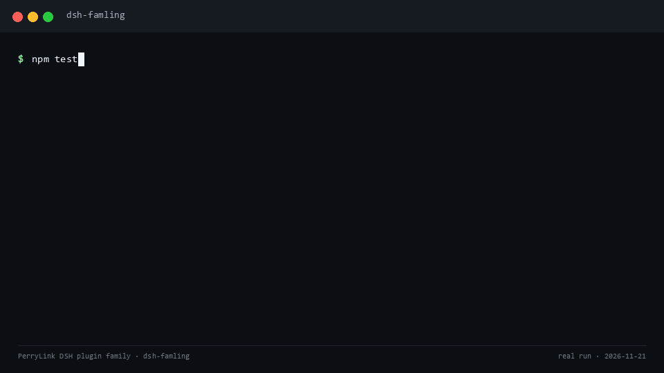

<div align="center">

<picture>
  <source media="(prefers-color-scheme: dark)" srcset="docs/assets/dsh-famling-hero-en-dark.webp">
  
</picture>

# dsh-famling

**Famling / Tinglan, as a DeepSeek Harness sidebar plugin.**

*A small research/technical demo entry in the sidebar footer, below the account area — 212 animation frames, zero permanent buttons, a right-click / Shift+F10 menu, and every preference stored locally. **Not** an emotional-companion product.*

Last verified on DeepSeek Harness `dsh-v0.2.3-alpha.1` (2026-11-22).

[English](README.en.md) · [简体中文](../README.md) · [Español](README-es.md) · [Português](README-pt.md) · [हिन्दी](README-hi.md)

</div>

> ⚠️ **Usage limits (read first)**: this project and all of its code, art, audio, copy, character assets and derivatives are **for technical research and prototype validation only**; **they must not be used for emotional companionship, virtual partners, psychological therapy, medical/legal/financial advice, intimate relationships with minors, impersonating a real person or an official body, or any purpose that violates laws, regulations or platform rules**. The full notice is in [docs/LEGAL-NOTICE-2026-11-18.md](../docs/LEGAL-NOTICE-2026-11-18.md).

Famling / Tinglan's DSH-compatible edition: a small research/technical demo entry rendered **in the lower-left corner of the DeepSeek Harness sidebar, below the account information** (not an emotional-companion product).

---

## The two packages

This work line provides two packages, separated by purpose:

| Package | Source | Purpose |
|---|---|---|
| **famling** | [PerryLink/famling](https://github.com/PerryLink/famling) | **The standalone desktop pet** (pet-only Tauri app; Tinglan / cat / dog, UI, TTS, age verification and more) |
| **dsh-famling** | this repository | **The DSH client plugin**; it only provides the small Tinglan entry in the sidebar's lower-left corner and small local interactions, and does not replace the standalone app |

> `famling` is the standalone application; `dsh-famling` is the lightweight companion entry inside DSH. They share characters and branding, not runtime code.
>
> **Cross-product statement (0.10.2 / E3-T3)**: the standalone famling **does not offer official free-form LLM role-play (RP) or emotional companionship**; this plugin offers **work-assistant-style AI replies** (not RP, not companionship; the text goes to the model provider configured in DSH and may be wrong). Neither should be promoted or turned into an emotional-companion / virtual-partner product; the full usage limits are in [docs/LEGAL-NOTICE-2026-11-18.md](../docs/LEGAL-NOTICE-2026-11-18.md).

<picture>
  <source media="(prefers-color-scheme: dark)" srcset="docs/assets/dsh-famling-flow-v5-dark.svg">
  
</picture>

*Structure: mount → interact → observe. The entry carries no sprite payload — a character chunk is downloaded only when that character is shown — and host state is a bounded local ring buffer with no session ids, messages or tool arguments. The token labels inside the diagram are real slot and bridge names, so the same picture serves all five languages.*

## Current implementation (0.13.0)

This README is also the long-form engineering log. The current release state in one screen:

- **0.13.0 (2026-11-21, B1/A4)**: a new **"work together (focus)" 25/50-minute mode** — an in-memory-only quiet window in which automatic ambient bubbles and random micro-motions pause, while explicit clicks, menu actions and chats still answer; when the timer ends one local bubble appears (no system notification, no history, no streak, no punishment, no new storage key). The focus UI and copy live entirely in the lazy `client.content.js`; the entry grew by 198 B (95,533 → **95,731 B**; 31% gate 97,576 B → 1,845 B spare, 96 KiB budget → 2,573 B spare). License cleanup: `LICENSE-ART` now covers the real art paths (`client.anims.*`, `icon.png`) and NOTICE / README license sections agree; real DSH 0.2.2-rc.4 host integration evidence (46/46) and the rc.4/rc.5 contract gates (45/45) ship in the package.
- **0.12.0 (2026-11-21)**: a host work-state hook (coarse state, minimal privacy). The host half keeps a bounded coarse state from `ctx.on('agent/status')` / `ctx.on('agent/error')` (≤16 `{ state, at }` ring + run counters + a classified `lastError.kind`), and adds bridge `op:"state"` (wire 2) returning `available` / `state` / `active` / `updatedAt` / `lastError` / `transitions` after closed-schema validation. It never reads or stores agent ids, session ids, messages, prompts, tool arguments or file content. If the events API is absent or subscription throws, `available:false` and the plugin still activates — `state` is never faked.
- **Earlier releases (0.8.x–0.11.x)** contributed the region-click reactions, species-specific interactions with random replies, `holdMs`-driven frame timing, the zero-button hierarchical right-click menu, the four-layer scaling model, low-disturb controls (quiet hours / reduce-motion / temporary hide), hello/probe host capability negotiation, the reserved content-extension v3 contract, versioned TTS/ASR consent and the package-hygiene gates.
- **Full release log**: the per-release byte budgets and test counts (0.10.3 through 0.13.0) are kept verbatim in the Chinese [`README.md`](../README.md); this five-language README translates the normative sections and condenses that historical appendix. Current tests: **314** (`npm test` in a shallow clone: 301 pass, 0 fail, 13 skipped).
## Four-layer scaling (0.10.4, MB-053)

The settings popup uses the same four layers as famling's `src/pet/scaling.ts`; all of them act only on this plugin's widget inline styles and widget-private CSS variables (`--dsh-famling-ui-scale` / `--dsh-famling-bubble-zoom`, component `transform`) and **never write `document.documentElement` or change the DSH global theme / host scaling**:

| Layer | Where | Control | Semantics |
|---|---|---|---|
| 1 Overall scale | Common · first control | native range 50%–200% (step 5%) | everything scales together: character image, UI/text, bubbles, menu, panels |
| 2 UI + text | Scale (independent axis) | range 40%–150%, 100% = follow overall | text/controls only; "follow overall" resets in one click |
| 2 Image | Scale (independent axis) | range 50%–200%, 100% = follow overall | character/preview image only; fits the window automatically when it does not fit |
| 3 Component scale | Advanced / debug (collapsed by default) | per component: inherit (default) / 75% / 125% / 150% | bubble / context menu / panels / content centre / settings popup; override = inherited UI factor × override factor, and inheritance can be restored at any time |

- Effective value = `global × axis`, then clamped for readability/safety: UI text 0.6×–2.5×, image 0.5×–2× (72px → 36–144px, still inside the 240px sidebar), components 0.5×–2×. Bubble width is hard-capped at 240px and its left edge is clamped to the viewport, so it cannot overflow the sidebar/window; menus and panels use "layout size ÷ zoom + `transform: scale(zoom)`" so they stay inside the viewport after scaling (left/bottom anchors, `transform-origin` aligned to the anchor) with no content clipping.
- Persistence: `dsh-famling/scale/model` (version marker) plus `dsh-famling/scale/global`, `/ui-text`, `/image`, `/component/<id>`; follow/default values do not write axis keys (restoring follow = delete the key), and resetting the default scale only writes `global=1` and the version marker. On first load, if the version marker is absent and the old absolute-factor keys `dsh-famling/scale` (number or `{pet,text}` JSON) or `dsh-famling/text-scale` exist, they are migrated once into `image`/`uiText` (global=100%, same effective value); after migration the old keys stay where they are but are marked invalid and are never applied twice. Clearing local settings deletes every scaling key under `dsh-famling/*`.
- Keyboard / ARIA: every scaling slider is a native `<input type="range">` (arrow keys work) with `aria-label` and `aria-valuetext` (for example "150% · independent"); advanced-group buttons carry `aria-expanded`; component selects carry `aria-label`; the "follow overall" button is `disabled` while following; the reset button has a readable name; the settings popup is still `role="dialog"`.
- Tests: `test/client-scale.test.js` covers the pure model (clamp/parse/persist/migrate/caps) + fake-React behaviour (three-layer IA, overall/independent axes, component overrides and inheritance, persistence/restore, 240px bubble and viewport clamping, menu scaling clamp, keyboard/ARIA, no fetch) + static gates (widget-private styles, no `document.documentElement`, no external URL). `npm test` is fully green.

## Low-disturb (0.10.6, E7 remaining / P-04)

The "low-disturb" group in the settings popup collects every quiet control in one place; its semantics align with famling's desktop shell `low-disturb.ts` / `reduce-motion.ts` (this plugin's widget only — the DSH host and global theme are untouched):

| Capability | Default | Behaviour | Persistence |
|---|---|---|---|
| Quiet hours | **on, 22:00–08:00** | inside the window **automatic output = 0**: no automatic ambient bubbles and no random micro-motions; region clicks, menu interactions and chat/reminder replies still work. `start === end` or switching it off never silences anything. A cross-midnight window (22:00–08:00) is evaluated as "start ≤ now or now < end". | `dsh-famling/settings.quietHours = { enabled, start, end }` |
| Motion preference | **follow system** | `auto` reads `prefers-reduced-motion: reduce` (read at mount; an explicit choice wins); `on` forces frame animation/blinks/micro-motions on, `off` freezes everything on the first frame. The old boolean `motion` migrates once to `auto`/`off`. | `dsh-famling/settings.motionMode` |
| Automatic micro-motion cadence | 60–90s | raised from 11–20s in 0.10.5 to **≥60s**; a trigger inside quiet hours re-arms the timer instead of playing. | not persisted (runtime cadence) |
| Temporary hide | off | "More → hide for 1 hour / hide until tomorrow" or the same-name button in settings; while hidden, neither the character nor bubbles render and only a ≥24×24px "show" restore control remains; it restores automatically at the deadline. | `dsh-famling/hidden-until` (millisecond timestamp) |
| Mute | off | stops browser TTS only: bubble captions stay, and speech already playing is cancelled immediately; cat/dog still use hollow thought bubbles and never TTS. | `dsh-famling/settings.sound` |

- The cleanup entry "clear local settings and consent" also deletes `hidden-until` and the v1/v2 consent records; the storage-key list under Settings → Advanced / debug shows them.
- All copy and controls live in the lazy `client.content.js` (the input panel, consent dialog and usage-limits dialog also moved into that chunk in 0.10.6; the 0.10.10 old-consent migration and "withdraw voice consent" live there too); throttling/cooldown decisions and frame timings live in the lazy `client.behavior.js`, while the entry `client.js` stays inside the 96 KiB first-screen budget.
- Tests: `test/client-lowdisturb.test.js` (pure model: time parsing, 22:00/08:00 boundaries, invalid-window fallback, start===end, auto/on/off precedence, hide deadline/expiry/corrupt storage, static wiring) and `test/client-behavior.test.js` (fake clock: quiet-hours state/persistence/invalid time preserved; quiet hours stop micro-motions but clicks still answer; system reduce-motion and explicit override; both hide modes, early restore, automatic restore at the deadline, persistence across reload, hide from settings); `npm test` green overall (including the MB-004 LOCK / vendored spec / clean-checkout gates).

## Host capability negotiation hello/probe (0.10.7, MB-034 / E3-T2)

Both halves of the plugin share the bridge wire-2 handshake; the goal is "keep working while host capabilities are unknown, and degrade honestly when they are missing" instead of assuming everything exists through `engines.dsh`.

| Item | Host half `index.js` | Client `client.js` |
|---|---|---|
| Required injection | only `connection` (the authenticated same-origin bridge); `llm` / `schedule` / `agentDefaultModel` are all probed on demand with `ctx.get()`, so a service that arrives late is found by the next call | — |
| Mount handshake | registers `POST /api/famling/bridge` | after mount sends once `{ v: 2, op: "hello", clientVersion, wireVersion: 2, contentExtension: 3, hostVersion?, hostCommit? }` (4s timeout, sent once) |
| Capability matrix | `hello` / `probe` return `capabilities { llm, schedule, agentDefaultModel, brief, bridge }`, per-item `probes[]` (id / available / method) and `degraded[]` | stores the capability document; the input panel and settings use it to show/disable features |
| Version / contract | `plugin.version` (read from this package's package.json), `wire { version: 2, accepts: [1,2] }`, `contract { bridge: 2, contentExtension: 3, contentExtensionSchema: 3 }`, `host { version, commit?, source }` | `hostVersion` comes from `window.__DSH_BOOT__.release` (not sent when absent; the host never guesses from elsewhere); `versionMismatch` is only a hint |
| Degradation | missing `llm` → chat 503 `E_LLM` + `capability:"llm"` + `unavailable:true` (the local crisis short-circuit still works); missing `schedule` → task/task-delete 503 `E_TASK` + `capability:"schedule"` | missing `llm`: send button disabled + panel/settings say "no model connected", the send path intercepts locally and never fakes a reply; missing `schedule`: the reminder entry is not rendered and the reason is shown; an old host that does not answer hello → "compatibility mode" with 0.10.6 behaviour |
| Manual probe | `probe` (wire 2) returns the same capabilities/contract + `generatedAt`, with no side effects, no model call and no reminder creation | Settings → Advanced / debug → "re-detect host capabilities" |

- **Honest version provenance**: when the host process has `process.env.DSH_CLIENT_VERSION` it is preferred (`source: "env:DSH_CLIENT_VERSION"`); otherwise the client-reported `__DSH_BOOT__.release` is used (`source: "client-boot"`); with neither it is `source: "unknown"` / `version: null` — no guessing.
- **Protocol matrix**: `hello` / `probe` / `state` accept only `v: 2` (an old client sending v1 gets 426 `E_WIRE`); `echo` / `chat` / `brief` / `task` / `task-delete` work on both wire 1 and wire 2, so old clients need no change.
- **content-extension v3 compatibility**: this release does not bump to v4; `content-extension.mjs` exports `CONTENT_EXTENSION_VERSION = 3`, `CONTENT_EXTENSION_COMPATIBILITY` (single version, `additive-within-major`) and the pure function `isContentExtensionCompatible(version)`; hello's `contract.contentExtension` is taken directly from that module and tests freeze the two to agree, so wire and schema cannot drift apart. 0.10.9 added optional compliance fields (license / aiProvenance / pack-level compatibility / canonical usage statement) inside the same v3 revision, so hello/probe **wire and revision both stay unchanged** and old hosts/packs keep working.
- Tests: `test/host-bridge.test.js` (minimal injection, hello/probe fields, version provenance, contract incompatibility, missing-capability 503, wire 1/2 matrix) and `test/client-behavior.test.js` (mount handshake payload, settings/input-panel degradation, old-host compatibility mode, version-mismatch hint, manual probe); `test/client-static.test.js` freezes `CONTENT_EXTENSION_VERSION` / the compatibility strategy.

## Multi-character animation data (0.8.0)

Three 96×96 pixel animation packs (12 clips each; frames per manifest: dog 70 / cat 74 / human 68, **212 frames** in total) are split per character into lazy chunks (0.8.6): the entry `client.js` is **95,731 B** (93.5 KiB; gzip 26.8 KiB, inside the 96 KiB first-screen budget — it went 72→78 KiB in 0.10.1 for the hierarchical context menu and 78→96 KiB in 0.10.4 for the four-layer scaling model, and is still 69.6% smaller than the 314.8 KiB pre-split baseline), while `client.anims.human.js` / `cat` / `dog` are fetched by DSH `require.async` only when that character is first shown; first paint (entry + human, measured by measure-bundle) is about 155.2 KiB (50.49% of baseline), real mount download plus the behavior / host-state chunks is about 164.8 KiB (53.63%, under the 54% baseline gate), and only after loading all characters is it about 334.7 KiB. `client.content.js` (content centre + unified settings popup + first-run safety card + scaling controls + input/consent/usage-limits dialogs + host capability panel + 0.10.9 compliance metadata + 0.10.10 versioned consent/withdrawal + 0.12.0 task-21 first-run useful actions + the "work together" focus mode) is downloaded only on first install or first opening of a dialog (83.7 KiB, gzip 24.2 KiB, measured in the 0.12.0 work tree); `client.behavior.js` (click geometry / region hit-testing / repeated-click cooldown / random replies / frame `holdMs` durations) is downloaded and memoized right after mount (5.6 KiB, gzip 2.0 KiB, measured in the 0.12.0 work tree); `client.status.js` (coarse host-state polling, minimal privacy, 4.0 KiB / gzip 1.5 KiB) is lazily loaded and memoized after mount in the same pattern:

- Data source: the private repository `desktop-games/public/assets/pet/anim/{human,cat,dog}/` (`manifest.json` + frame PNGs).
- Generator: `scripts/embed-anims.mjs` reads the manifest/PNGs, validates the three clip contracts, re-encodes RGBA frames **losslessly** into minimum-bit-depth indexed PNGs (hard alpha preserved, roughly half the size) and injects them into `client.js` at markers. **Never hand-edit the generated blocks** — change the data and re-run the script.
- Sizes (0.12.0 work tree, measured 2026-11-21): entry `client.js` 93.5 KiB / 95,731 B (gzip 27,470 B, brotli 22,972 B as frozen in 0.13.0's version truth); the three character chunks total about 241.2 KiB (human 61.7 / cat 99.8 / dog 79.7 KiB); the content-centre + settings + first-run card + scaling controls + input/consent/usage-limits dialogs + host capability panel + compliance metadata + versioned consent + task-21 first-run actions + task-B1 "work together" focus-mode chunk is 83.7 KiB (gzip 24.2 KiB / brotli 19.7 KiB, 0.12.0 work tree; task-21 +4,905 B, task-B1 +6,656 B) loaded on demand; the behavior chunk `client.behavior.js` 5.6 KiB (gzip 2,043 B / brotli 1,786 B) and the host-state chunk `client.status.js` 4.0 KiB (gzip 1,545 B / brotli 1,306 B) load after mount. The first-screen budget was raised from 72 KiB to **78 KiB** in 0.10.1 (the hierarchical menu has to be usable on first paint) and to **96 KiB** in 0.10.4 for the four-layer scaling model and panel fitting (0.10.6/0.10.7 did not raise it again); the first-run card, settings content, low-disturb UI and input/consent dialogs all stay in lazy chunks and the sprite payload stays in the character chunks: the entry is **30.41%** of the pre-split audit baseline (under the 31% gate), first paint (entry + human) is 158,935 B = **50.49%** of baseline; the real mount download (entry + human + behavior + status) is 168,802 B = **53.63%** (under the 54% gate).
- Regenerate: `npm run embed:anims`; validate only, no writes: `node scripts/embed-anims.mjs --check`; `npm run verify:anims`; quantify: `npm run measure:bundle`.
- Validation: `scripts/verify-anims.mjs` checks characters/clips, per-character frame counts from each manifest, `holdMs` / `durationMs` timing consistency, PNG dimensions and visible pixels, bubble/TTS policy, action mapping and i18n keys; it also checks that `client.content.js` exists, has four top-level tabs and no fetch / external URL, checks `client.behavior.js` chunk registration / export set / no network, no eval, no storage writes and the entry's single `require.async` wiring, and — when private assets are available — compares the embedded blocks byte for byte for staleness.
- Static QA: `node scripts/embed-anims.mjs --qa` generates `scripts/qa/anim-data.js`; opening `scripts/qa/index.html` in a browser lets you switch characters, play all 12 clips, see solid/hollow bubbles and run the data self-check without restarting DSH.

## Region click reactions (0.8.2)

- Region data comes from the private repository `desktop-games/public/characters/{pet-tinglan-anim,pet-cat,pet-dog}/regions.json` and shares the same `version/canvas/regions/gestures` contract as the standalone famling hero: regions are `head` / `body` / `tail` rectangles (with priority) on a 96×96 logical canvas.
- `scripts/embed-anims.mjs` reads and validates these documents and writes the generated block `ANIMS[character].regions`; `--check` includes it in staleness detection, and the `anim-data.js` produced by `--qa` carries the region data too.
- On click, `offsetX/offsetY` are mapped back into 96 logical coordinates using the image's **actual rendered size**, then hit-tested by priority; the same relative position hits the same region at any display size (64/72/96/144px …).
- Hit mapping: `head → pat_head` (head pat), `body → stand_wag` (tail wag / stretch), `tail → chase_tail` (tail chase); bubble lines come from the region rule's own random `says` rows (0.8.3) — with no line data it says nothing. Repeated clicks on the same region have a 1.2s cooldown; from the 4th click on the same region within 10s it degrades to the existing `idle_blink` light reaction (2.5s cooldown after saturation), and menu actions are not subject to this. Hit geometry / region decisions / the cooldown state machine and the random-reply picker live in the lazy `client.behavior.js`; the entry only applies the decision and updates state.
- Only `idle` / `idle_blink` states respond; playing any other clip is not interrupted. A hit on a transparent or undeclared region is an explicit no-op and **no longer falls back to a random micro-motion** (random micro-motions are still triggered by the idle timer).
- Region replies (0.8.3): every region rule in `regions.json` carries 3 `says` rows; a hit picks one at random (consecutive clicks in the same region switch lines); cat/dog still use hollow thought bubbles and never TTS; Tinglan uses a solid speech bubble plus the existing TTS consent.

## Species-specific interactions and random replies (0.8.3)

- The interaction menu is no longer a hand-written fixed table: `scripts/embed-anims.mjs` embeds the `actions` (id/label/event/followUpEvent/followUpMs/says) and `gestures[].says` from `regions.json` into `ANIMS[character]`, and includes them in `source-sha256` and `--check` staleness detection; after changing the data, re-run `npm run embed:anims`.
- The event → clip mapping is no longer hand-written either: `scripts/gen-content-constants.mjs` generates the `EVENT_CLIPS` block of `client.js` from famling's `public/characters/*/{regions,behavior}.json` + `public/assets/pet/anim/*/manifest.json` (`pat`→`pat_head`, `ball_throw`→`ball_throw`, `ball_chase`→`ball_chase`, `paw_face`→`paw_face`, `run`→`run`; `feed` reuses the stand/wave clip; `talk` only shows a bubble and stays idle); `npm run check:content` detects staleness of the generated blocks, and `scripts/verify-anims.mjs` keeps validating that the mapping is complete, that cat/human have no ball actions, the golden retriever's throw→chase follow-up, and that every action/region has at least two random replies.
- Single source and check chain (MB-107/MB-108): the character/dialogue/appearance/usage/compliance constants of `public/content/library.json` are likewise generated into the `@generated` block of `client.js` by `gen-content-constants.mjs` (declared differences D1–D4 are in `docs/CONTENT-CONSTANTS-2026-11-20.md`); `npm run check` (both ANIMS and content generated blocks), `npm run lint` (minimal JSDoc/lint chain) and `npm run typecheck` (checkJs, **including content-extension.mjs**; honest skip when TypeScript is absent) are part of `release:check`. The i18n/locale single source is frozen by `scripts/check-i18n.mjs` (10 checks: `L` in client.js, `STRINGS` in client.content.js, key tree/references/dead keys in `locale/*.json`; runs inside `npm test` as `test/i18n.test.js`).
- Random replies use an "avoid the previous line" picker: consecutive clicks on the same region/action never return the same line; bubble copy, TTS and thought policy are unchanged from 0.8.2.

## Frame timing and holdMs playback (0.8.4)

- Frame counts/durations are no longer hard-coded: `scripts/embed-anims.mjs` and `scripts/verify-anims.mjs` read each character's own `manifest.json` for frame counts and per-clip `fps` / `holdMs` / `durationMs`; character frame counts may differ (dog 70 / cat 74 / human 68, **212 in total**; cat `stand_wag` = 10 frames).
- `client.js` playback uses per-frame `setTimeout`: frame n stays for `holdMs[n] ?? round(1000/fps)` milliseconds; a non-looping clip returns to `idle` after its last frame, and if the manifest's `durationMs` exceeds the sum of holds the last frame is extended. Cat stretch = 300+300+300+350+400+400+400+350+250+150 = **3200ms** (10 frames), no longer played too fast by a fixed `setInterval(1000/fps)`; attack frames also play by the attack `holdMs` (83/83/63/42/42/63/63).
- `holdMs` / `durationMs` feed `source-sha256` and `--check`: a manifest change that only touches timing also makes the embedded block stale; `verify-anims.mjs` validates that `holdMs` covers every frame and that the sum equals `durationMs`.
## Minimal UI and hierarchical context menu (0.10.1)

- **Zero buttons by default**: the footer holds only the 72px character image; the image itself is a Tab-focusable button with `aria-haspopup="menu"` / `aria-expanded`, and no permanent input/interaction/settings/content button is rendered.
- **How to open**: right-click the character, Shift+F10, or the ContextMenu key; the menu is a custom `role="menu"` + `role="menuitem"` with `aria-activedescendant` and roving tabIndex; an outside click / window blur / Escape closes it, and focus returns to the character when it closes.
- **Keyboard**: ↑/↓ cycle, Home/End jump to the first/last item, ←/→ go back a level or enter a subpage, Enter activates, Escape closes, Tab closes; the first item of every subpage is "« back".
- **Hierarchy (only 5 top-level items)**: Chat… (input panel) / Interact ▸ (the current `ANIMS[character].actions`) / Content & character… (content centre dialog) / Settings… (unified settings dialog) / More ▸ (Reminders… + usage limits and version…). Complex features are not crammed into the top level.
- **Viewport clamping**: the menu is `position: fixed` and clamps left/top to an 8px margin by viewport size; `clampMenuPosition` is a pure function and behaviour tests assert its coordinates directly.
- **Menu button**: "show menu button" in the settings dialog is off by default; when enabled a small "⋯" trigger appears next to the character (`aria-label` "menu"). The preference is written to `dsh-famling/menu` (`{ button: boolean }`); menu open state and subpages are not persisted, so every open starts at the top level.
- **Degradation**: if `client.content.js` fails to load, the content/settings dialogs show a local failure message while the context menu and character interactions keep working; if `client.behavior.js` is not ready or fails to load, frame playback falls back to one uniform default cadence (no `holdMs` segmentation) and region clicks become a local no-op (no throw, no blocked render) — menu actions still play their clip, only the random line is missing.

## Content centre: the character is the theme (0.10.0)

The content centre no longer treats "theme / background / font" as parallel top-level visuals. **The character is the theme bundle**: one role = six components (character + voicePolicy + dialogue + theme + background + font); one click on "apply all" applies the whole pack atomically. Afterwards the user can change any component under "customise" (overriding the role preset), or restore the role default in one click.

### Four top-level tabs

| Tab | Content | Behaviour / persistence |
|---|---|---|
| **Roles** | Tinglan / Ragdoll cat / Golden retriever (origami bundle data is reserved; assets are not installed, so no card is offered) | each card shows a glyph avatar, the role name, one sentence, a voice / dialogue / appearance summary and an "apply all" button; the current role carries a ✓ mark. Applying writes character, voicePolicy, dialogue, theme/background/font and `dsh-famling/role` together and does not preload other character animation chunks. |
| **Customise** | voice (TTS policy) / dialogue / theme / background / font (0.9.1 capabilities kept) | the header explains "changes only the current role's arrangement, not its preset" and shows "role preset / customised"; changing one component writes only its old key and the role id does not change; "restore role default" resets all components from the current role bundle. |
| **Content packs** | currently only the built-in packs (4 role bundles); no external pack | shows the installed list and the v3 mandatory `usageDeclaration` check result (researchOnly=true + the six prohibited uses), plus an asset-pack import entry (**needs host support**: zip/folder manifest + sha256 parsed by the host; this version does not read files, execute scripts, load assets or go online). |
| **Market** | remote-market placeholder | always shows "remote market interface reserved, server not configured"; shows the reserved fields `catalogUrl` / `configKey` (`dsh-famling/market/catalog`, `dsh-famling.market`); it makes no network request and shows no fabricated products. |

### Role bundles

| role | character | Voice policy | Dialogue | Theme / background / font |
|---|---|---|---|---|
| `human` | Tinglan | speech, browser TTS allowed (still behind its own consent gate) | `standard` | `default` / `transparent` / `system` |
| `cat` | Ragdoll cat | thought, no TTS | `standard` | `night` / `dark` / `serif` |
| `dog` | Golden retriever | thought, no TTS | `standard` | `paper` / `paper` / `system` |
| `origami` | reserved | speech (shares the tide voice policy; data reserved, not appliable) | `standard` | `night` (explicit mapping of the shared `high-contrast`) / `transparent` / `mono` (data reserved, not appliable) |

These six components align with `rolePresets` in famling's `public/content/library.json` (human: standard/default/transparent/system; cat: standard/night/dark/serif; dog: standard/paper/paper/system); the origami shared pack uses the `high-contrast` theme, which this plugin does not have, so it is explicitly mapped to `night` with `available:false` and never silently mismatched. Dialogue modes align with the shared `dialoguePacks` as well: `standard` = 240 characters / 70% ambient bubbles, `brief` = 80 characters / 40%, `quiet` = 50 characters / 5%; changing these values must be synced in both famling and the plugin.

"Apply all" also sets the TTS switch to the bundle's voice policy; if the user has not consented to TTS it stays off (the consent gate is never bypassed). Switching to cat/dog cancels any browser speech that is playing.

### Persistence and backfill

- The new key `dsh-famling/role` records the current role theme (primary), and `dsh-famling/menu` records the "show menu button" switch; the old keys keep working: `dsh-famling/character`, `dsh-famling/settings` (`sound` / `voiceURI`), `dsh-famling/dialogue`, `dsh-famling/theme`, `dsh-famling/background`, `dsh-famling/font`.
- Applying a role = writing the keys of all six components + `dsh-famling/role`; customising = overriding only the one component key that was clicked, with the role id unchanged.
- Load: read `dsh-famling/role` first; without that key, derive the role from the stored `character`; missing component keys are backfilled from that role's bundle, while explicitly saved component keys win. A 0.9.x user gets the role backfill on the first render after upgrading.
- The behaviour kit `client.behavior.js` is fetched after mount through one memoized `require.async` entry point (`requestBehaviorChunk`), falling back to the default frame cadence on failure; the content-centre UI chunk `client.content.js` is downloaded through `require.async('./client.content.js')` only when the panel is first opened; if that fails the local panel shows a load failure and core interactions are unaffected.

## Content extension interface v3 (reserved, offline)

[`content-extension.mjs`](../content-extension.mjs) is the public contract for future local/remote content packs (package export: `dsh-famling/content-extension`):

- `CONTENT_EXTENSION_POINTS` — **version 3** (pack `schemaVersion: 3`), `status: "reserved"`, `transport: { network: false, execute: false, innerHTML: false, worker: false, assets: false }`; since 0.10.9 the top-level `compliance` publishes the shape of the optional compliance fields, frozen anchors and the strict-mode option.
- `CONTENT_KINDS` — **seven kinds**: `role` / `character` / `voice` / `dialogue` / `theme` / `background` / `font`. `role` is the bundle kind added in v3: apply must include the six components `character / voicePolicy / dialogue / theme / background / font`, and the entry must also carry `compatibility` (`minPluginVersion`, optional `maxPluginVersion`).
- **Every pack must carry `usageDeclaration`**: `{ researchOnly: true, prohibitedUses: [six items] }`; the six are fixed as `emotional-companionship` / `virtual-partner` / `professional-advice` / `minor-intimacy` / `impersonation` / `illegal-use`. A missing declaration, `researchOnly !== true`, a missing or extra item, duplicates or unknown fields are all rejected. Role entries are not exempt from the pack-level declaration; a role entry may optionally repeat a `usageDeclaration`, validated by the same rule when present. The declaration template is exported as `USAGE_DECLARATION_TEMPLATE`. Since 0.10.9 a canonical `statement` / `statementRef` / `statementSha256` may be added, and when present all three must match `CONTENT_USAGE_STATEMENT` / `CONTENT_USAGE_STATEMENT_REF` / `CONTENT_USAGE_STATEMENT_SHA256` verbatim (strict mode requires `statement` + `statementRef`).
- **0.10.9 compliance fields (optional, backwards compatible)**: a pack may carry `license` (`spdx` + `attribution`, optional `url` / `file`), `aiProvenance` (`generated` + `disclosure`, optional `tools`) and `compatibility` (`minPluginVersion` + optional `maxPluginVersion`); an entry may also carry `license` / `aiProvenance` (a role entry's `compatibility` stays mandatory). Declared fields must be valid field by field (fail-closed); undeclared ones only produce `warnings`, and pre-0.10.9 v3 packs keep working. The frozen first-party anchors are exported as `CONTENT_LICENSE_TEMPLATE` / `CONTENT_AI_PROVENANCE_TEMPLATE`.
- **Strict mode and version gate**: `validateContentPack(pack, { requireCompliance: true })` lets a host fail closed when loading an untrusted pack — a missing `license` / `aiProvenance` / `compatibility` or canonical `usageDeclaration.statement` / `statementRef` goes straight into `errors`; `{ pluginVersion: "x.y.z" }` additionally validates whether the pack-level and role-entry compatibility ranges include the current plugin version (pure function `isPackCompatibleWithPlugin`).
- **`assets` (reserved)**: a pack may carry `{ format: "zip" | "folder", files: [{ path, sha256, bytes? }], totalBytes? }`; `path` must be a safe relative path (≤6 segments, no `..`, no scheme, ≤160 characters, with an extension) and `sha256` must be 64 lowercase hex characters; **data validation/manifest only — no asset is read, opened, executed or loaded**.
- **`remoteCatalog` (reserved)**: optional `{ status: "reserved", url?: "https://..." }`; metadata validation only — **no fetch, no prewarm, no remote catalogue loading**. A remote source (`source: "remote"`) is rejected by default; a future host must pass `{ allowRemote: true }` explicitly for schema validation to pass.
- `validateContentPack(pack, { allowRemote?, requireCompliance?, pluginVersion? }) → { ok, errors, warnings }` — **pure data** validation: `warnings` reports missing optional compliance fields (it does not change `ok`), strict mode/version gate as above; it never throws, never executes, never goes online and never reads files.
- `CONTENT_PACK_EXAMPLE` — one legal v3 example pack (complete usageDeclaration + canonical statement fields, license / aiProvenance / compatibility, one role bundle, one theme entry; legal both by default and with `requireCompliance: true`); it is never loaded automatically.

Minimal declaration and role fragment:

```json
{
  "schemaVersion": 3,
  "id": "com.example.warm-pack",
  "name": "Warm Example",
  "version": "1.0.0",
  "source": "local",
  "usageDeclaration": {
    "researchOnly": true,
    "prohibitedUses": [
      "emotional-companionship", "virtual-partner", "professional-advice",
      "minor-intimacy", "impersonation", "illegal-use"
    ],
    "statement": "本项目及其全部代码、美术、音频、文案、角色素材和衍生物仅用于技术研究与原型验证，不得用于情感陪伴、虚拟伴侣、心理治疗/医疗/法律/金融建议、未成年人亲密关系、冒充真人/官方，或任何违反法律法规/平台规则的用途。",
    "statementRef": "docs/legal/USE-RESTRICTIONS-2026-11-19.md",
    "statementSha256": "0353536cefd702014b12a8365c4a486f19848d049652e9692027216adb80c743"
  },
  "license": { "spdx": "CC-BY-4.0", "attribution": "Example pack authors" },
  "aiProvenance": { "generated": false, "disclosure": "Example content is written by hand; no generative AI was used.", "tools": ["deterministic-python-renderer"] },
  "compatibility": { "minPluginVersion": "0.10.0" },
  "entries": [
    {
      "kind": "role",
      "id": "warm-human",
      "name": "Warm Human",
      "version": "1.0.0",
      "source": "local",
      "preview": { "kind": "glyph", "value": "🧑" },
      "permissions": ["apply:role", "store:selection"],
      "compatibility": { "minPluginVersion": "0.10.0" },
      "apply": {
        "character": "human",
        "voicePolicy": { "canTts": true, "mode": "speech", "sound": true },
        "dialogue": { "mode": "standard" },
        "theme": { "variables": { "--dsh-famling-bubble-bg": "#fff3cd", "--dsh-famling-bubble-text": "#3b2f24" } },
        "background": { "kind": "transparent" },
        "font": { "family": "system-ui, sans-serif", "size": 12, "lineHeight": 1.5 }
      }
    }
  ]
}
```

Other validation (unchanged from v2 and continuing): pure data (reject functions / symbols / bigints / non-finite numbers / non-plain objects), unknown fields/enums, over-long strings/arrays, JSON ≤ 64 KiB, entries ≤ 32 (≤16 per kind), id/name/description limits, prototype-chain keys (`__proto__` / `constructor` / `prototype`), image-preview path traversal/absolute paths/URLs, `<` and control characters, dangerous CSS such as `url()` / `expression()` / `@import`; theme variables must be `--dsh-famling-*` with safe colour values; background allows only transparent/safe solid colours; font allows only 1..8 unquoted local font names (quotes, `url()`, `var()`, semicolons, braces and `@` rules are rejected). Duplicate entry ids / duplicate asset paths / inverted role compatibility ranges are rejected. Since 0.10.9 the compliance fields are likewise pure-data validated: `spdx` 2..64 characters, `attribution` ≤ 200, `url` https only (no fetch), `file` safe relative path only (never opened), `aiProvenance.disclosure` ≤ 280 and `generated=true` requires a real disclosure, `tools` 1..8 lowercase tool ids (never executed), and compatibility versions must be `x.y.z`.

This version **loads no pack at all**: no network requests, no pack script execution, no `innerHTML`, no asset unpacking; the content centre only shows the built-in catalogue, the declaration check and reserved notes. A future loader must also be "pure data + parsed/validated on the host side + UI renders data only". The full schema, limits and examples are in [docs/DETAIL.md](../docs/DETAIL.md).

> The relationship with the standalone famling's shared content model `famling.content/0.2` (characters / voices / dialoguePacks / themes / backgrounds / fonts / **rolePresets**) is a **target-superset relation**: the six kinds still map one-to-one to plugin kinds (`builtin` ≡ `bundled`), and v3's `role` is those six kinds combined into a character-theme bundle. Since 0.10.1 the plugin's `ROLE_BUNDLES` and the shared `rolePresets` align component by component (human/cat/dog), and `DIALOGUE_MODES` aligns with the shared `dialoguePacks` maxChars/bubbleChance; origami's `high-contrast` theme does not exist in this plugin, so it is explicitly mapped to `night` with `available:false`. The plugin contract models "select/apply" as `apply` + permissions, while the shared model is catalogue entries + resolver functions; the theme CSS prefix, the voice source (browser speechSynthesis vs DeepSeek stella/tide) and the validation return shape still differ. The two contracts coexist, each fail-closed; 0.10.9 projects the **shape and semantics** of v2's license / aiProvenance / compatibility into v3 as additive optional fields (and freezes anchors on both sides), but still does not merge the two schemas or change the v2 pack structure, and future convergence still goes through an adapter layer — see [docs/DETAIL.md](../docs/DETAIL.md).
## Host bridge (P0/P1/P2/P4 implemented; hello/probe in 0.10.7; state in 0.12.0)

- `POST /api/famling/bridge` (same-origin, owner-only, JSON ≤16KB); wire 1 and wire 2 are both accepted, while `hello` / `probe` / `state` accept wire 2 only
- `op:"hello"` (wire 2) → handshake: plugin version / bridge wire / **content-extension v3** contract / host version and source / capability matrix / per-item probes / `compatible` / `versionMismatch`; no model call, no file reads, no side effects
- `op:"probe"` (wire 2) → re-probes the optional host services (`llm` / `schedule` / `agentDefaultModel`) and returns the same capabilities/contract + `generatedAt`; "re-detect host capabilities" in settings uses it
- `op:"state"` (wire 2) → read-only coarse state: `{ available, source, state: "idle"|"running"|"unknown", active, updatedAt, lastError: null | { kind, at }, transitions: [{ state, at }] }`. `source:"events"` comes from the bounded in-memory ring of `ctx.on("agent/status")` + `ctx.on("agent/error")` (≤16 entries, only state + timestamp + classified error kind: `aborted`/`auth`/`network`/`rate-limit`/`server`/`timeout`/`tool`/`unknown`); it **never reads or stores** agent ids / session ids / messages / prompts / tool arguments / file content, writes nothing to disk, uploads nothing and logs nothing. When the host has no events API or subscription throws, `available:false` + `source:"unsupported"` and the plugin still activates; the response is validated host-side against a closed schema and an invalid snapshot falls back to unavailable as a whole (fail-closed)
- `inject` requires only `connection`; without `llm`/`schedule` the plugin still activates, the corresponding entries are `false` in the response `capabilities`, and chat/task return 503 `E_LLM`/`E_TASK` + `{ capability, unavailable: true }`
- `op:"echo"` → local echo
- `op:"chat"` → host `ctx.llm.stream`; provider/model come from the DSH default model selection or this plugin's Config and are **never hard-coded** (the key stays in the host only); the system prompt picks the persona by the requested `character` (invalid/missing falls back to `human`)
- `op:"brief"` → read-only `~/.advisers/pet-brief.json` (≤128 KiB); the whole document is first strictly validated against closed contract v0.2 (`schemaVersion 1|2`, closed-schema unknown/forbidden fields, `displayPolicy`, ISO times with a **5-minute TTL upper bound**, counts = array length, item/enum/caps), and any deviation is a 404 `E_MEMORY` fail-closed; only on success does it project counts + at most 3 today/commitments, never relaying the Advisers TOS and never projecting risks/facts/suggestedLines. Compatibility with Advisers 0.3.0 (Pet Brief contract v0.2), the validation matrix and the uncovered items are in [docs/PET-BRIEF-0.3.0-COMPAT-2026-11-20.md](../docs/PET-BRIEF-0.3.0-COMPAT-2026-11-20.md).
- `op:"task"` → `ctx.schedule.create` one-shot reminder (absolute time; no home-grown timer)
- TTS/ASR have separate consents; both are off by default; browser speech states explicitly where the audio goes; consent records carry the declaration version + SHA-256 + acceptedAt + withdrawn (0.10.10) and can be withdrawn individually
- **LLM chat is wired to the host bridge** (`op:"chat"` goes through DSH `ctx.llm.stream`, so content is sent to the configured model provider); TTS/ASR are local browser capabilities with separate consents; **memory writes are still not implemented**. Next steps are in `docs/DSH-FAMLING-BRIDGE-2026-11-17.md`.
- Data-flow disclosure: chat text goes through the DSH host to the model provider configured in DSH; the plugin itself does not receive or store API keys and does not keep chat logs; `brief` only reads the local `~/.advisers` and uploads nothing. **On a crisis-keyword hit the text never leaves the machine** (local short-circuit, no model call); with the "AI chat" switch off in settings no chat text is sent; "clear local settings and consent" only deletes this plugin's browser keys, leaving DSH host/session/provider data untouched.

## Pet Brief compatibility (Advisers 0.3.0, 2026-11-20)

Advisers 0.3.0 (npm raw registry `latest`; the local npmmirror cache still shows 0.2.3, which does not reflect the published state) **does not change the Pet Brief contract**: it is still v0.2 (`schemaVersion: 2`), with v0.1 (`1`) readable as legacy; the `pet-brief` change in 0.3.0 is a performance refactor plus producer-side secrecy filtering, and the evidence that the output is equivalent is the `assert.deepEqual(projectedBrief, fullBrief)` test in the Advisers repository's `test/read-model-projections.test.js`. **This round (task-152) upgrades the bridge from a loose projection boundary to a strict consumer**: after reading, the whole document is validated against closed contract v0.2 and only then projected through a fixed allowlist; the old loose behaviour (unknown policy normalised to private / counts not compared / unknown fields accepted) is removed (fail-closed, 404 `E_MEMORY`).

| Check | Plugin behaviour (measured) |
|---|---|
| Valid v0.2 private/public | 200, projecting counts + at most 3 each of today/commitments |
| `displayPolicy: none` | 404 `E_MEMORY` (no derived content rendered) |
| Unknown displayPolicy / v0.2 missing displayPolicy | **404 fail-closed** (closed enum / required) |
| v0.1 legacy (no displayPolicy) | accepted, treated as `private` |
| schemaVersion ≥3 / invalid / missing | 404 fail-closed |
| expired / no `expiresAt` / invalid time / **TTL >5 min** / times out of order / generatedAt more than 60s ahead | 404 |
| missing/invalid counts, **counts ≠ array length**, corrupt JSON, >128 KiB | 404 |
| unknown/forbidden fields (reasoning/api_key/…), >10 items, duplicate ids, invalid enum/confidence/over-long strings | **404 fail-closed** (closed schema; error messages carry only stable codes) |

Tests: `test/pet-brief-compat.test.js` (14: 11 always-on strict/negative cases + 3 optional layers — the real 0.3.0 producer, the canonical v0.2 26 vectors, private famling fixtures; "real 0.3.0 producer synthetic ledger round-trip", "canonical v0.2 26 vectors" and "private famling fixtures round-trip" skip honestly when the sibling checkouts are missing and are not registered in the MB-004 clean-checkout subprocess); `test/host-bridge.test.js` 26. Locally measured: `node --test test/pet-brief-compat.test.js test/host-bridge.test.js` = **40/40 pass**, and `npm run lint` / `npm run typecheck` / `npm run check:package` are all ok. Full version truth, validation matrix, remaining gaps (G3–G6) and evidence are in [docs/PET-BRIEF-0.3.0-COMPAT-2026-11-20.md](../docs/PET-BRIEF-0.3.0-COMPAT-2026-11-20.md).

### Model selection (no longer hard-coded since 2026-11-18)

The provider/model of `op:"chat"` is resolved in this order (`resolveSelection` in `index.js`):

1. **Explicit plugin Config override** (optional): `provider`/`model` must appear as a pair, otherwise loading fails; `reasoningEffort` is optional.
2. **DSH default model selection**: read from the host service `agentDefaultModel.currentSelection()` (i.e. the default model in the DSH settings/model picker), so the pet's chat follows automatically when you switch models.
3. If neither resolves, `chat` returns 503 `E_LLM` and **never silently falls back to a hard-coded model**.

A fixed model (only when you know you want it) is supplied by the user's patch layer, for example:

```yaml
- id: dsh-famling
  name: dsh-famling
  config:
    provider: deepseek-official
    model: deepseek-flash
    reasoningEffort: max   # optional
```

Do not edit DSH's own profile bundle; prefer the DSH model picker.
## Persona follows the character (0.8.1)

Switching characters switches the image and the chat persona together: the `op:"chat"` request from `client.js` carries the current `character` (`human`/`cat`/`dog`; invalid or missing is normalised client-side to `human`), and `index.js` uses it to select the system prompt, with the host side also falling back to `human` for invalid values.

| character | Image | Persona notes | Bubble/voice |
|---|---|---|---|
| `human` | Tinglan | quiet, concise work buddy; conclusion first | solid speech, browser TTS allowed |
| `cat` | Ragdoll cat (white base, blue-point long hair) | lazy, aloof, short sentences; mildly tsundere but never offensive | hollow thought, never TTS |
| `dog` | Golden retriever | friendly, enthusiastic, simple and direct | hollow thought, never TTS |

The three personas share one set of safety boundaries: never impersonate a real person, an official body or a professional adviser; never induce dependency, romance, payment or emotional relationships with minors; never output illegal, private or impersonated content. A persona is only a system-prompt-level tone difference, not independent role-play or emotional companionship; the model is still decided by the DSH default model selection.

## Install

### A. From npm (recommended, 0.11.1+)

```sh
dsh plugin --profile web add dsh-famling
```

The package declares the `dsh.bundle` manifest (`cordis.patch.yml`) and the `dsh.client` frontend; the npm package name is `dsh-famling`.

### B. Local directory

1. Put this directory into the DSH plugin directory;
2. In DSH **Plugins → Add plugin**, select this directory (or use `plugin_manager install_bundle` with the absolute path of this directory as target);
3. Enable `dsh-famling` and refresh the Web UI;
4. Check that `汀岚` (Tinglan) appears in the lower-left sidebar, below the account area;
5. `npm view dsh-famling` shows the published version (currently 0.11.1); installing through the DSH plugin directory still follows steps 1–4.

## Release and package hygiene (0.11.1, MB-094 residual, 2026-11-21)

This plugin is distributed as an npm tarball, so `package.json` metadata and the `files` allowlist *are* the release surface; these rules are enforced by script gates, not conventions:

- **Metadata**: `repository` = `git+https://github.com/PerryLink/dsh-famling.git`, `homepage` = this repository's README, `bugs` = this repository's issues; all three must point at the same repository (`dsh-famling` is the DSH plugin repository; the standalone app repository `PerryLink/famling` appears only as a related-product link in "The two packages" above).
- **`files` allowlist**: no duplicates (the legacy duplicate `docs` entry was removed), every entry must exist, all runtime-required files and `exports` are covered, and `test/` / `scripts/` / `*.tgz` are never packed; `npm run verify:package` uses `npm pack --dry-run --json` to check set equality between "actual packed list = allowlist expansion + npm always-included files".
- **`prepack`**: every `npm pack` / `npm publish` runs the static release-hygiene check automatically; the success message goes to stderr (so it does not pollute the stdout of `npm pack --json`), and a failure aborts packing.
- **Commands**: `npm run check:package` (static) / `npm run verify:package` (includes `npm pack --dry-run`) / `npm run release:check` (test + check + verify + verify:package, the pre-release gate).
- **Published**: `npm publish` 0.11.0 (2026-11-21, published with a local npm token; **provenance / trusted publishing not enabled**); `npm view dsh-famling version` = 0.11.0. The first real CI run after pushing the public repository is whatever the actual run reports (this machine does not fabricate CI results). Details, evidence and local measurement records are in [docs/RELEASE-HYGIENE.md](../docs/RELEASE-HYGIENE.md).

## Independent checkout rebuild and LOCK (MB-004, 2026-11-20)

This plugin can be rebuilt, tested and verified in a standalone checkout **without the private famling repository**:

- **Install LOCK**: the repository commits `package-lock.json` (lockfileVersion 3; the plugin has zero runtime dependencies → a root-only lock); `npm ci` / `npm ci --offline` install reproducibly. `scripts/check-package.mjs` includes the LOCK in the release gate (name/version/license match `package.json`, every declared dependency is in the lock, and private resolutions such as `file:`/`link:`/absolute paths are forbidden).
- **Animation vendored spec/LOCK**: `scripts/spec/anim-spec.json` stores the semantic contract of the three animation packs (per-clip frame counts/fps/holdMs, regions/actions), the SHA-256 of `client.js` / lazy chunks / every frame, and per-file SHA-256 of the private source frames (**without PNG/base64 bytes**). `node scripts/embed-anims.mjs --check` enters `standalone spec mode` when private assets are absent (a missing or tampered spec always fails, it no longer skips); `node scripts/verify-anims.mjs` always validates the vendored spec and prints `private assets: absent` instead of skipping the byte-level comparison when private assets are missing.
- **Clean-checkout gate**: `node scripts/clean-checkout.mjs` copies the package into a temporary directory, points `FAMLING_ANIM_DIR` / `FAMLING_CHARACTERS_DIR` / `FAMLING_REPO_DIR` at nonexistent paths, and really runs `npm ci --offline` + the full `node --test` + `check` / `verify` / `check-package --pack` / `lint` / `typecheck`; `--json` prints reviewable evidence and `--keep` keeps the copy. `test/clean-checkout.test.js` integrates the gate into `npm test`.
- **Public-repository sync preparation**: `node scripts/clean-checkout.mjs --export DIR` produces a public-repository tree that can be pushed as-is (excluding `node_modules` / `.git` / caches / tarballs) and runs static package hygiene + spec validation on the exported tree; the first push, the first CI run, branch protection and `npm publish` are external steps (this workspace does not perform them and does not claim them as done).
- **Remaining limits**: a standalone checkout still has **10 cross-repository parity skips** (against the sibling famling repository's frozen library/behavior/terms/compliance values; the plugin-side frozen values and `test/fixtures/content-compliance/` still run), which are not build dependencies — the clean-checkout gate asserts "only these known cross-repository skips remain and no private-asset skip". In a bare checkout without TypeScript, `typecheck` prints an honest skip by design.
- Details and measured evidence: [docs/INDEPENDENT-REBUILD-2026-11-20.md](../docs/INDEPENDENT-REBUILD-2026-11-20.md); public-repository staging manifest: [docs/PUBLIC-REPO-SYNC-2026-11-20.md](../docs/PUBLIC-REPO-SYNC-2026-11-20.md).

## Verification



*Animated: the repository's own `npm test` and `npm run verify` stdout, captured on 2026-11-21 in a shallow clone. The 13 skipped tests need sibling checkouts (Advisers producer, private famling fixtures) that this clone does not contain, so they are shown as skipped rather than hidden.*

- `node --check client.js`
- `node --check client.content.js` (content-centre lazy UI chunk, purely local rendering)
- `node --check client.behavior.js` (behaviour-kit lazy chunk, pure interaction/timing logic, no DOM writes)
- `node --check content-extension.mjs` (content-extension contract, pure data / no side effects)
- `node --check index.js`
- `node --test test/pet-brief-compat.test.js` (Pet Brief v0.2 × Advisers 0.3.0 compatibility: strict closed schema, TTL upper bound, counts consistency, displayPolicy, schema gates, projection allowlist and negative cases; the optional "real 0.3.0 producer synthetic ledger" and "private famling fixtures" layers skip honestly when the sibling repositories are missing)
- `npm test` (`node --test test/`: host-bridge fake-context tests + **host capability negotiation hello/probe/degradation (0.10.7)** + client generated-block / multi-character behaviour tests + minimal-UI / hierarchical-menu / settings-dialog / keyboard tests + content-centre four-category / role-bundle / shared rolePresets alignment / content-extension v3 contract and 0.10.9 compliance fields (license / aiProvenance / compatibility, backwards compatibility, strict mode) tests + plugin safety floor (crisis short-circuit / send destination / first-run card / clear-and-withdraw / chat switch / version truth) tests + versioned consent (0.10.10 / MB-014: accept/migrate/stale version or hash/withdraw/clear, canonical hash and frozen anchors on both sides) tests + release hygiene (metadata / files allowlist / prepack wiring / packed list) tests + **MB-004 independent rebuild (package-lock LOCK / vendored anim spec / clean checkout / public-repository export staging)** tests (the case count moves with concurrent work; the measured `npm test` is authoritative) — no real model calls)
- `npm run check:package` (static release hygiene: repository/homepage/bugs agree, `files` has no duplicates and everything exists, forbidden entries, full `exports` coverage)
- `npm run verify:package` (static + `npm pack --dry-run --json`: the actual tarball list must equal the allowlist expansion exactly)
- `npm run release:check` (pre-release gate = test + check + verify + verify:package)
- `node scripts/clean-checkout.mjs` (MB-004: temporary checkout rebuild without the private repository; `--json` evidence / `--export DIR` public-repository staging; also runs inside `npm test`)
- `npm run check` (= `check:anims`: embedded blocks match the private animation pack; without private assets it uses the vendored `anim-spec` in `standalone spec mode`)
- `npm run verify` (= `verify:anims`: vendored anim-spec validation + 3 characters × 12 clips, per-manifest frame counts 68/74/70 = **212** and `holdMs` durations, region-click contract, bubble/TTS policy, action mapping, content-centre four tabs / declaration check / no-fetch gate, behaviour-chunk registration and export set / no network, no eval, the 96 KiB first-screen budget; it also prints the entry+human first paint and the mount download including the behaviour kit)
- `npm run measure:bundle` (measured entry 93.5 KiB, the content + settings + first-run card + input/consent dialogs + host capability panel + compliance metadata + versioned consent chunk 83.7 KiB and other figures; the 5.6 KiB behaviour kit is measured separately and is not yet counted by the script)
- Version truth: `package.json` is the single source; `node test/version-truth.test.js --write` regenerates the `PLUGIN_VERSION` constants of `client.js`/`client.content.js` (the zh/en labels derive from it), the README "current implementation" line, the LEGAL-NOTICE "applicable plugin version" and the `meta.version` of `locale/*.json` from package.json, and `npm test` verifies they all agree (including the safety-floor document truth)
- `npm run qa:anims`, then open `scripts/qa/index.html` in a browser (static QA, no DSH restart)
- Plugin detail/icon: `locale/zh.json`, `locale/en.json`, `icon.png`
- This version is written for the `sidebar.footer.action` slot of the DSH 0.2.2-rc line (the local DSH checkout is `dsh-v0.2.2-rc.4`); `package.json`'s `engines.dsh` covers both `>=0.2.1-rc.5 <0.3.0` and the 0.2.2 pre-release line (`>=0.2.2-0 <0.3.0`); actual rendering of the slot still has to be verified in the DSH Web UI.

## Licence

- © 2026 PerryLink. This is an unofficial project and is not affiliated with DeepSeek.
- Code: **PolyForm Noncommercial 1.0.0** (`LICENSE`; SPDX `PolyForm-Noncommercial-1.0.0`). Source-available, **not OSI open source**; commercial use requires separate written permission.
- Art: **CC BY-NC-SA 4.0** (`LICENSE-ART`; SPDX `CC-BY-NC-SA-4.0`), covering the character animation frames embedded in the `client.anims.*.js` files actually distributed in this package and `icon.png` (Tinglan / Ragdoll cat / Golden retriever pixel art, originating from `PerryLink/famling`).
- Redistribution must carry `LICENSE`, `LICENSE-ART` and `NOTICE`; attribution, change notices and the unofficial-statement requirement are in `LICENSE-ART` §3.
- Third-party assets: this package packs no third-party art, fonts or audio; browser TTS/ASR, model services and the DSH host follow their own terms (boundaries in `docs/LEGAL-NOTICE-2026-11-18.md`).
- The licensing direction was decided by the project owner on 2026-11-16; the licence text is a project declaration (DRAFT, not reviewed by a lawyer), not legal advice.

## Limits

- A small local widget only, not the full famling; the full application is `PerryLink/famling`.
- The content centre is **character themes + component overrides**, not a programmable theme engine; it loads no pack, loads no assets and goes online never.
- The remote market is placeholder UI plus reserved fields only: no server, no products, no network requests. Do not treat it as a live market.
- The `origami` role bundle is data-reserved only (no animation/asset chunk), and the UI offers no "apply all" for it.
- Host chat persona follows the character (0.8.1): the difference is only in the system prompt, the safety boundaries and AI statement are unchanged; switching characters only affects later chat requests and never rewrites an in-flight or already generated reply. Model selection is still decided by the DSH default model selection / plugin Config.
- The animation packs are labelled placeholder (not final art, not commercially licensed), consistent with the plugin's overall PolyForm Noncommercial licence.
- Not an official DeepSeek project; it uses no official DeepSeek logo or wordmark.
- The plugin stores no personal data; click counts are not persisted.
